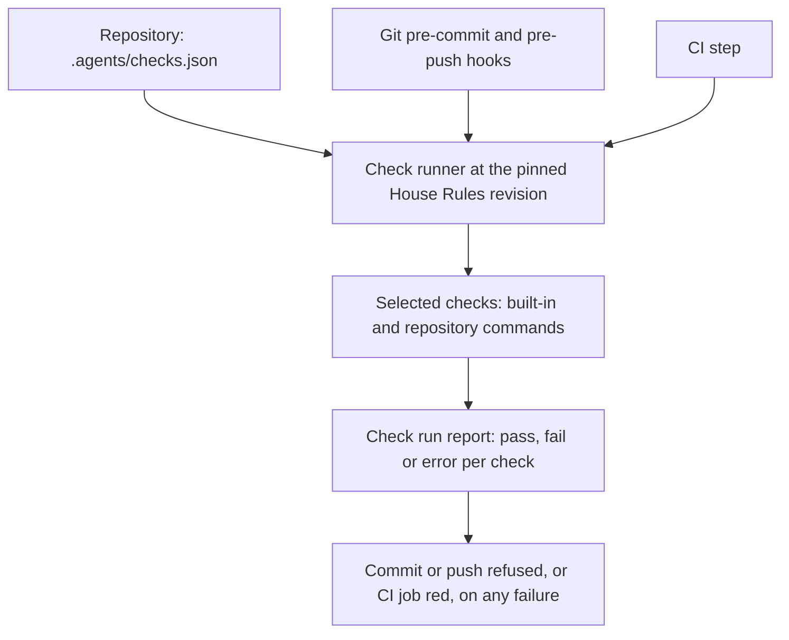

<a id="repository-checks"></a>
# Repository checks

Repository checks run a repository's deterministic rule checks before each commit, before each push and in CI, from one declared configuration.
House Rules ships the runner, a default set of checks and an install procedure.
A repository keeps the defaults, changes their settings, turns them off with a reason or adds its own commands.
The same runner runs in the Git hook and in CI, so both give the same result for the same input.
Readers need Git hooks, a CI workflow and the [spec checker](../../skills/spec-writing/SKILL.md) at the level of "it checks Markdown and metadata".
The operator approved this design for implementation on 2026-10-23; the work is tracked in [#194](https://github.com/symbiotic-build/house-rules/issues/194).

How does one configuration reach the commit hook, the push hook and CI?



The [check configuration](#check-configuration) names the pinned House Rules revision and the repository's choices.
The [check runner](#check-runner) reads it, selects the checks for the current [check stage](#check-stage) and runs each [check definition](#check-definition).
Its [check run report](#check-run-report) says which check failed, why, how to fix it and how to rerun it.
The [hook block](#hook-block) is the few lines of shell that connect a Git hook to the runner.

<!-- spec-docs:navigation document="repository-checks" -->
<!-- Generated by spec-docs; edit authored declarations. -->

## Overview

Repository checks run a repository's deterministic rule checks before each commit, before each push and in CI, from one declared configuration.

**Audience:** House Rules maintainers and repository owners familiar with Git hooks and CI workflows.

**Scope:** The check configuration, the check runner, built-in checks, the install procedure, agent session status and the rule line.

**Non-goals:** Judgment rules that need a reviewer, prose warnings, Warden changes and implementation in this change.

## Document map

Use this map to choose the next explanation to read.

- [Repository checks](194-repository-checks.md#repository-checks) — Read what repository checks do and who runs them.
- [Current state and evidence](194-repository-checks.md#evidence) — See what exists today, what was measured and the constraints.
- [Tour: a default install](194-repository-checks.md#tour) — Follow one install, a refused commit and its fix.
- [Configuration and checks](194-repository-checks.md#configuration) — Declare checks in one file and write a check to the command contract.
- [Running checks](194-repository-checks.md#running) — See when each check runs, what it reads and how pre-commit stays fast.
- [Installation, hooks and agents](194-repository-checks.md#installation) — Install hooks and CI without breaking other tools, and connect agent sessions.
- [Pinning and offline use](194-repository-checks.md#pinning) — Control the House Rules revision and work without a network.
- [Overrides and review](194-repository-checks.md#review) — Review overrides, and know which rules stay with reviewers.
- [Worked examples](194-repository-checks.md#examples) — Apply the configuration to another naming style and to a repository without specifications.
- [Requirements](194-repository-checks.md#requirements) — Find the obligations each mechanism must meet.
- [Decisions and alternatives](194-repository-checks.md#decisions) — Read each choice, its authority and the alternatives it rejects.
- [Open questions](194-repository-checks.md#questions) — Confirm that no design choice remains open.
- [Rollout and work packages](194-repository-checks.md#rollout) — Plan the implementation pull requests and adoption.
- [Reference](194-repository-checks.md#reference) — Look up configuration fields, built-ins, commands and the report format.
- [Acceptance](194-repository-checks.md#acceptance) — See the planned demonstrations for each requirement.

## Entity index

Each technical term below links to its defining Markdown section.

- [Check configuration](194-repository-checks.md#check-configuration) (`repository-checks.check-configuration`) — A check configuration is the versioned JSON file .agents/checks.json that pins House Rules and declares the repository's checks.
- [Check definition](194-repository-checks.md#check-definition) (`repository-checks.check-definition`) — A check definition is one command, the stages it runs at, the files it reads and how its result is read.
- [Check installation](194-repository-checks.md#check-installation) (`repository-checks.check-installation`) — Check installation is the repository-checks procedure that writes a repository's configuration, Git hooks and CI step, and prepares the local cache.
- [Check run report](194-repository-checks.md#check-run-report) (`repository-checks.check-run-report`) — A check run report is the runner's account of one run and of each check in it.
- [Check runner](194-repository-checks.md#check-runner) (`repository-checks.check-runner`) — The check runner is skills/repository-checks/scripts/checks.py, one standard-library Python file that reads the configuration, selects checks, runs them and prints the report.
- [Check stage](194-repository-checks.md#check-stage) (`repository-checks.check-stage`) — A check stage is one point in the change loop where the runner runs checks: pre-commit, pre-push or ci.
- [Hook block](194-repository-checks.md#hook-block) (`repository-checks.hook-block`) — A hook block is the marked shell fragment the install puts into a Git hook file to call the runner.
<!-- /spec-docs:navigation -->

<a id="evidence"></a>
## Current state and evidence

Rule checks that a script can decide run today only when an agent remembers to run them.
This section records what exists, what was measured and which constraints the design must meet.

On 2026-10-22 the operator found commits to a large private specification that no hook or CI step had checked.
The agent ran the spec checker by hand before some commits, and that repository has no CI step for it.

`FACT` House Rules main at `ebb6b37` already has these parts, as read in this session:

- The spec checker reads the staged index (`check --staged`) or one commit (`check --rev REV`), as its [command reference](../specs/spec-system/source-formats.md#sources-and-commands) states.
- Its naming rules and rejected forms are data in the repository's `docs/ENTITIES.json`, not code in the checker ([#190](https://github.com/symbiotic-build/house-rules/pull/190) makes declaring them a rule).
- `scripts/sync.py --install-hooks` registers agent session hooks in agent homes such as `~/.claude/settings.json`. It writes no Git hook and no repository file.
- The PR watcher `skills/agent-lanes/scripts/watch_prs.py` wakes a session when a PR's CI checks or reviews change.
- House Rules' own [specification workflow](../../.github/workflows/spec-docs.yml) runs the spec checker over its whole corpus and audits the declared test selectors. Each consuming repository needs its own copy of such a step, and nothing runs the checker before a commit.

`FACT` These measurements and observations come from this session, at House Rules `ebb6b37` on macOS with Git 2.54.0:

> **Detail — measured behavior**
>
> - Spec checker on a 1.24 MB private specification corpus: 40.7 s wall, 39.8 s CPU with `check`; 40.6 s wall with `check --staged`. One CPU core does the work.
> - Spec checker on House Rules' own documents: 0.8 s CPU. The wall time was 85.4 s, because the command waited 84 s in this machine's shared build queue.
> - A profile of the 40.7 s run put 83% of it in two repeated-work defects: patterns rebuilt 3.2 million times and documents split into lines 276 000 times. [#196](https://github.com/symbiotic-build/house-rules/issues/196) removes them, to the operator's target of 2 s or less on that corpus.
> - The spec checker's runtime file requires CPython 3.11 to 3.14. On this machine `python3` is 3.15.0 and `/usr/bin/python3` is 3.9.6; `python3.14` is installed separately.
> - In a scratch repository, a `.git/hooks/post-commit` hook ran. After `git config core.hooksPath .githooks`, the same hook no longer ran.
> - `git rev-parse --git-path hooks` printed `.git/hooks` before and `.githooks` after that setting. In a linked worktree it printed the main clone's shared hooks folder.
> - `git diff --cached --check` printed `w:1: trailing whitespace.` and exited with status 2.
> - Of the Git clones directly under this workspace folder, six have a tool-written `post-commit` in `.git/hooks`. Five set `core.hooksPath` to a tracked folder, four of them to a Husky folder.

The design must meet these constraints:

- Never stop another tool's existing hook, which rules out setting `core.hooksPath` on a clone that has hooks in `.git/hooks`.
- Check exactly the staged content at pre-commit, because a working tree can differ from the commit and another session can stage files during a run.
- Never change the working tree or the Git stash, because several agent sessions can share one working tree and one stash.
- Run the runner itself on Python 3.9 or later, and run each check with its own supported interpreter.
- Never fail on prose warnings, which the [writing rules](../../rules/writing.md) §House technical English keep advisory.
- Run every check under the machine's build-queue rule, with no exception for commit checks.

<a id="tour"></a>
## Tour: a default install

Follow one repository from install to a refused commit and its fix.
The repository has a specification registered in `docs/DOCUMENTS.json`, uses GitHub Actions and has no Git hooks yet.
Its declared naming rules reject the spelling "segment id" in favour of "segment identifier".
Everything in this tour uses House Rules defaults.

**Procedure: install, commit, fix and commit again**

1. **Preview the install:** `python3 <House Rules>/skills/repository-checks/scripts/checks.py install --dry-run`.
   - Lists the four files it would write and the two per-clone Git settings.
   - Writes nothing.
2. **Install:** the same command without `--dry-run`.
   - Writes the [check configuration](#check-configuration), the pre-commit and pre-push [hook blocks](#hook-block) and the CI workflow.
   - Prepares the pinned House Rules revision and the spec checker's environment in the local cache.
3. **Stage the install and check everything:** `git add` the files the install listed, then `checks.py run --stage ci --index`.
   - Runs every CI check that reads the snapshot over the staged snapshot, which already holds the new configuration. Existing failures show before the hook starts refusing commits.
   - Here both checks pass.
4. **Commit the install** through a normal PR. A reviewer reads the configuration, which holds only the pin.
5. **Edit a chapter and commit:** the change adds "segment id" to `docs/specs/storage/recovery.md`.
   - The pre-commit hook builds a snapshot commit of the staged index and runs both default checks on it.
   - The spec checker reports one error; Git refuses the commit.
6. **Fix and rerun one check:** rename to "segment identifier", stage it, then run the `rerun` command the report printed.
   - The spec check passes.
7. **Commit again.** Both checks pass and Git creates the commit.
8. **Push the branch.** The CI step runs the same checks at the same pinned revision and passes.

> **Detail — configuration written in step 2**
>
> ```json
> {
>   "version": 1,
>   "house_rules": {
>     "revision": "ebb6b3762d90c7f8ed725b5119eb874325aa6c42",
>     "url": "https://github.com/symbiotic-build/house-rules"
>   },
>   "checks": {}
> }
> ```
>
> The empty `checks` object means "House Rules defaults at this revision": whitespace and spec-docs.

> **Detail — report printed in step 5**
>
> ```text
> repository checks: pre-commit on the staged index, House Rules ebb6b37 (pinned)
> FAIL  spec-docs    1.8 s
>       spec-docs: error D13 docs/specs/storage/recovery.md:118: rejected form 'segment id'; use 'segment identifier'
>       spec-docs: 1 error, 0 warnings
>       fix: apply the remedy for each code in the spec checker's diagnostic table, run spec_docs.py generate, stage the result
>       rerun: python3.14 ~/.cache/house-rules/revisions/ebb6b37…/skills/repository-checks/scripts/checks.py run --stage pre-commit --only spec-docs
> PASS  whitespace   0.1 s
> Commit refused: 1 of 2 checks failed. Fix the findings, stage the fixes and commit again.
> ```
>
> The 1.8 s is illustrative: it assumes [#196](https://github.com/symbiotic-build/house-rules/issues/196) meets its target of 2 s or less on the large corpus. The rerun line holds the full revision; it is shortened here.

The spec check runs on every commit, because the files it reads cannot yet be listed safely, as [Running checks](#running) explains.
The whitespace check runs on every commit too, because every staged file is its input.

<a id="configuration"></a>
## Configuration and checks

This chapter defines what a repository declares and what a check is.
A repository chooses its checks in one file; House Rules supplies the defaults and the command contract every check follows.

<a id="check-configuration"></a>
### Check configuration

A check configuration is the versioned JSON file `.agents/checks.json` that pins House Rules and declares the repository's checks.
It sits beside the repository's [bible](../../rules/core.md) (§Terms), `.agents/rules.md`, because it is part of the repository's rules.
The runner reads this file from the run's snapshot: the staged index at pre-commit, the commit at pre-push and in CI.
An unstaged edit to it therefore has no effect on the commit being checked.
A snapshot without the file has not adopted repository checks; the runner then does nothing and says so.

The file has four top-level fields:

- `version` is 1.
- `house_rules` holds the pinned `revision`, a full 40-character commit, and the `url` to fetch it from. This is the consuming repository's tool configuration that the [House Rules revision](../specs/spec-system/source-formats.md#house-rules-revision) reference asks for.
- `budgets` optionally maps a hook [check stage](#check-stage) to an entry with `seconds` and `reason`. A run that takes longer prints a warning.
- `checks` maps a check identity to an entry. An entry for a built-in identity changes that built-in; any other identity adds a repository check.

The effective set is every built-in [check definition](#check-definition) at the pinned revision, changed by the repository's entries.
Entry fields are listed in [Configuration fields](#configuration-fields).
Unknown fields, unknown built-in placeholders, an unsupported version or a revision that is not 40 hexadecimal characters stop the run with a configuration error.

Every entry that changes a default carries a `reason`, and so does every repository check.
The reason is one sentence a reviewer can judge, such as "Spec checks take 40 s on this corpus; run them at pre-push."
The runner refuses an entry without one, because [Overrides and review](#review) depends on it.

<a id="check-definition"></a>
### Check definition

A check definition is one command, the stages it runs at, the files it reads and how its result is read.
Built-in definitions ship with the runner; repository definitions live in the [check configuration](#check-configuration).
Both follow one contract, so the runner treats a House Rules check and a repository's linter the same way.

The contract has five parts:

- **Inputs.** `paths` lists the repository-relative globs the check reads. `requires` lists files that must exist in the snapshot for the check to apply; a snapshot without them skips the check with that reason.
- **Scope.** `tree` runs once over the whole snapshot. `files` runs once with the matching files that exist in the snapshot as arguments. `diff` runs once with a base and the snapshot.
- **Snapshot.** `run` is one argument list. A check that reads the [snapshot commit](#snapshot-handling) names it with `{snapshot}` and reads files from it, never from the working tree. Only such a check may list a hook stage; a check without `{snapshot}` reads the working tree and runs in CI only.
- **Result.** Exit status 0 is a pass. Any other status is a failure. A command that cannot start, such as a missing program, is an error.
- **Output.** The runner shows everything the command printed, unshortened, in its [check run report](#check-run-report). `fix` adds one line telling the reader what to change.

A deleted or renamed-away file selects a `files` check but is not passed to it, because it no longer exists.
A selection that holds only such files skips the check with the reason "only deleted inputs".
`{snapshot}` is always a commit identity. `{base}` is a commit identity, except in three cases where it is the empty tree's identity: before the first commit; at pre-push when a pushed commit has neither a remote commit nor a remote default branch to compare with; and at pre-push when the pushed commit shares no ancestor with the commit it is compared with. Git accepts both in a comparison, so a `diff` check runs the same command everywhere.
At pre-commit `{base}` is `HEAD`.

Commands run without a shell, from the repository root, with standard input closed.
A check must not change files, the index or Git references.
The runner adds `CHECK_STAGE`, `CHECK_BASE` and `CHECK_SNAPSHOT` to the environment with the same values as the placeholders, so a check script can read the range the runner chose.
A configuration that lists a hook stage for a check without `{snapshot}` stops with a configuration error.

The built-in definitions at the first implemented revision are whitespace and spec-docs, listed in [Built-in checks](#built-in-checks).
Spec-docs reads its naming style from the repository's own `docs/ENTITIES.json`.
A repository with another naming style therefore changes its `docs/ENTITIES.json`, not the check, as [Worked examples](#examples) shows.

<a id="running"></a>
## Running checks

This chapter explains when checks run, what each run reads and how pre-commit stays fast.

<a id="check-stage"></a>
### Check stage

A check stage is one point in the change loop where the runner runs checks: `pre-commit`, `pre-push` or `ci`.
Each check lists its stages; the runner runs only the checks that list the current stage.
Pre-commit and pre-push are for fast checks on what changed. CI is the full gate.

| Stage | Started by | Snapshot | Change selection |
|---|---|---|---|
| pre-commit | Git `pre-commit` hook | staged index | files staged for this commit |
| pre-push | Git `pre-push` hook | each pushed commit | files changed since that commit's push base |
| ci | CI step | head commit | none: every CI check runs |

At pre-commit and pre-push the runner skips a check whose `paths` match no changed file.
A deleted file counts as changed, because a deletion can break links that other files hold.
At CI every check listed for `ci` runs over the whole commit.
CI therefore also catches a commit made without hooks, such as one from a clone that never ran the install.

A `diff` check needs a base. At pre-commit it is `HEAD`, as the check contract states.
At pre-push Git writes one line per pushed reference to the hook's standard input: local reference, local commit, remote reference and remote commit.
The runner checks each pushed local commit as its own snapshot, so a commit made in the same clone during the push cannot stand in for the one Git sends. A deleted reference, whose local commit is all zeros, has nothing to check.

Before using an object Git names, the runner resolves it to the commit it points at (`<object>^{commit}`), so a pushed annotated tag is checked as its commit. A pushed object that resolves to no commit, such as a tag of a tree, stops the run with a [preparation failure](#failure-preparation) naming the reference.

A pushed commit's push base is its merge base with the remote commit Git names, when that commit is present locally. Otherwise it is the merge base with the remote's default branch, and otherwise the empty tree. When the two commits share no ancestor, for example a new unrelated branch, the base is the empty tree too, so every file in the pushed commit counts as changed.
For a new branch the merge base gives exactly the branch's own changes. After a rebase it can also include the commits the branch was moved onto, which only selects more checks, never fewer. In CI the base is the PR's base commit, or the previous commit for a push.

<a id="snapshot-handling"></a>
### Snapshot handling

Every check of one snapshot reads that snapshot's fixed content, a commit, so no concurrent edit can change what a check sees. A pre-commit or CI run has one snapshot; a pre-push run has one per pushed commit.
At pre-commit the runner builds it once, at the start, without touching the real index, the working tree or any reference:

**Procedure: build the pre-commit snapshot**

1. **Copy the index file** into a temporary folder. Git replaces that file by an atomic rename, so the copy is one complete version.
2. **Write its tree:** `GIT_INDEX_FILE=<copy> git write-tree`. This writes objects only.
3. **Wrap the tree in a commit:** `git commit-tree <tree> -p HEAD`, without `-p` before the first commit. The runner sets a fixed author and committer, `repository checks <checks@localhost>`, so the step needs no Git identity. No branch or reference points to the commit.

At pre-push the snapshot is each pushed commit that Git names on the hook's standard input, and in CI it is the commit under test.
The runner reads the configuration, the pin, `requires` and the changed files from the snapshot, and passes it to every check as `{snapshot}`.
Spec-docs reads it with `--rev {snapshot}`. Whitespace compares it with `git --attr-source={snapshot} diff --check {base} {snapshot}`, so the whitespace rules in `.gitattributes` also come from the snapshot.

After the last check the runner builds the tree of the live index again, the same way.
When it differs from the snapshot's tree, another process staged something during the run. The run then stops with a [preparation failure](#failure-preparation), because the commit Git is about to write is not the content the checks saw.
Git writes the commit from the live index after the hook exits. A change in that last moment is not detected; CI checks the commit that results.

A check that reads the working tree, such as a linter run on its files, cannot see the snapshot. It runs in CI, on a clean checkout of the commit.
A repository that wants it at pre-commit wraps it to read the files from `{snapshot}`, for example with `git show {snapshot}:<path>` piped to the tool.

### Keeping pre-commit fast

Pre-commit stays fast because each check is fast, not because slow checks are skipped:

- **Time targets.** Each built-in check has a measured time target, listed in [Built-in checks](#built-in-checks). Spec-docs must take 2 s or less on the 1.24 MB corpus, which [#196](https://github.com/symbiotic-build/house-rules/issues/196) delivers before spec-docs becomes a default.
- **Change selection.** A check runs only when the commit stages one of its inputs. Spec-docs declares every file as its input, because its inputs include linked source files, unclassified Markdown and generated attributes.
- **Measured time.** The report prints every check's duration. The run's total is compared with the pre-commit budget, 10 s by default. A run over budget prints a warning naming the slowest check.
- **Stage choice.** A repository whose own check does not fit moves it to `pre-push` or raises its budget, in both cases with a reason in the configuration.

The budget is a warning, never a timeout.
The [verification rules](../../rules/delivery.md) (§Verification) fail long-running checks on lack of progress, not on elapsed time; the runner adds no timer of its own.

Checks run one at a time, in configuration order with built-ins first.
Parallel checks would add load on a shared machine. A repository with many slow checks moves them to pre-push instead.

### Build queue

A machine can declare a build queue: one shared queue in which builds and test runs wait, one at a time.
When the environment variable `HOUSE_RULES_CHECK_QUEUE` names the machine's queue command, the runner starts every check through it.
The queue must let a queued tool started inside a queued command, such as a build tool inside a check, run straight through. The queue on the measured machine does this, so a check never waits for itself.
A commit can therefore wait behind another session's build. The [queue decision](#decision-build-queue) records why.

<a id="check-runner"></a>
### Check runner

The check runner is `skills/repository-checks/scripts/checks.py`, one standard-library Python file that reads the configuration, selects checks, runs them and prints the report.
It runs on Python 3.9 or later, because the measured machine's system interpreter is 3.9.6.
The same file runs in the Git hooks and in CI, at the pinned revision, so a check behaves the same in both.

The runner has four commands, listed in [Runner commands](#runner-commands): `run`, `install`, `prepare` and `status`.
`run` exits 0 when every selected check passed or was skipped. It exits 1 when a check failed or could not start, and 2 when the configuration or preparation failed.
The hooks refuse the commit or push on any nonzero status.

<a id="check-run-report"></a>
### Check run report

A check run report is the runner's account of one run and of each check in it.
It names the stage and, for each snapshot the run checked, the snapshot, its base and its House Rules revision. For each check it gives the status, duration, output, fix line and rerun command.

A run checks one snapshot, except at pre-push, where it checks one per pushed commit; each pushed commit can have its own configuration and pin. A snapshot's result is `fail` when any of its checks failed or could not start, and `pass` otherwise. A preparation failure, which can occur without any snapshot, makes the run's result `error`. Otherwise the run's result is `fail` when any snapshot failed, and `pass` otherwise. A push that only deletes references checks nothing and passes with the line "nothing to check: the push only deletes references".
It is the one output format for every check, so an agent can act on any failure the same way.

Each check's status is `pass`, `fail`, `error` or `skipped`. A skipped check states why, for example "no staged input", "requires docs/DOCUMENTS.json" or "disabled: <reason>".
The report then lists every override of a default with its reason, and any budget or snapshot warnings.
The last line says what the run refused and what to do next.

`run --json` prints the same report as one JSON object, defined in [Report format](#report-format).
The CI step prints the text report in the job log. The PR watcher then wakes the session on the red check; the session reruns the printed command locally.

<a id="failure-check-refused"></a>
### Failure state: commit or push refused

This refusal keeps a change that breaks a declared rule out of the commit or the push.

**Trigger:** A selected check exits with a nonzero status, or cannot start.

**Outcome:** The runner exits 1 and the hook exits with that status, so Git creates no commit or sends no push. The report names each failing check, its output, its fix line and its rerun command.

**Retained state:** The working tree, the index and the stash are unchanged. Staged changes stay staged.

**Recovery:** The author fixes the findings, stages the fixes and commits again. A check that is wrong for the repository is changed in the configuration through a reviewed PR. Skipping the hook with `git commit --no-verify` needs the operator's instruction for that commit, under the [rule line](#rule-line).

**Authority:** The author fixes; the repository's reviewers approve a configuration change; the operator alone allows a bypass.

**Verification:** [Refused commit](#test-checks-refused-commit).

<a id="installation"></a>
## Installation, hooks and agents

This chapter explains what the install writes, why it writes into the existing hooks folder, and how agent sessions and the PR watcher fit in.

<a id="check-installation"></a>
### Check installation

Check installation is the `repository-checks` procedure that writes a repository's configuration, Git hooks and CI step, and prepares the local cache.
An agent or a person runs it once per clone.
Running it again repairs missing pieces and keeps every choice the repository made.

**Procedure: install repository checks in one clone**

1. **Preview:** `checks.py install --dry-run`. Lists each file and setting with "create", "update", "unchanged" or "refused", and writes nothing.
2. **Install:** `checks.py install`. Performs the listed writes.
3. **Stage the install:** `git add` the configuration and, when written, the CI workflow.
4. **Check everything:** `checks.py run --stage ci --index`. Every CI check that reads `{snapshot}` runs over the staged snapshot, and failures in existing files show before the hooks start refusing commits. A check that reads the working tree is listed as skipped with the reason "reads the working tree; runs in CI on the commit".
5. **Commit the repository files** through a reviewed PR. CI then runs the same checks on the commit.

> **Detail — what the install writes**
>
> - `.agents/checks.json`: created only when absent, pinned to the House Rules revision the runner came from. An existing file is never rewritten, except its `house_rules.revision` under `--update-pin <revision>`.
> - The `pre-commit` and `pre-push` hook files in the folder `git rev-parse --git-path hooks` prints: the [hook block](#hook-block) is added or refreshed.
> - Two per-clone Git settings: `house-rules.checks-runner`, the runner's absolute path in the cache, and `house-rules.checks-python`, an absolute interpreter path.
> - `.github/workflows/repository-checks.yml`, when the repository has `.github/workflows/` or the caller passes `--ci github`. A rerun never rewrites an existing workflow file. It reports when the runner step differs from the current template, so a repository's own setup steps stay.
> - Cache contents: the pinned House Rules tree and the spec checker's environment, built from its hash-locked requirements.

The installer chooses `house-rules.checks-python` as the newest interpreter on `PATH` that every enabled built-in supports.
With spec-docs enabled that range is CPython 3.11 to 3.14. On the measured machine it chooses `python3.14`, not `python3` 3.15.0.

For another CI system the install writes no file and prints the one command the CI job runs.

<a id="hook-block"></a>
### Hook block

A hook block is the marked shell fragment the install puts into a Git hook file to call the runner.
Markers let a rerun replace exactly its own lines and leave other tools' lines alone, the same way other tools mark their blocks in these files.

```sh
# house-rules:repository-checks:begin
runner=$(git config --get house-rules.checks-runner) || {
  echo "repository checks are not installed in this clone; run: python3 <House Rules>/skills/repository-checks/scripts/checks.py install" >&2
  exit 1
}
"$(git config --get house-rules.checks-python)" -I "$runner" run --stage pre-commit || exit $?
# house-rules:repository-checks:end
```

The pre-push block runs `--stage pre-push` instead, and also handles the pushed references that Git writes once to the hook's standard input:

```sh
# house-rules:repository-checks:begin
runner=$(git config --get house-rules.checks-runner) || {
  echo "repository checks are not installed in this clone; run: python3 <House Rules>/skills/repository-checks/scripts/checks.py install" >&2
  exit 1
}
refs=$(mktemp) || { echo "repository checks: cannot create a temporary file; push refused" >&2; exit 1; }
cat > "$refs" || { echo "repository checks: cannot save the pushed references; push refused" >&2; rm -f "$refs"; exit 1; }
"$(git config --get house-rules.checks-python)" -I "$runner" run --stage pre-push --remote "$1" < "$refs" || { status=$?; rm -f "$refs"; exit $status; }
exec < "$refs" || { echo "repository checks: cannot reopen the pushed references; push refused" >&2; rm -f "$refs"; exit 1; }
rm -f "$refs"
# house-rules:repository-checks:end
```

The block saves the reference lines to a temporary file and gives them to the runner. When creating or writing that file fails, the block names the failure, removes the file and refuses the push before any check runs, so a partial copy never stands for the whole push. After the runner passes, the block reopens the hook's standard input from that file, so another tool's lines after the block read the same lines; a large-file extension's pre-push hook is one such reader. Removing the file after `exec` is safe, because the open input stays readable until the hook exits.

When that reopening fails, the push is refused after the checks ran. A plain `/bin/sh` exits at the failed redirection before the block's message and removal run, so the author may see only the shell's own error and a leftover temporary file.
The block holds no machine paths: both paths come from per-clone Git settings, so the block can also live in a tracked hooks folder.

The install handles each existing hook file one way:

- **No file:** create it with `#!/bin/sh`, the block and mode 0755.
- **File with the markers:** replace the lines between them.
- **Shell script without the markers:** insert the block directly after the first line, so it runs before any later `exit` in the file.
- **Hook file that is not executable:** refuse, and print the `chmod +x` command. Git ignores such a file, and making it executable would also start the other tool's code.
- **File written by the pre-commit framework:** refuse, and print the `repo: local` entry that calls the runner from that framework's configuration.
- **Any other file:** refuse, naming the file and its first line.

The install never sets `core.hooksPath`.
When the repository already set it, for example to a Husky folder, `git rev-parse --git-path hooks` points there and the block goes into that folder's files.
A block in a tracked folder is a repository change; the install lists it with the other files to commit.

A linked worktree shares its main clone's Git settings. It shares the hooks folder only when that folder is the default or an absolute `core.hooksPath`.
A relative `core.hooksPath` resolves inside each worktree, so each of those worktrees needs its own install. The session status line reports a worktree whose hooks folder lacks the block.

<a id="agent-sessions"></a>
### Agent sessions and the PR watcher

Agents commit with Git, so the Git hooks check their commits without any agent-side hook.
The agent side only needs to notice a clone where the hooks are missing.

`scripts/sync.py --install-hooks` registers one more session-start handler beside the House Rules context and the approved-work listing.
It runs `checks.py status --session` from the House Rules main checkout. In a repository with a [check configuration](#check-configuration) it prints one line:

- `repository checks: ready (House Rules ebb6b37, hooks installed)`, or
- what is missing, with the command that fixes it: no hook block, the pinned revision not in the cache, or the spec checker's environment not built.

In a managed repository without a configuration it prints the install command. Elsewhere it prints nothing.
It runs Git commands only, no checks, and needs no network.

The PR watcher needs no change.
The CI step appears on the PR as one more check. The watcher already wakes the session when a check turns red, and the job log holds the report with its rerun command.

No end-of-turn agent hook runs checks.
The Git hook already gates every commit, and an end-of-turn hook would run on turns that commit nothing.

<a id="pinning"></a>
## Pinning and offline use

This chapter explains how a repository controls which House Rules checks it runs, and what works without a network.

The [check configuration](#check-configuration) pins one full House Rules commit.
A newer House Rules revision changes nothing in a repository until a reviewed PR moves its pin with `checks.py install --update-pin <revision>`.
That PR's CI run uses the new revision, so it shows what the new defaults would change before the merge.

The runner prepares a revision once and reuses it:

> **Detail — cache layout**
>
> - The cache root is `HOUSE_RULES_CACHE`, or `$XDG_CACHE_HOME/house-rules`, or `~/.cache/house-rules`.
> - `source.git` is a bare clone of the pinned `url`. `HOUSE_RULES_CLONE` names an existing House Rules clone to read objects from instead.
> - `revisions/<commit>/` holds that commit's files, extracted read-only with `git archive`.
> - `environments/<digest>/` holds one virtual environment per requirements lock and interpreter version. The digest is SHA-256 over the lock file and the interpreter version.
> - A revision or environment is built in a temporary folder and renamed into place. Two hooks that prepare the same revision at once both end with one complete copy.

The runner in a hook is the one at the path in `house-rules.checks-runner`.
A pull can move the pin, so that runner's revision can differ from the configuration's pin. It then prepares the pinned revision and runs the runner from it.
The runner that runs the checks is therefore always the pinned one.

Offline use works as follows:

- A pinned revision and environment already in the cache need no network. This is the normal state after the install.
- A pinned revision missing from the cache is fetched once. Offline, the run stops with a preparation error that names the revision and the command `checks.py prepare` to run when online.
- Building the spec checker's environment the first time installs hash-locked wheels with pip. Offline, pip can use its own wheel cache; otherwise the run stops the same way.
- The checks themselves make no network calls. The spec checker checks external links by syntax only.

Warden pins its own House Rules revision for its review prompts.
That pin and the repository's pin are independent; the report names the revision it ran, so a reviewer can tell them apart.

<a id="failure-preparation"></a>
### Failure state: runner cannot prepare

This refusal keeps a commit from passing without its checks having run.

**Trigger:** The configuration is invalid, the pinned revision cannot be read or fetched, the extracted runner does not match the pin, or no supported interpreter or environment can be prepared.
The live index's tree differs from the snapshot at the end of a pre-commit run.
The snapshot cannot be built: the index copy cannot be read, or the index still has unmerged entries.
The installed Git cannot read attributes from a commit (`--attr-source`).
A pushed object resolves to no commit, such as a tag of a tree.
At pre-push, the [hook block](#hook-block) cannot create or write its temporary copy of the pushed references; the block refuses the push itself, before the runner starts. Reopening the copy after the checks can fail too; the push is then refused after the checks ran.

**Outcome:** The runner exits 2 and prints one error line naming the cause and the command that repairs it. The hook refuses the commit or push.

**Retained state:** The working tree, the index and the stash are unchanged. A partly built cache entry is left in its temporary folder and is never used. A failed temporary copy of the pushed references is removed, except when a plain `/bin/sh` exits at a failed reopening; the file then stays in the temporary folder.

**Recovery:** The author runs the printed repair: `checks.py prepare` when online, `checks.py install` for a missing setting, or a configuration fix through a reviewed PR.
For a changed index the author reviews what was staged and commits again.
For unmerged entries the author resolves the conflicts and stages the result; for an unreadable index the author runs the commit again, and repairs the clone if the error repeats.
For an old Git the author installs a Git that supports `--attr-source`.
For a pushed object with no commit the author pushes that reference without the hook's check, under the [rule line](#rule-line), or changes the reference.
For a failed temporary copy the author frees space in, or repairs access to, the temporary folder and pushes again.

**Authority:** The author repairs the clone; a configuration change needs the repository's normal review.

**Verification:** [Preparation failure](#test-checks-preparation-failure).

<a id="review"></a>
## Overrides and review

This chapter explains how a repository's changes to the defaults stay visible, and which rules stay with reviewers.

Every change to a default is one entry in one file, with a reason.
A reviewer therefore sees each override in the PR's diff of `.agents/checks.json`, without reading hook scripts or CI files.
Each report also lists the active overrides, so a reader of a CI log sees them without opening the file.

CI reads the configuration from the commit under test, not from the PR's base.
GitHub documents that a `pull_request` workflow runs the workflow file from the PR's own merge commit. A PR could therefore change the CI step itself, and reading the base configuration would not stop that.
Review of the PR is the control for both files.
This differs from the `.rule-changes.json` file of the [rule-changes specification](../specs/rule-changes/rule-changes.md), which a review service reads from the base outside the PR's control.

### What stays with reviewers

The runner automates only checks a script decides the same way every time.
These rules stay with reviewers:

- Judgment rules: design fit, whether a name says what a thing does, word order in names, one term per concept across documents.
- Prose warnings from the writing rules, which never fail a run.
- Meaning of rule-text changes, which the rule-preservation review owns.
- Whether a configuration override's reason is good enough.

A passing run proves only that the configured checks passed. It does not prove conformance to the rules a reviewer checks.

<a id="rule-line"></a>
### Rule line

The implementation adds these lines to [rules/delivery.md](../../rules/delivery.md) §Verification.
They replace the one-line pre-commit rule that the naming-defaults follow-up to [#190](https://github.com/symbiotic-build/house-rules/pull/190) planned; that follow-up adds only the naming defaults.

> **Detail — proposed rule text**
>
> - A repository runs its fast deterministic rule checks before each commit and the same checks in CI, from one declared configuration.
> - The House Rules [check runner](#check-runner) (skill `repository-checks`) is the default way. Another runner that runs the same checks at both points also meets this rule.
> - Never skip a repository's Git hooks (`git commit --no-verify`, `git push --no-verify`) without the operator's instruction for that change.

<a id="examples"></a>
## Worked examples

This chapter applies the configuration to two repositories unlike the tour's.

### A repository with another naming style

This TypeScript repository spells setting names in lower camel case, `maxUploadBytes`, where the House Rules example convention uses lower snake case.
It keeps every default check and adds its own linter for code names.

**Procedure: swap the naming style**

1. **Declare the style for specifications** in `docs/ENTITIES.json`: one naming rule for `setting` symbols. Spec-docs now refuses `max_upload_bytes` in a setting's symbols.
2. **Record the style for code** in `.agents/rules.md`, the repository's bible, as the naming rules require.
3. **Add the code check** to the configuration with its reason.
4. **Add the linter's setup** to the CI workflow: Node.js and `npm ci`, before the runner step.
5. **Commit the files** through a reviewed PR. The CI run on that PR already runs the new check.

> **Detail — naming rule and configuration entry**
>
> ```json
> {"naming_rules": [
>   {"id": "setting-symbol", "kind": "setting", "field": "symbols",
>    "pattern": "[a-z]+(?:[A-Z][a-z0-9]*)*",
>    "message": "Settings are lower camel case."}
> ]}
> ```
>
> ```json
> "checks": {
>   "code-names": {
>     "run": ["npx", "--no-install", "eslint", "--max-warnings=0", "{files}"],
>     "paths": ["src/**/*.ts"],
>     "stages": ["ci"],
>     "scope": "files",
>     "fix": "Rename to the convention in .agents/rules.md §Naming.",
>     "reason": "Code names follow the repository's lower camel case convention."
>   }
> }
> ```
>
> The linter's own configuration holds its naming rule. The command has no `{snapshot}`, so it reads the working tree and runs in CI only, with every matching file.

The default spec-docs check needed no change, because its naming style is data in `docs/ENTITIES.json`.
A repository that wants the linter before each commit wraps it to read each file from `{snapshot}` and adds `pre-commit` to its stages, as [Running checks](#running) explains.

### A repository with no specifications

This small script repository has no `docs/DOCUMENTS.json`.
Its install writes a configuration with only the pin and the default checks.

> **Detail — report at its first commit**
>
> ```text
> repository checks: pre-commit on the staged index, House Rules ebb6b37 (pinned)
> PASS  whitespace   0.1 s
> SKIP  spec-docs    requires docs/DOCUMENTS.json
> All 1 selected check passed; 1 skipped.
> ```

The spec check skips with a stated reason; nothing is disabled, so no override needs a reason.
When the repository later adds a specification, the check starts running without a configuration change.
A repository that wants no whitespace check sets `"whitespace": {"enabled": false, "reason": "…"}`.

<a id="requirements"></a>
## Requirements

These obligations make the mechanisms above implementable and testable.
Their status is specified; the operator approved them with the design on 2026-10-23.

<a id="req-checks-one-configuration"></a>
### Requirement: one configuration with defaults

A repository declares all its checks in one place.

**Actor:** [Check runner](#check-runner).

**Condition:** A repository has a [check configuration](#check-configuration).

**Result:** The runner applies the built-in [check definitions](#check-definition) at the pinned revision, changed by the repository's entries. It refuses unknown fields, unknown built-in placeholders and any changed default or repository check without a reason.

**Verification:** Fixture configurations through the runner.

**Tests:** [Default install](#test-checks-default-install), [naming override](#test-checks-naming-override), [no specifications](#test-checks-no-specs).

**Status:** specified.

**Basis:** [Configuration file decision](#decision-configuration-file).

<a id="req-checks-same-runner"></a>
### Requirement: the same runner in hooks and CI

A check gives the same result in the hook and in CI for the same snapshot.

**Actor:** Check runner.

**Condition:** A hook or a CI step runs repository checks.

**Result:** Both run `checks.py run` from the pinned revision with the same configuration. A runner at another revision prepares and runs the pinned one.

**Verification:** Fixture repository with the pin moved between commits.

**Tests:** [Default install](#test-checks-default-install), [pin move](#test-checks-pin-move).

**Status:** specified.

**Basis:** [One runner decision](#decision-one-runner).

<a id="req-checks-snapshot"></a>
### Requirement: check the snapshot without changing the working tree

A pre-commit check sees what the commit contains, and no run disturbs other work in the same working tree.

**Actor:** Check runner.

**Condition:** Any stage.

**Result:** Every check of a snapshot reads that snapshot's commit; at pre-commit the run's one snapshot is built from a copy of the index. The configuration, pin and `requires` come from it. A hook stage accepts only checks that read `{snapshot}`. A pre-commit run whose live index no longer matches the snapshot at the end stops. The runner never writes the working tree, the index, the stash or references.

**Verification:** Fixtures with partly staged files and with a file staged by another process during a run.

**Tests:** [Refused commit](#test-checks-refused-commit), [naming override](#test-checks-naming-override).

**Status:** specified.

**Basis:** [Snapshot decision](#decision-snapshot).

<a id="req-checks-fast"></a>
### Requirement: run only checks whose inputs changed

Pre-commit and pre-push stay fast without skipping a check whose inputs changed.

**Actor:** Check runner.

**Condition:** Stage `pre-commit` or `pre-push`.

**Result:** A check runs when at least one changed or deleted file matches its `paths`, and is skipped with a stated reason otherwise. At pre-push each pushed commit's changes are counted from its own push base. The report prints each duration and warns when the total exceeds the stage's budget. CI runs every CI check regardless of changes. Each built-in meets its time target.

**Verification:** Fixture commits that touch and do not touch each check's inputs, including a one-commit push; timing of each built-in on its target corpus.

**Tests:** [Change selection](#test-checks-change-selection).

**Status:** specified.

**Basis:** [Build-queue decision](#decision-build-queue) and the operator's target in [#196](https://github.com/symbiotic-build/house-rules/issues/196).

<a id="req-checks-report"></a>
### Requirement: failure output an agent can act on

Every failure tells the reader what failed, how to fix it and how to rerun only that check.

**Actor:** Check runner.

**Condition:** A check fails or cannot start, or preparation fails.

**Result:** The [check run report](#check-run-report) gives each check's status, full output, fix line and rerun command, the active overrides and the warnings. `--json` gives the same content in the [report format](#report-format).

**Verification:** Golden report text and JSON for the tour's failure.

**Tests:** [Refused commit](#test-checks-refused-commit), [preparation failure](#test-checks-preparation-failure).

**Status:** specified.

**Basis:** [One runner decision](#decision-one-runner).

<a id="req-checks-install"></a>
### Requirement: install without overwriting choices or other hooks

A rerun of the install repairs what is missing and changes nothing the repository or another tool owns.

**Actor:** [Check installation](#check-installation).

**Condition:** Any clone, with or without existing hooks, `core.hooksPath` or configuration.

**Result:** The install writes only the items listed in check installation, never sets `core.hooksPath`, keeps hook lines outside its markers, refuses hook files it cannot edit safely or that are not executable, and rewrites the configuration only for `--update-pin`. `--dry-run` writes nothing.

**Verification:** Fixture clones with existing hooks, a non-executable hook, a Husky folder, a relative hooks folder with a linked worktree, a pre-commit framework hook and an existing configuration.

**Tests:** [Install over existing hooks](#test-checks-install-existing).

**Status:** specified.

**Basis:** [Hook location decision](#decision-hook-location).

<a id="req-checks-offline"></a>
### Requirement: pinned and offline

A repository runs the checks of the revision it pinned, and a prepared clone needs no network.

**Actor:** Check runner.

**Condition:** The pinned revision and its environment are in the cache, or are not.

**Result:** With both in the cache, a run makes no network call. Otherwise the runner fetches once, or stops with the [preparation failure](#failure-preparation) and its repair command.

**Verification:** Fixture runs with network access denied.

**Tests:** [Preparation failure](#test-checks-preparation-failure), [pin move](#test-checks-pin-move).

**Status:** specified.

**Basis:** [One runner decision](#decision-one-runner).

<a id="decisions"></a>
## Decisions and alternatives

Each record below states its own authority. The lead made most choices on 2026-10-22 within the operator's direction, and the operator approved the whole design on 2026-10-23.
The operator's direction, quoted: "We should provide sane defaults but it should be all overridable and the hooks should work with different type of rules than we chose as defaults even if they are good."

<a id="decision-approval"></a>
### Decision: implement the design

**Choice:** Approve this design and implement it now, in the work packages under [Rollout and work packages](#rollout).

**Authority:** Operator decision, 2026-10-23, relayed by the lead session. The operator answered "1. 1" to the question "Should the merged enforcement design be implemented now? 1. Go: implement it now (recommended)."

**Reason:** No design choice was open, and [#196](https://github.com/symbiotic-build/house-rules/issues/196) met the spec-docs time target in [#198](https://github.com/symbiotic-build/house-rules/pull/198).

**Rejected alternatives:** Waiting for more review rounds on the draft would delay the gap this design closes: rule checks before a commit still depend on agents remembering to run them.

<a id="decision-configuration-file"></a>
### Decision: one JSON file in the repository's rules folder

**Choice:** Declare checks in `.agents/checks.json`, versioned JSON, beside the bible.

**Authority:** Lead decision, 2026-10-22, which the operator left to the lead ("you tell me"). The operator's example name was `.house-rules.toml`.

**Reason:** The runner must read it on Python 3.9, and Python has no TOML reader before 3.11. House Rules already keeps tool configuration in JSON (`.rule-changes.json`, `docs/DOCUMENTS.json`). The `.agents/` folder already holds the repository's rules, and the file adds nothing at the top level.

**Rejected alternatives:** `.house-rules.toml` needs Python 3.11 or a third-party reader in every hook. YAML needs a third-party reader. Settings inside the bible's Markdown would need a parser for a second format in a prose file. A file named after House Rules describes its owner, not what it does.

<a id="decision-one-runner"></a>
### Decision: one runner, run from the pinned revision

**Choice:** Ship one standard-library runner in House Rules; hooks and CI run it from the pinned revision, prepared in a per-user cache.

**Authority:** Lead proposal, 2026-10-22; approved with the design on 2026-10-23.

**Reason:** One program in both places is what makes hook and CI results agree. Running from the pin means a House Rules change reaches a repository only through a reviewed pin move. The [spec-writing skill](../../skills/spec-writing/SKILL.md) already forbids copying the checker into consuming repositories.

**Rejected alternatives:** A copy of the runner in each repository drifts from House Rules and multiplies fixes. A published Python package needs a release process House Rules does not have. Running the live House Rules main checkout would change every repository's checks on each House Rules merge, without review.

<a id="decision-hook-location"></a>
### Decision: marked blocks in the existing hooks folder

**Choice:** Add a marked [hook block](#hook-block) to the hook files in the folder Git already uses, and never set `core.hooksPath`.

**Authority:** Lead proposal, 2026-10-22; approved with the design on 2026-10-23.

**Reason:** Setting `core.hooksPath` stopped an existing `.git/hooks/post-commit` from running in the scratch test, and six local clones have such a tool-written hook. Five other clones already set `core.hooksPath` for another tool; writing into the folder Git reports works for both cases. Marked blocks follow the convention other tools already use in these files.

**Rejected alternatives:** A tracked `.githooks/` folder with `core.hooksPath` silently disables other tools' hooks and fights tools that set the same setting. The pre-commit framework adds a third-party Python tool, its own configuration and network fetches of hook repositories; a repository that already uses it calls the runner from a local hook entry instead. Plain hook files written without markers could not be refreshed without overwriting other tools' lines.

<a id="decision-snapshot"></a>
### Decision: one snapshot commit per run

**Choice:** Build one snapshot commit at the start of a pre-commit run from a copy of the index, and give every check that commit. Allow at hook stages only checks that read it; run working-tree checks in CI. Stop when the live index differs from the snapshot at the end. Never modify the working tree.

**Authority:** Lead decision, 2026-10-22, after Warden rounds 1 and 2 asked for one; approved with the design on 2026-10-23.

**Reason:** A pre-commit check must see what the commit contains, or a commit can pass with content no check saw. Several agent sessions can share one working tree and one Git stash. Hiding unstaged changes during a run would change files another session is editing, and a stash entry could be applied by the wrong session. The spec checker and `git diff --check` already read a commit. A scratch test built the snapshot this way and left the index file and every reference byte-identical; the spec checker read the snapshot through `--rev`.

**Rejected alternatives:** Running a working-tree check with only a warning lets the hook pass a commit whose staged content fails; Warden round 1 found that this contradicts the snapshot requirement. Running working-tree checks only when their inputs have no unstaged changes, with captures of the index at the start and the end, was the round 1 fix. Warden round 2 found two interleavings that pass it: a working-tree file corrected after the guard, and a staged file changed and restored during the run. Letting each check read the live index (`--staged`) has the same gap. Hiding unstaged changes for the duration of the run, which the pre-commit framework's documentation describes, edits a shared working tree; this was not reproduced in this session. Exporting the index into a temporary tree for every check costs a full copy per commit and breaks tools that find their configuration relative to the repository. Locking the index for the run would block other sessions' work; detecting a change and asking for a rerun costs nothing in the normal case.

<a id="decision-build-queue"></a>
### Decision: commit checks wait in the build queue

**Choice:** Run every check through the machine's build queue when the machine declares one, with no exception for commit checks. Make slow checks fast instead.

**Authority:** Operator decision, 2026-10-22, quoted: "no... the queue is there for something... No skips if it runs cargo or whatever... Also it should be solved by fixing the time it takes and fixing slow code..."

**Reason:** The queue keeps builds and tests from overloading a shared machine. A commit check is one more such command. The 84 s wait measured in [Current state and evidence](#evidence) came from a slow check meeting a busy queue; [#196](https://github.com/symbiotic-build/house-rules/issues/196) addresses the slow check.

**Rejected alternatives:** Commit checks skip the queue: rejected by the operator, because the queue exists to protect the machine and the fix for slow checks is faster code.

<a id="decision-no-agent-stop"></a>
### Decision: no end-of-turn agent check

**Choice:** Agents get a session-start status line only; no agent hook runs checks.

**Authority:** Lead proposal, 2026-10-22; approved with the design on 2026-10-23. The lead's brief listed agent session start and stop as possible stages.

**Reason:** Agents commit with Git, so the Git hook already checks every agent commit. An end-of-turn hook would run the checks on turns that commit nothing and duplicate the hook's result.

**Rejected alternatives:** An end-of-turn [check stage](#check-stage) adds cost to every turn for no extra coverage. A tool-permission rule that denies `--no-verify` matches command text only and misses other ways to skip hooks; the rule line and CI cover that case.

<a id="decision-ci-head-configuration"></a>
### Decision: CI reads the configuration under test

**Choice:** CI reads `.agents/checks.json` from the commit under test and lists every active override in its report.

**Authority:** Lead proposal, 2026-10-22; approved with the design on 2026-10-23.

**Reason:** GitHub documents that a `pull_request` workflow runs the workflow file from the PR's merge commit, so a PR controls its own CI step anyway. A pin-move PR must run the new runner to show what changes.

**Rejected alternatives:** Reading the base configuration, as the rule-changes preparer does, would protect nothing the PR cannot change through the workflow file, and would test a pin move with the old runner.

<a id="questions"></a>
## Open questions

No design choice is open. The operator answered the build-queue question, and left the file name and the warning budget to the lead.
Spec-docs runs at pre-commit by default; the operator's answer is to make it fast rather than move it.
Both conditions for implementation hold: the operator approved the design on 2026-10-23, and [#196](https://github.com/symbiotic-build/house-rules/issues/196) met its time target in [#198](https://github.com/symbiotic-build/house-rules/pull/198).

<a id="rollout"></a>
## Rollout and work packages

The work lands as four implementation PRs, which the operator approved on 2026-10-23.
Each PR follows the normal review and closes nothing until the last one closes [#194](https://github.com/symbiotic-build/house-rules/issues/194).

- **Runner and built-ins:** `skills/repository-checks/scripts/checks.py` with `run`, `prepare` and `status`, the whitespace and spec-docs definitions, and its tests. Depends on [#196](https://github.com/symbiotic-build/house-rules/issues/196) for the spec-docs time target. Gate: the acceptance cases below as unit tests.
- **Install procedure:** `install`, `skills/repository-checks/SKILL.md` and its `INDEX.md` entry. Depends on the runner. Gate: the install fixture cases.
- **Agent status line:** the extra session-start handler in `scripts/session_context.py` and `scripts/sync.py --install-hooks`. Depends on the runner's `status`. Gate: `scripts/test_sync.py`.
- **Rule line and House Rules adoption:** the [rule line](#rule-line), House Rules' own `.agents/checks.json`, and its CI step, which replaces the corpus check in `.github/workflows/spec-docs.yml`; that workflow keeps its tests and selector audit. Depends on the install. Gate: CI on that PR.

Repositories adopt by running the install; nothing changes in a repository that has not.
Removing adoption is deleting the configuration, the hook blocks and the workflow file; the install's `--dry-run` lists them.

<a id="reference"></a>
## Reference

This chapter lists the exact fields, built-ins, commands and report format for the tour and the worked examples.

<a id="configuration-fields"></a>
### Configuration fields

Fields of one entry in `checks`. A built-in entry may set any field; a repository check needs `run`, `stages`, `paths` and `reason`.

| Field | Type | Meaning |
|---|---|---|
| `enabled` | boolean | `false` turns the check off; needs `reason` |
| `run` | list | command arguments |
| `stages` | list of stages | where the check runs |
| `scope` | `tree`, `files` or `diff` | how inputs are passed |
| `paths` | list of globs | input files |
| `requires` | list of paths | skip unless all exist |
| `fix` | text | one-line fix hint |
| `reason` | text | why the entry differs from the default |

A `budgets` entry has `seconds`, a positive number, and `reason`. The default pre-commit budget is 10 s and needs no entry; pre-push and CI have no default budget.

Placeholders in `run`: `{files}` (one argument per selected file; `files` scope only), `{base}`, `{snapshot}`, `{house_rules}` (the pinned tree) and `{python}` (the pinned spec checker environment's interpreter). `{base}` and `{snapshot}` hold the same values at every stage that the [snapshot handling](#snapshot-handling) defines.
Glob `**/` matches zero or more folders and `*` matches within one path segment, as in the `.rule-changes.json` file of the [rule-changes specification](../specs/rule-changes/rule-changes.md).

<a id="built-in-checks"></a>
### Built-in checks

| Identity | Stages | Scope | Requires | Time target |
|---|---|---|---|---|
| `whitespace` | pre-commit, ci | diff | nothing | none set |
| `spec-docs` | pre-commit, ci | tree | `docs/DOCUMENTS.json` | 2 s or less on the 1.24 MB corpus |

> **Detail — built-in commands and inputs**
>
> - `whitespace` reads every file and runs `git --attr-source={snapshot} diff --check {base} {snapshot}` at every stage. Without `--attr-source`, Git reads `.gitattributes` from the working tree, and an unstaged edit there could turn the check off. The runner checks at preparation that Git supports the option; Git 2.54.0 does.
> - `spec-docs` declares `**` as its input: every file. The checker classifies every candidate Markdown file in any letter case, resolves links to source files and checks generated attributes, so no narrower list is complete. It runs `{python} {house_rules}/skills/spec-writing/scripts/spec_docs.py check --root . --rev {snapshot}` at every stage.
> - It passes no `--base`. With a base, the checker also requires review-assignment input for changed requirements, which only the review procedure supplies.

<a id="runner-commands"></a>
### Runner commands

```text
checks.py run --stage pre-commit|pre-push|ci [--base REV] [--head REV | --index] [--remote NAME] [--only ID]... [--house-rules PATH] [--json]
checks.py install [--dry-run] [--update-pin REV] [--ci github]
checks.py prepare
checks.py status [--session]
```

`--remote NAME` names the pushed remote at pre-push; the runner then reads the pushed reference lines from standard input. `--index` builds the snapshot from the staged index, as pre-commit does, for the install's preflight; `--head` names a commit instead. `--house-rules PATH` runs from an existing House Rules checkout, which must be at the pinned revision; the CI step uses it. `--only` limits the run to named checks and is what the report's rerun line uses.

The workflow the install writes for GitHub Actions has five steps. It checks out the repository with full history and reads the pin from the configuration. It checks out House Rules at that pin into `.tmp/house-rules`, sets up Python 3.13 and runs:

```text
python .tmp/house-rules/skills/repository-checks/scripts/checks.py run --stage ci --house-rules .tmp/house-rules --base <PR base or previous commit> --head <commit>
```

<a id="report-format"></a>
### Report format

`run --json` prints one object for the run, with one entry in `snapshots` for each snapshot it checked.

```json
{"version": 1, "stage": "pre-commit", "result": "fail",
 "snapshots": [
 {"reference": null, "source": "index",
 "house_rules": "ebb6b3762d90c7f8ed725b5119eb874325aa6c42",
 "base": "4e1a…", "snapshot": "9f3c…", "result": "fail",
 "checks": [
  {"id": "spec-docs", "status": "fail", "seconds": 40.6,
   "command": ["…/python", "…/spec_docs.py", "check", "--root", ".", "--rev", "9f3c…"],
   "output": "spec-docs: error D13 docs/specs/storage/recovery.md:118: …",
   "fix": "apply the remedy for each code in the spec checker's diagnostic table, …",
   "rerun": "… checks.py run --stage pre-commit --only spec-docs",
   "skip_reason": null},
  {"id": "whitespace", "status": "pass", "seconds": 0.1, "command": ["git", "--attr-source=9f3c…", "diff", "--check", "4e1a…", "9f3c…"],
   "output": "", "fix": null, "rerun": "… --only whitespace", "skip_reason": null}],
 "overrides": [],
 "warnings": ["budget: pre-commit took 40.7 s of 10 s; slowest check spec-docs"]}]}
```

The run's `result` is `error` after a preparation failure, matching exit status 2. Otherwise it is `fail` when any snapshot `result` is `fail`, matching exit status 1, and `pass` with exit status 0. A check that could not start has check status `error` and makes its snapshot's result `fail`. On a preparation failure the run object also holds `error`: one object with `reference` (the pushed reference it concerns, or `null`), `cause` and `repair`; the snapshots checked before the failure stay listed. `snapshots` is empty for a push that only deletes references, and the run's result is then `pass`.

In each snapshot entry, `reference` is the pushed local reference at pre-push and `null` otherwise. `source` is `index` when the snapshot was built from the staged index and `commit` otherwise. `snapshot` is the commit identity passed to the checks. `base` is a commit identity, or the empty tree's identity in the cases the [check definition](#check-definition) names. Each override has `id`, `change` and `reason`.

<a id="acceptance"></a>
## Acceptance

These cases become unit tests in the runner's work package.
Until then each is a planned demonstration of the worked example it names; none has been run.

<a id="test-checks-default-install"></a>
### Demonstration: default install

**Method:** demonstration.

**Requirements:** [One configuration](#req-checks-one-configuration), [same runner](#req-checks-same-runner).

**Inputs:** A fixture clone with a registered specification, no hooks and no configuration; the tour's install and commits. After the install, the fixture adds one CI-only repository check that reads the working tree (a stub command without `{snapshot}`) to the configuration and stages it.

**Expected:** The install writes the tour's configuration and both hook blocks. After the stub is added and staged, `run --stage ci --index` runs both default checks and lists the stub check as skipped with the reason "reads the working tree; runs in CI on the commit"; `run --stage ci` on the commit runs the stub. The hook and `run --stage ci` give the same result for the same commit.

Evidence: planned, following the [tour](#tour).

<a id="test-checks-refused-commit"></a>
### Demonstration: refused commit

**Method:** demonstration.

**Requirements:** [Snapshot](#req-checks-snapshot), [failure output](#req-checks-report).

**Inputs:** The tour's staged "segment id", with an unstaged correction of the same file in the working tree. Staged trailing whitespace with an unstaged `.gitattributes` edit that turns whitespace checks off. A configured check whose program is missing. Separately, a file staged by another process while a check runs, and the same file staged and restored again during the run.

**Expected:** The commit is refused from the staged content and the report matches the tour's text. The staged trailing whitespace fails under the snapshot's attributes. The check with a missing program has status `error`, its snapshot's result is `fail`, and the run exits 1. The file staged during the run stops the run with a preparation failure. The staged-and-restored file leaves the checks' result unchanged, because they read the snapshot. The working tree, index, stash and references are unchanged.

Evidence: planned, following the [refusal declaration](#failure-check-refused).

<a id="test-checks-change-selection"></a>
### Demonstration: change selection

**Method:** demonstration.

**Requirements:** [Run only changed inputs](#req-checks-fast).

**Inputs:** A repository check with `paths: ["src/**/*.ts"]`: one commit staging only a `.py` file, one staging a `.ts` file, one deleting a `.ts` file, and a CI run on the first commit. A one-commit push of a new branch and of a rebased branch with a pre-push check. A push during which another commit is made on the pushed branch. A pre-push hook file with another tool's line after the block that reads standard input. A push of two branches where one fails a check, a push that only deletes a branch, a pushed annotated tag, and a new branch that shares no history with the remote. Spec-docs timed on the 1.24 MB corpus.

**Expected:** The repository check skips with "no staged input" on the first commit, runs on the second, skips with "only deleted inputs" on the third, and runs in CI. Both pushes count the pushed commit's files. The push with a new commit made during it checks the commit Git sends, not the new one. The other tool's line reads the same reference lines as the runner. A push of two branches, one failing, reports both snapshots and fails. A deletion-only push reports "nothing to check" and passes. A pushed annotated tag is checked as its commit. A new unrelated branch counts every file as changed. Spec-docs runs on all three commits within its time target. The budget warning appears when the total exceeds the configured budget.

Evidence: planned, following [Running checks](#running).

<a id="test-checks-naming-override"></a>
### Demonstration: naming override

**Method:** demonstration.

**Requirements:** [One configuration](#req-checks-one-configuration), [snapshot](#req-checks-snapshot).

**Inputs:** The camel-case repository from [Worked examples](#examples), with a stub command in place of the linter, and the same entry without a reason.

**Expected:** Spec-docs applies the repository's naming rule; the repository check runs in CI with every matching `.ts` file; the entry without a reason, and the entry with `pre-commit` but no `{snapshot}`, are refused with configuration errors.

Evidence: planned, following [Worked examples](#examples).

<a id="test-checks-no-specs"></a>
### Demonstration: no specifications

**Method:** demonstration.

**Requirements:** [One configuration](#req-checks-one-configuration).

**Inputs:** A fixture clone without `docs/DOCUMENTS.json`.

**Expected:** Whitespace runs; spec-docs is skipped with "requires docs/DOCUMENTS.json"; the report lists no override.

Evidence: planned, following [Worked examples](#examples).

<a id="test-checks-install-existing"></a>
### Demonstration: install over existing hooks

**Method:** demonstration.

**Requirements:** [Install](#req-checks-install).

**Inputs:** Clones with a tool-written `post-commit` and `pre-commit`, a non-executable `pre-commit`, a `core.hooksPath` Husky folder, a relative hooks folder with a linked worktree, a pre-commit framework hook, a binary hook and an existing configuration; each installed twice.

**Expected:** Other tools' lines still run; the Husky folder receives the blocks; the non-executable, framework and binary hooks are refused with their stated output; the status line reports the linked worktree without its block; the configuration is unchanged; the second install reports every item unchanged.

Evidence: planned, following [Check installation](#check-installation).

<a id="test-checks-pin-move"></a>
### Demonstration: pin move

**Method:** demonstration.

**Requirements:** [Same runner](#req-checks-same-runner), [pinned and offline](#req-checks-offline).

**Inputs:** A clone whose hook setting points at the runner of revision A, after a pull that moved the pin to revision B already in the cache, with network access denied.

**Expected:** The run reports revision B and makes no network call.

Evidence: planned, following [Pinning and offline use](#pinning).

<a id="test-checks-preparation-failure"></a>
### Demonstration: preparation failure

**Method:** demonstration.

**Requirements:** [Failure output](#req-checks-report), [pinned and offline](#req-checks-offline).

**Inputs:** A pin missing from the cache with network access denied; an invalid configuration; no supported interpreter; an index with unmerged entries; a Git without `--attr-source`; a pushed tag of a tree, alone and pushed together with a passing branch; a pre-push whose temporary copy of the references fails to write.

**Expected:** Each runner case exits 2 with one line naming the cause and its repair command, and the hook refuses the commit or push. The failed temporary copy makes the [hook block](#hook-block) print its own line and refuse the push with status 1 before the runner starts. The push of a passing branch with a tag of a tree exits 2 with run result `error`; its `error` names the tag, and the branch's snapshot stays listed with result `pass`.

Evidence: planned, following the [preparation declaration](#failure-preparation).
