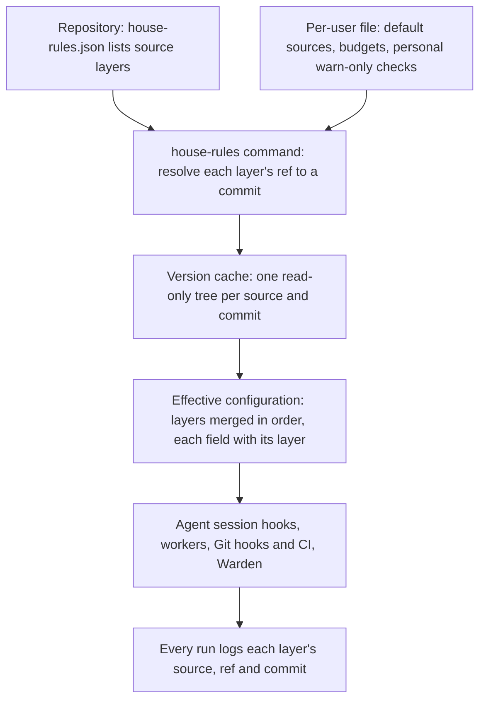

<a id="layered-configuration"></a>
# Layered House Rules configuration

Layered House Rules configuration lets every repository say which House Rules version and which further rule and setting repositories it uses, and makes every tool resolve them from the repository it runs in.
A repository lists ordered [source layers](#source-layer) in one file: House Rules first, then any number of custom repositories, each at a branch or a commit.
Later layers replace earlier entries with the same key, field by field, and the repository's own settings come last.
One small `house-rules` command per machine resolves the layers into a [version cache](#version-cache), the way a Rust toolchain file selects a toolchain without any "current version" state on the machine.
Agent session hooks, worker tooling, Git hooks, CI and Warden all resolve the same layers, and every run logs what it resolved.

Readers need Git branches and commits, JSON, and the [repository checks design](194-repository-checks.md#repository-checks) at the level of "a runner reads a configuration file and runs checks in Git hooks and CI".
This design is a draft. The operator decided its eight main choices on 2026-10-22 and 2026-10-23 and directed its implementation; the operator has not reviewed this record yet. The work is tracked in [#218](https://github.com/symbiotic-build/house-rules/issues/218).

How does one repository's configuration reach every tool that uses House Rules?



The [repository configuration](#repository-configuration) names the [source layers](#source-layer) and the repository's own settings.
The [house-rules command](#house-rules-command) runs [version resolution](#version-resolution): it turns each layer's ref into one commit and prepares that commit's files in the [version cache](#version-cache).
Each tool then reads the [effective configuration](#effective-configuration), which records the layer that set each value.
A repository without a configuration uses the default sources of the [global configuration](#global-configuration), and then House Rules `main`.
Each tool reads the repository configuration from its [configuration origin](#configuration-origin): Git hooks from the commit being checked, Warden from the PR's base branch.

<!-- spec-docs:navigation document="layered-configuration" -->
<!-- Generated by spec-docs; edit authored declarations. -->

## Overview

Layered House Rules configuration lets every repository say which House Rules version and which further rule and setting repositories it uses, and makes every tool resolve them from the repository it runs in.

**Audience:** House Rules maintainers, repository owners and teams adopting House Rules, familiar with Git branches and commits, JSON and the repository checks design.

**Scope:** The repository, layer, global and local configuration files, version resolution and its cache, the house-rules command, link mode, Git isolation for checks, and how every consumer resolves.

**Non-goals:** New language checks, a runner other than House Rules', a package registry, and implementation in this change.

## Document map

Use this map to choose the next explanation to read.

- [Layered House Rules configuration](218-layered-configuration.md#layered-configuration) — Read what layered configuration does and which tools resolve it.
- [Current state and evidence](218-layered-configuration.md#evidence) — See how House Rules reaches tools today and the constraints the design meets.
- [Tour: a Rust repository with two custom layers](218-layered-configuration.md#tour) — Follow a Rust repository with two custom layers from its file to a refused commit and a session.
- [Configuration files and layers](218-layered-configuration.md#configuration) — Declare layers, profiles and settings, and predict the effective value of every key.
- [Resolving a version](218-layered-configuration.md#resolving) — Know how a ref becomes a commit, where its files live, and what works offline or linked.
- [Consumers](218-layered-configuration.md#consumers) — Find where each tool reads the configuration and how checks avoid personal Git settings.
- [Worked examples](218-layered-configuration.md#examples) — Apply the design to a default repository, no configuration, link mode, a Warden review and an offline run.
- [Requirements](218-layered-configuration.md#requirements) — Find the obligations each mechanism must meet.
- [Decisions and alternatives](218-layered-configuration.md#decisions) — Read the operator's decisions with their words, the lead's recommendations and the design choices.
- [Open questions](218-layered-configuration.md#questions) — See which choices wait for the operator's review.
- [Migration](218-layered-configuration.md#rollout) — Move a machine from one checkout to the command, and adopt the file in a repository.
- [Work packages](218-layered-configuration.md#work) — Plan the implementation pull requests and their order.
- [Reference](218-layered-configuration.md#reference) — Look up schemas, commands, variables, record formats, messages and naming conventions.
- [Acceptance](218-layered-configuration.md#acceptance) — See the planned demonstrations for each requirement.

## Entity index

Each technical term below links to its defining Markdown section.

- [Command environment variables](218-layered-configuration.md#environment-variables) (`layered-configuration.command-environment-variable`) — A command environment variable is an environment variable of the House Rules command: a variable whose name the command defines and reads, or sets for a script it starts.
- [Configuration origin](218-layered-configuration.md#configuration-origin) (`layered-configuration.configuration-origin`) — A configuration origin is the file or commit from which a consumer reads the repository configuration.
- [Effective configuration](218-layered-configuration.md#effective-configuration) (`layered-configuration.effective-configuration`) — The effective configuration is the result of applying every layer file, the repository configuration and the machine files in order, with the layer that set each value recorded beside it.
- [Global configuration](218-layered-configuration.md#global-configuration) (`layered-configuration.global-configuration`) — The global configuration is the per-user JSON file ~/.config/house-rules/house-rules.json that supplies default sources for repositories without a repository configuration, machine budgets and personal checks.
- [House Rules command](218-layered-configuration.md#house-rules-command) (`layered-configuration.house-rules-command`) — The House Rules command is scripts/house_rules.py, one standard-library Python file that resolves layers, manages the version cache and links, and starts House Rules scripts at the resolved version.
- [Isolated Git environment](218-layered-configuration.md#git-isolation) (`layered-configuration.isolated-git-environment`) — An isolated Git environment is the set of environment variables and the temporary Git folder in which the checks runner starts every check, so that no Git setting except the repository configuration's git_settings reaches it.
- [Layer file](218-layered-configuration.md#layer-file) (`layered-configuration.layer-file`) — A layer file is a JSON file inside a source layer's repository that supplies that layer's settings: checks/base.json, applied always, and checks/profiles/<profile>.json, applied when the repository chose that profile.
- [Run placeholder for layers](218-layered-configuration.md#run-placeholder-layer) (`layered-configuration.layer-placeholder`) — The run placeholder {layer} is the absolute path of the tree of the layer whose file defined the check's run.
- [Link mode](218-layered-configuration.md#link-mode) (`layered-configuration.link-mode`) — Link mode is the developer mode in which a source layer reads the working tree of a local checkout instead of a fetched commit.
- [Local configuration](218-layered-configuration.md#local-configuration) (`layered-configuration.local-configuration`) — The local configuration is the untracked JSON file house-rules.local.json at a repository's root that holds machine-only budgets for that clone.
- [Offline resolution](218-layered-configuration.md#offline-use) (`layered-configuration.offline-use`) — Offline resolution is resolution without a network, from what the version cache already holds.
- [Repository profile](218-layered-configuration.md#profile) (`layered-configuration.profile`) — A repository profile is a named set of layer settings for one kind of repository, such as rust, that a repository selects in profiles and every layer may define in checks/profiles/<profile>.json.
- [Repository configuration](218-layered-configuration.md#repository-configuration) (`layered-configuration.repository-configuration`) — A repository configuration is the versioned JSON file house-rules.json at a repository's root that lists its source layers, its profiles and its own settings.
- [Resolution record](218-layered-configuration.md#resolution-record) (`layered-configuration.resolution-record`) — A resolution record is the account of one resolution: the repository, the configuration origin, and for each layer its name, URL, ref, commit, source and fetch time.
- [Source layer](218-layered-configuration.md#source-layer) (`layered-configuration.source-layer`) — A source layer is one entry of sources: a Git repository, named by name and url, at one ref.
- [Version cache](218-layered-configuration.md#version-cache) (`layered-configuration.version-cache`) — The version cache is the per-user folder that holds one read-only file tree per commit, and each source's branch answers.
- [Version resolution](218-layered-configuration.md#version-resolution) (`layered-configuration.version-resolution`) — Version resolution is the procedure that turns each source layer's ref into one commit and makes that commit's files available in the version cache.
- [Check configuration](194-repository-checks.md#check-configuration) (`repository-checks.check-configuration`) — A check configuration is the versioned JSON file .agents/checks.json that pins House Rules and declares the repository's checks.
- [Check definition](194-repository-checks.md#check-definition) (`repository-checks.check-definition`) — A check definition is one command, the stages it runs at, the files it reads and how its result is read.
- [Check installation](194-repository-checks.md#check-installation) (`repository-checks.check-installation`) — Check installation is the repository-checks procedure that writes a repository's configuration, Git hooks and CI step, and prepares the local cache.
- [Check run report](194-repository-checks.md#check-run-report) (`repository-checks.check-run-report`) — A check run report is the runner's account of one run and of each check in it.
- [Check runner](194-repository-checks.md#check-runner) (`repository-checks.check-runner`) — The check runner is skills/repository-checks/scripts/checks.py, one standard-library Python file that reads the configuration, selects checks, runs them and prints the report.
- [Check stage](194-repository-checks.md#check-stage) (`repository-checks.check-stage`) — A check stage is one point in the change loop where the runner runs checks: pre-commit, pre-push or ci.
- [Hook block](194-repository-checks.md#hook-block) (`repository-checks.hook-block`) — A hook block is the marked shell fragment the install puts into a Git hook file to call the runner.
<!-- /spec-docs:navigation -->

<a id="evidence"></a>
## Current state and evidence

This section records how House Rules reaches tools today, which parts this design reuses and which constraints it must meet.

`FACT` House Rules main at `df20297` has one install path, read in this session:

- `scripts/sync.py --install-hooks` registers agent session hooks that run `scripts/session_context.py` from one House Rules checkout. The hooks print that checkout's rules in every repository.
- `scripts/session_context.py` reads every rule file relative to its own folder (`root()` returns the script's parent folder), so the checkout that holds the script decides the rules a session gets.
- The same install links each House Rules skill into agent homes, such as `~/.claude/skills/<name>`, pointing at that checkout.

`FACT` The [repository checks](194-repository-checks.md#repository-checks) runner of the open PRs [#212](https://github.com/symbiotic-build/house-rules/pull/212) and [#213](https://github.com/symbiotic-build/house-rules/pull/213), read at their heads `86b7e9f` and `30c8b99`, already has these parts:

- It reads `.agents/checks.json` from the snapshot being checked and always runs House Rules `main`. It resolves `main` with `git ls-remote` and keeps one read-only tree per commit in a per-user cache.
- Offline it uses the main last fetched, with a warning. `HOUSE_RULES_REVISION` runs another commit for one deliberate test run, and the report marks it.
- A runner at another revision hands the run to the runner at the resolved revision, through the environment variables `HOUSE_RULES_RESOLVED` and `HOUSE_RULES_SNAPSHOT`.
- Each report logs the House Rules revision and the SHA-256 of each check's program and scripts.
- The issue that asks for custom [source layers](#source-layer) in this runner is [#217](https://github.com/symbiotic-build/house-rules/issues/217); this design includes it.

`FACT` On the machine where this design was written, read on 2026-10-24:

- A local session-start script fetches House Rules main into one read-only checkout per commit and moves one stable link to it. Every agent session and every worker run reads House Rules through that link.
- Worker tooling writes the House Rules revision it used at the top of each run log.
- Warden, the review service, follows House Rules main through its own qualification step: it checks that a new main commit holds the prompt collection before it uses it, and keeps the last qualified commit.

The design must meet these constraints:

- Resolve the same layers in a Git hook and in CI for the same commit, so both give the same result.
- Keep no "current version" state that a person selects, because a repository's file alone must decide its version.
- Work offline from what was fetched before, and say so in every run that does.
- Never let a PR change the configuration of its own Warden review.
- Run the command and the resolver on Python 3.9 or later with the standard library only, as the checks runner does.

<a id="tour"></a>
## Tour: a Rust repository with two custom layers

Follow one repository from its configuration to a refused commit, a passing CI run and a session that reads the same rules.
The repository is a Rust service in a team that keeps shared rules in one repository, `team-rules`, and shared Rust settings in another, `rust-settings`.
The team follows `team-rules` at its latest commit and pins `rust-settings` to one reviewed commit.

**Procedure: write the configuration, commit, push and start a session**

1. **Install the command once on the machine:** `python3 <House Rules checkout>/scripts/house_rules.py install`.
   - Copies the command to `~/.local/bin/house-rules` and registers the agent session hooks.
   - Writes nothing in any repository.
2. **Write the [repository configuration](#repository-configuration):** `house-rules init` in the repository.
   - Finds `Cargo.toml` and `docs/ENTITIES.json`, so it writes the profiles `rust` and `specs`.
   - The team then adds its two layers to `sources` by hand.
3. **Resolve and look at the result:** `house-rules resolve`.
   - Prints one line per layer with its ref and the commit it resolved to.
   - Fetches each missing commit into the [version cache](#version-cache).
4. **Commit a change with trailing whitespace.**
   - The pre-commit hook resolves the same layers from the staged configuration.
   - The whitespace check fails; Git refuses the commit.
5. **Fix it and commit again.** Every check passes.
6. **Push the branch.** CI resolves the same layers from the pushed commit and passes. Its log names the same commits.
7. **Start an agent session in the repository.**
   - The session hook resolves from the repository's working tree.
   - It prints the House Rules rules of the resolved commit, then the rule file that `team-rules` adds.

> **Detail — configuration after step 2**
>
> ```json
> {
>   "version": 2,
>   "sources": [
>     {"name": "house-rules", "ref": "main"},
>     {"name": "team-rules", "url": "https://git.example.com/team/team-rules", "ref": "main"},
>     {"name": "rust-settings", "url": "https://git.example.com/team/rust-settings",
>      "ref": "3f2a9c0d41b7e65a8c1d2b3f4e5a6b7c8d9e0f1a"}
>   ],
>   "profiles": ["rust", "specs"],
>   "checks": {}
> }
> ```
>
> `house-rules` needs no `url`, because it is always House Rules. `main` is a branch, so every run uses its latest commit. The 40-digit `ref` is a commit, so `rust-settings` changes only through a reviewed PR that edits this line.

> **Detail — [layer files](#layer-file) the three sources supply**
>
> - House Rules `checks/base.json` defines the `whitespace` and `spec-docs` checks. Its `checks/profiles/rust.json` defines no check yet.
> - `team-rules` `checks/base.json` sets the pre-commit budget to 20 s and adds `rules/team.md` to the session context.
> - `rust-settings` `checks/profiles/rust.json` adds a check `cargo-deny` that runs in CI only, and moves `spec-docs` to pre-push with a reason.

> **Detail — output of step 3**
>
> ```text
> house-rules: repository /work/service, configuration house-rules.json (working tree)
> house-rules: layer house-rules   ref main   -> 4b1f0c2d9e8a7f6e5d4c3b2a1f0e9d8c7b6a5f4e (fetched 2026-10-24T09:00:00Z)
> house-rules: layer team-rules    ref main   -> 7c2e19d04b3a5f6e7d8c9b0a1f2e3d4c5b6a7f80 (fetched 2026-10-24T09:00:01Z)
> house-rules: layer rust-settings ref 3f2a9c0d41b7e65a8c1d2b3f4e5a6b7c8d9e0f1a (pinned)
> house-rules: profiles rust, specs
> ```
>
> The commits and times are illustrative. Every layer line names the full commit, so a reader can compare any two logs.

> **Detail — check report of step 4**
>
> ```text
> repository checks: pre-commit on the staged index
> house-rules: layer house-rules   ref main   -> 4b1f0c2d9e8a7f6e5d4c3b2a1f0e9d8c7b6a5f4e (reused, fetched 2026-10-24T09:00:00Z)
> house-rules: layer team-rules    ref main   -> 7c2e19d04b3a5f6e7d8c9b0a1f2e3d4c5b6a7f80 (reused, fetched 2026-10-24T09:00:01Z)
> house-rules: layer rust-settings ref 3f2a9c0d41b7e65a8c1d2b3f4e5a6b7c8d9e0f1a (pinned)
> FAIL  whitespace   0.1 s
>       src/main.rs:12: trailing whitespace.
>       fix: remove the trailing whitespace the output names, stage the fix and commit again
> settings:
>   budgets.pre-commit.seconds = 20                  from team-rules (reason: Our pre-commit includes a slower lint.)
>   checks.spec-docs.stages = ["pre-push", "ci"]     from rust-settings/rust (reason: Spec checks run at pre-push in Rust services.)
> Commit refused: 1 of 1 checks failed. Fix the findings, stage the fixes and commit again.
> ```
>
> Spec-docs is not listed, because its effective stages no longer include pre-commit; a check not configured for the stage does not appear in the report. `reused` means the run took the commit that another run resolved less than 60 s earlier, as [Version resolution](#version-resolution) explains. The `settings` block lists every effective value that a later layer changed, with the layer that set it.

Each later chapter explains one part of this tour: the files in [Configuration files and layers](#configuration), how a ref becomes a commit in [Resolving a version](#resolving), and how each tool finds its configuration in [Consumers](#consumers).

<a id="configuration"></a>
## Configuration files and layers

This chapter defines the four files a configuration can come from and how their entries combine into one [effective configuration](#effective-configuration).
A repository's choices live in one tracked file; machine-only values live in two untracked files that can only warn.

<a id="repository-configuration"></a>
### Repository configuration

A repository configuration is the versioned JSON file `house-rules.json` at a repository's root that lists its [source layers](#source-layer), its profiles and its own settings.
It is the one place a repository states which House Rules version and which further rule repositories it uses, so a reviewer sees every change to them in a PR's diff.

The file has six top-level fields:

- `version` is 2. Version 1 was the runner PRs' earlier `.agents/checks.json`.
- `sources` lists the [source layers](#source-layer) in order. It is required, so the file alone decides the layers: a hook and CI resolve the same list, and no per-user file can change it.
- `profiles` lists [profile](#profile) names in order. It is optional and defaults to none.
- `budgets` maps a [check stage](194-repository-checks.md#check-stage) to an entry with `seconds` and `reason`, as the repository checks design defines.
- `checks` maps a check identity to an entry, with the fields of the [check configuration](194-repository-checks.md#check-configuration).
- `git_settings` maps a Git configuration key to a string value. They are the only Git settings a check sees, as [Isolated Git environment](#git-isolation) explains.

The tour's file lists three sources and two profiles and changes no check. The exact schema is in [the schema reference](#schema-repository).

The runner PR [#212](https://github.com/symbiotic-build/house-rules/pull/212) introduces this file with exactly one source, the `house-rules` layer, and refuses a second source with a configuration error that names [#217](https://github.com/symbiotic-build/house-rules/issues/217). This design adds custom layers, profiles and their merge to that file; it renames nothing.
A repository that has `.agents/checks.json`, the name of an earlier runner draft, and no `house-rules.json` stops with a configuration error that names the rename.

Only this file lists layers. A [layer file](#layer-file) that lists sources is refused, so no layer can pull further repositories into a run that the repository did not list.

<a id="source-layer"></a>
### Source layer

A source layer is one entry of `sources`: a Git repository, named by `name` and `url`, at one `ref`.
Layers let a team share rules and settings in their own repositories, after House Rules and before the repository's own settings, without any special "organization" concept.

Each layer entry has three fields:

- `name` is the layer's name in logs and reports, in lower kebab case, unique in the list. The first layer is always `house-rules`, and no other layer may use that name.
- `url` is the repository to fetch. The `house-rules` layer may omit it; its default is `https://github.com/symbiotic-build/house-rules`. Every other layer needs it.
- `ref` is a branch name or a full commit identity. It is optional and defaults to `main`.

A `ref` of 40 or 64 hexadecimal digits is a commit; any other value is a branch name.
A branch always resolves to its latest commit, so a layer that follows `main` gets every change at the next run.
A commit is a deliberate pin: it is visible in the file and changes only through a reviewed PR.
Tags and other references are not refs; a value such as `v1` is read as the branch `v1`, and a missing branch stops resolution with an error naming it.

In the tour, `team-rules` follows `main` and `rust-settings` is pinned to `3f2a9c0…`.

Listing a source trusts its content like a dependency, because a layer's check definitions run its commands.
A commit pin is how a repository makes that trust reviewed: the pinned content changes only in a PR that changes the pin.

<a id="layer-file"></a>
### Layer file

A layer file is a JSON file inside a source layer's repository that supplies that layer's settings: `checks/base.json`, applied always, and `checks/profiles/<profile>.json`, applied when the repository chose that profile.
Every source, House Rules included, uses the same two paths, so House Rules is one layer among others and a custom repository needs no other format.

A layer file has four fields, each optional except `version`:

- `version` is 1.
- `checks` maps a check identity to an entry. An entry for an identity no earlier file defined is a full [check definition](194-repository-checks.md#check-definition); an entry for an existing identity changes it field by field.
- `budgets` maps a check stage to an entry with `seconds` and `reason`.
- `context` lists Markdown files of this layer, relative to its repository root, that agent sessions receive after the House Rules rules.

A layer file may also set `enforced` in a check entry. The repository configuration and the machine files cannot, so only a layer decides whether a check's failure refuses a commit or only warns, as [New built-in checks warn first](194-repository-checks.md#check-definition) describes in the repository checks design.

A check command of a layer can name files of its own layer with the [run placeholder](#run-placeholder-layer) `{layer}`, so a team ships a check script in its rules repository.
House Rules' own built-in checks move from the runner's code into House Rules `checks/base.json`.

A missing layer file is no error: a source without `checks/base.json` contributes nothing at that step.
A layer file that is not valid JSON, has an unknown field or lists `sources` stops resolution with a configuration error naming the file and its layer.

> **Detail — the tour's `team-rules` `checks/base.json`**
>
> ```json
> {
>   "version": 1,
>   "budgets": {"pre-commit": {"seconds": 20, "reason": "Our pre-commit includes a slower lint."}},
>   "context": ["rules/team.md"]
> }
> ```

<a id="profile"></a>
### Repository profile

A repository profile is a named set of layer settings for one kind of repository, such as `rust`, that a repository selects in `profiles` and every layer may define in `checks/profiles/<profile>.json`.
Profiles let a layer ship language-specific checks that only repositories of that kind receive.

House Rules defines five profiles: `rust`, `typescript`, `python`, `svelte` and `specs`.
At the first implementation none of them defines a check; each file has `version` 1 and nothing else. A later House Rules PR adds language checks to them, warning first, as [#218](https://github.com/symbiotic-build/house-rules/issues/218) tracks.
`spec-docs` stays in `checks/base.json`, because it skips itself in a repository without `docs/DOCUMENTS.json`, and the repository checks design promises that a repository starts checking specifications when it adds one.

A profile name that no layer defines stops resolution with a configuration error, because it is most likely a spelling mistake.

`house-rules init` chooses profiles once, from marker files at the repository root, and writes them into the file:

| Profile | Marker files |
|---|---|
| `rust` | `Cargo.toml` |
| `typescript` | `package.json` and `tsconfig.json` |
| `python` | `pyproject.toml` |
| `svelte` | `svelte.config.js` |
| `specs` | `docs/ENTITIES.json` |

No tool detects profiles at run time. A repository that adds a language later edits `profiles` in a reviewed PR, so its checks never change because a file appeared.

<a id="global-configuration"></a>
### Global configuration

The global configuration is the per-user JSON file `~/.config/house-rules/house-rules.json` that supplies default sources for repositories without a repository configuration, machine budgets and personal checks.
It serves one person on one machine and can never change whether a repository's declared checks pass.

The file has four fields:

- `version` is 1.
- `sources` lists default source layers, with the schema of the repository configuration. They apply to a repository without a repository configuration and to jobs that run in no repository.
- `budgets` sets machine budgets. A budget only ever prints a warning.
- `checks` adds personal checks. Each needs a new identity, a full definition and a `reason`. A personal check runs in Git hooks only, never in CI, and its failure is always a warning.

The folder is `$XDG_CONFIG_HOME/house-rules` when `XDG_CONFIG_HOME` is set, and `~/.config/house-rules` otherwise.
The folder also holds `links.json`, written by [link mode](#link-mode), and `custom/`, this computer's local index that agent sessions read.

A problem in this file never stops a check run. An invalid file, or a personal check that names a check the repository already has, is ignored with a warning that names it.
Resolution for a repository without a repository configuration is the one exception: it needs the file's `sources`, so an invalid file stops that resolution with a configuration error.

<a id="local-configuration"></a>
### Local configuration

The local configuration is the untracked JSON file `house-rules.local.json` at a repository's root that holds machine-only budgets for that clone.
It lets one machine, such as a slow laptop, raise a budget without a repository change.

It has one field, `budgets`, with the shape the repository configuration uses. Any other field is a configuration error, because a file that seems to change a check but does not would mislead its owner. Neither the field nor that error can make a failing check pass.
The runner reads it from the working tree, because it is never part of a commit.
A tracked `house-rules.local.json` is ignored with a warning that says it must stay untracked, so a commit can never carry one machine's values to others.

<a id="effective-configuration"></a>
### Effective configuration

The effective configuration is the result of applying every layer file, the repository configuration and the machine files in order, with the layer that set each value recorded beside it.
It is what the checks runner and the session hooks use, and its provenance lets a report say where each value came from.

The application order is fixed.

**Procedure: build the effective configuration**

1. **Each source layer, in `sources` order:** its `checks/base.json`, then its `checks/profiles/<profile>.json` for each profile in `profiles` order.
2. **The repository configuration:** its `budgets` and `checks`.
3. **The global configuration:** its `budgets`, and its personal checks.
4. **The local configuration:** its `budgets`.

Steps 3 and 4 apply only in Git hooks and in commands run on the machine. CI has neither file, and a value from them only ever warns.

An entry replaces an earlier entry with the same key field by field:

- A check entry `checks.<identity>` keeps every field the later entry does not set. A field's value is replaced whole; a list such as `stages` is one value, never merged element by element.
- A budget entry `budgets.<stage>` works the same way, with its fields `seconds` and `reason`.
- `context` files accumulate: each layer adds its own files after those of earlier layers.

Every entry that changes a value an earlier step set carries a `reason`, in a layer file as in the repository configuration.
A field whose value equals the earlier value is no change and needs no reason.

The layer label of a value is the source name, followed by `/` and the profile name for a profile file: `house-rules`, `house-rules/rust`, `team-rules`, `rust-settings/rust`. The last three steps are labelled `repository`, `global` and `local`.

> **Detail — the tour's `spec-docs` entry after each step**
>
> - `house-rules` (base): `stages` = `["pre-commit", "ci"]`, `enforced` = `true` and the full definition.
> - `rust-settings/rust`: `stages` = `["pre-push", "ci"]`, with the reason "Spec checks run at pre-push in Rust services." Every other field keeps its House Rules value.
> - `repository`: no entry, so nothing changes.
>
> The effective `stages` is `["pre-push", "ci"]`, from `rust-settings/rust`. At pre-commit the check is not selected, as the tour's report shows.

<a id="resolving"></a>
## Resolving a version

This chapter explains how a ref becomes a commit, where its files live, what works offline, and the two ways to run something other than the configured version.

<a id="version-resolution"></a>
### Version resolution

Version resolution is the procedure that turns each [source layer](#source-layer)'s ref into one commit and makes that commit's files available in the [version cache](#version-cache).
It runs once per run of any consumer, so every part of one run uses one set of commits.

**Procedure: resolve the layers of one run**

1. **Find the configuration** at the consumer's [configuration origin](#configuration-origin), and read its `sources`.
2. **Apply a one-run override:** when [`HOUSE_RULES_REVISION`](#environment-variables) or [`HOUSE_RULES_LINK`](#environment-variables) is set, it replaces the `house-rules` layer, as [link mode](#link-mode) and the revision override explain.
3. **Resolve each branch ref:** `git ls-remote <url> refs/heads/<branch>` names its latest commit. A record of the answer is kept in the cache.
4. **Take each commit ref as it is.** It needs no network unless its files are missing.
5. **Fetch each missing commit** into the version cache and extract its files.
6. **Read the [layer files](#layer-file)** of every layer and build the [effective configuration](#effective-configuration).
7. **Log the resolution** as the [resolution record](#resolution-record) defines.

> **Detail — resolution rules**
>
> - One process at a time resolves a branch of one source. It holds an advisory lock on that source's `lock` file in the cache for steps 3 and 5. The system releases the lock when the process ends, however it ends.
> - A branch answer younger than 60 s is reused without asking the remote again, and the layer's source is `reused`. Twelve session hooks that start together therefore make one remote call and agree on one commit.
> - Each fetch creates a new temporary bare repository in the cache, fetches the one commit with depth 1, extracts it into a temporary folder, renames that folder into place and deletes the repository, as the runner PRs already do for House Rules.
> - Fetching a commit by its identity needs a server that allows it. GitHub does. A server that refuses stops resolution with an error that names the commit and the server's answer.
> - Every `ls-remote` and fetch passes `-c http.lowSpeedLimit=1 -c http.lowSpeedTime=30`, so Git stops a transfer that moves less than 1 byte per second for 30 s. Resolution adds no timer of its own.
> - Messages show each URL without the user name and password of its authority; Git itself receives the full URL.

A consumer that hands its run to a tool at another House Rules revision passes the resolution in [`HOUSE_RULES_RESOLVED`](#environment-variables), as the checks runner already does. The started tool uses it and resolves nothing again.

<a id="version-cache"></a>
### Version cache

The version cache is the per-user folder that holds one read-only file tree per commit, and each source's branch answers.
It makes every resolution after the first local and fast, and it is what an offline run falls back to.

> **Detail — cache layout**
>
> - The cache root is [`HOUSE_RULES_CACHE`](#environment-variables), or `$XDG_CACHE_HOME/house-rules`, or `~/.cache/house-rules`.
> - `revisions/<commit>/` holds that commit's files, extracted with `git archive`, as in the runner PRs. A commit identifies its content, so a fork and its upstream share the tree of a common commit. Files are read-only; folders stay writable, so the cache can be removed.
> - `revisions/<commit>.used` is an empty file whose modification time is the last resolution that used the commit.
> - `sources/<source key>/` holds one source's branch answers and lock. The source key is the URL's host and path, lower-case host, without user name, password, port 443 or a trailing `.git`: `github.com/symbiotic-build/house-rules`.
> - `sources/<source key>/branches/<branch>.json` records the last answer for one branch: `url` without user name and password, `branch`, `revision` and `fetched`, an ISO 8601 UTC time. The checks runner of [#212](https://github.com/symbiotic-build/house-rules/pull/212) writes the same record, so both tools share one answer. The source key follows #212's escaping: a character outside `[A-Za-z0-9._-]` is escaped, and a `file:` URL becomes `file/<absolute path>`.
> - `sources/<source key>/lock` is the empty file whose lock serializes resolution of that source.
> - `environments/<digest>/` holds the virtual environments of the checks runner, unchanged from the runner PRs.
> - `default` is a symbolic link to the House Rules tree of the last resolution of the global default sources. Agent-home skill links point through it, as [Agent sessions](#consumer-sessions) explains.
> - A tree or environment is built in a folder whose name starts with `.partial-` and renamed into place, so two processes that prepare the same commit at once both end with one complete copy.

`house-rules cache list` prints each source with its branch records, then each tree with its size and last use.
`house-rules cache prune` removes what no run needs:

- A tree that no branch record names and that no run used in the last 7 days.
- A `.partial-` folder or temporary fetch repository older than 1 day.
- An environment that no run used in the last 7 days.
- A branch record or lock that the runner PRs kept outside `sources/`, which this design's records replace.

It never removes the tree that `default` points to or a tree used in the last day, because a running process may still read it.
`--dry-run` lists what it would remove and removes nothing.

<a id="offline-use"></a>
### Offline resolution

Offline resolution is resolution without a network, from what the version cache already holds.
A machine without a network keeps working on the rules it last fetched, and every run that does so says so.

- **A branch ref:** when `ls-remote` fails, resolution uses the branch's last record, and the layer's source is `offline`. The run prints one warning naming the layer, its commit and when it was fetched.
- **A branch with no record:** resolution stops with a preparation error that names the layer and says to run again when online.
- **A commit ref:** a commit already in the cache needs no network. A missing commit stops resolution with a preparation error that names it.
- **A link:** a linked layer needs no network.

> **Detail — offline lines**
>
> ```text
> warning: cannot reach https://git.example.com/team/team-rules (fatal: unable to access …); using team-rules main last fetched 2026-10-24T09:00:01Z, 7c2e19d04b3a5f6e7d8c9b0a1f2e3d4c5b6a7f80
> house-rules: cannot reach https://git.example.com/team/team-rules (fatal: unable to access …) and no earlier fetch of team-rules main is cached; run again when online
> ```

<a id="overrides"></a>
### Overrides and link mode

A run uses something other than the configured version in exactly two ways, both visible in its log: a revision override for a deliberate test, and link mode for developing a layer.
Neither is stored in any repository, so no commit can make another machine run an unreviewed version.

The revision override is [`HOUSE_RULES_REVISION`](#environment-variables), a full commit identity that replaces the `house-rules` layer's ref for one run.
It keeps the meaning it has in the runner PRs: a deliberate test, marked in every log line of the layer with `override` and in a `TEST OVERRIDE` warning.

<a id="link-mode"></a>
#### Link mode

Link mode is the developer mode in which a source layer reads the working tree of a local checkout instead of a fetched commit.
It lets a person who edits House Rules or a team's rules repository try the edit in real repositories before pushing it.

**Procedure: try an edit to a rules repository**

1. **Link the checkout:** `house-rules link ~/src/team-rules`.
   - Reads the checkout's `remote.origin.url`, prints the source key it links and writes the link to `links.json` in the [global configuration](#global-configuration) folder.
   - `--url URL` names the source instead.
2. **Work in any repository that lists that source.** Every run of every consumer uses the checkout's working tree for that layer, uncommitted edits included, and warns.
3. **Unlink:** `house-rules unlink ~/src/team-rules`. The next run fetches the layer again.

> **Detail — the warning every linked run prints**
>
> ```text
> warning: LINKED team-rules -> /home/dev/src/team-rules at 9f3c2a1b4d5e6f708192a3b4c5d6e7f8091a2b3c with uncommitted changes; this run does not use the fetched source
> ```

A link applies to every repository that lists a source with the same source key, on this machine only.
[`HOUSE_RULES_LINK`](#environment-variables) links the `house-rules` layer to a checkout for one run, without writing `links.json`.
Setting both `HOUSE_RULES_LINK` and `HOUSE_RULES_REVISION` stops resolution with a usage error, because a run can use only one of them.
A link whose folder is missing or is not a Git checkout stops resolution with an error that names the `unlink` command.

A linked run gives up the equal-result promise between hook and CI, because CI has no link. Every report says so through the warning above, so nobody mistakes a linked result for a configured one.

<a id="resolution-record"></a>
### Resolution record

A resolution record is the account of one resolution: the repository, the configuration origin, and for each layer its name, URL, ref, commit, source and fetch time.
Every consumer logs it, so a reader of any session context, worker log, check report or Warden review can tell which rules produced it.

The text form of a resolution record is the `house-rules:` lines the tour shows: one line for the configuration and one per layer.
The JSON form is in [the record format reference](#schema-resolution).

Each layer's source is one of these words:

- `fetched`: the branch was asked for in this resolution.
- `reused`: the branch's answer was younger than 60 s.
- `offline`: the remote could not be reached; the last answer was used.
- `pinned`: the ref is a commit.
- `override`: [`HOUSE_RULES_REVISION`](#environment-variables) replaced the ref.
- `link`: a link replaced the layer.

Besides layers, each consumer logs what it adds:

- The checks runner logs each effective value that a later step changed, with its layer and reason, and each check's version, the SHA-256 of its program and scripts, as the runner PRs define.
- Session hooks log the resolution in the first context part.
- Worker tooling logs it at the top of each run log, beside the prompt files' Git blob identities it already writes.
- Warden logs it in each review's debug data.

<a id="house-rules-command"></a>
### House Rules command

The House Rules command is `scripts/house_rules.py`, one standard-library Python file that resolves layers, manages the version cache and links, and starts House Rules scripts at the resolved version.
It is installed once per machine as `house-rules`, and the checks runner imports the same file as its resolver.

`house-rules install` copies the file to `~/.local/bin/house-rules`, with the absolute path of the interpreter that ran it on its first line and `-I`, so inherited Python settings cannot change it.
The installed copy resolves with its own code. It never hands itself over to another revision, so it has no state and no version selection beyond what the repository's file says.

The installed command is older than House Rules `main` after any House Rules merge that changes it.
A configuration whose `version` it does not know stops it with an error that names `house-rules self-update`. That command replaces the installed copy with the file from the global default's House Rules tree.
`house-rules resolve` also warns when the installed copy differs from the file in that tree.

`house-rules exec <path> [arguments]` runs a script from the resolved House Rules tree, such as `scripts/session_context.py`, with the resolution in [`HOUSE_RULES_RESOLVED`](#environment-variables).
With `--hook` it reads an agent hook's JSON input from standard input, takes the repository from its `cwd` field and passes the same input on to the script.
The script therefore always runs at the repository's resolved House Rules version, and it reads its rule files from its own tree.

The commands and their options are listed in [Commands](#commands).

<a id="consumers"></a>
## Consumers

This chapter names every tool that uses House Rules, where each one reads the [repository configuration](#repository-configuration), and how checks are kept from reading personal Git settings.

<a id="configuration-origin"></a>
### Configuration origin

A configuration origin is the file or commit from which a consumer reads the repository configuration.
Each consumer reads from the point that matches what it acts on, so a hook and CI agree, and a PR cannot weaken its own review.

| Consumer | Configuration origin | Without a repository configuration |
|---|---|---|
| Git pre-commit hook | staged index | no checks run |
| Git pre-push hook | each pushed commit | no checks run |
| CI step | commit under test | no checks run |
| Warden | PR's base commit | Warden's own default |
| Agent session hooks | working tree | global default sources |
| Worker and review-lane tooling | working tree of the work folder | global default sources |
| Jobs in no repository | none | global default sources |

The repository is the Git top level of the folder the consumer runs in: `git rev-parse --show-toplevel`.
The global default sources are the `sources` of the [global configuration](#global-configuration), and without them House Rules `main`.
A repository without a repository configuration has not adopted repository checks, so the checks runner checks nothing there, as the repository checks design already states.

The CI step reads the commit under test, not the PR's base. The repository checks design records why, in its [CI configuration decision](194-repository-checks.md#decision-ci-head-configuration): a PR controls its own CI workflow file anyway, and a PR that changes the configuration must show what the change does.
Warden is different, because it is the independent review; [Warden](#consumer-warden) explains its rule.

<a id="consumer-checks"></a>
### Git hooks and CI

The checks runner resolves the layers of each snapshot through the [House Rules command](#house-rules-command)'s resolver and builds the [effective configuration](#effective-configuration) from them.
This replaces the runner's own resolution of House Rules `main`; everything else in the repository checks design stays.

- **One resolution per run.** A run resolves once, at its first snapshot that has a repository configuration. Every later snapshot of a push uses the same layers when its configuration lists the same sources. A pushed commit whose `sources` differ resolves its own layers, and the report shows both.
- **Handover.** A runner at another House Rules revision hands over to the runner of the resolved `house-rules` layer, with the resolution and the snapshot, as it does today.
- **Report.** The report's run object replaces its `house_rules` object with the [resolution record](#resolution-record)'s `layers`, and adds `settings`, each changed value with its layer and reason.
- **Personal and local values.** Personal checks of the global configuration run in hooks only, as warnings. Budgets from the global and [local configuration](#local-configuration) only print warnings.

<a id="git-isolation"></a>
#### Isolated Git environment

An isolated Git environment is the set of environment variables and the temporary Git folder in which the checks runner starts every check, so that no Git setting except the repository configuration's `git_settings` reaches it.
It is what makes a hook give the same result as CI's fresh clone for the same commit and layers.
The runner PR [#212](https://github.com/symbiotic-build/house-rules/pull/212) builds it; this design records its contract, because every layer's checks rely on it.

The runner builds it once per snapshot.

**Procedure: build the isolated Git environment**

1. **Create a temporary Git folder:** `git init --bare --object-format=<the repository's format>` in a temporary folder.
2. **Point it at the repository's objects:** write the absolute path of the repository's object folder, `git rev-parse --git-common-dir` followed by `/objects`, into its `objects/info/alternates`.
3. **Write the declared settings:** each `git_settings` entry becomes one line of that folder's `config`, and nothing else does.
4. **Start each check in it:** with `GIT_DIR` set to that folder, `GIT_CONFIG_NOSYSTEM=1`, `GIT_CONFIG_GLOBAL=/dev/null` and `GIT_ATTR_NOSYSTEM=1`.

The runner also removes every inherited `GIT_CONFIG_PARAMETERS`, `GIT_CONFIG_COUNT`, `GIT_CONFIG_KEY_<n>` and `GIT_CONFIG_VALUE_<n>`, which `git -c` passes to hooks.
A check therefore reads no system or global Git configuration, no `.git/config` of the clone and no `.git/info/attributes`; its only Git settings are the declared ones. It reads the snapshot's commits through the alternate object folder, and `.gitattributes` from the snapshot as before.
The runner removes the temporary folder after the snapshot's last check.

A check that reads the working tree runs only in CI, as the repository checks design requires. It runs with the same variables but with the real Git folder, because it needs the checkout; CI's fresh clone has no personal settings.

This replaces the runner PRs' limit that attribute files outside the snapshot can still change the whitespace result. The operator's [isolation decision](#decision-git-isolation) records the change.

A partial clone, which fetches missing objects on demand, can lack objects the alternate folder does not hold. A check that reads such an object fails in the hook, and CI decides; the session status line names partial clones as unsupported for hook checks.

<a id="consumer-sessions"></a>
### Agent sessions

Agent session hooks put House Rules rules into an agent's context at session start, resume, clear and compaction. With layers they print the rules of the repository's resolved version.

- **Session context.** Each registered hook runs `house-rules exec --hook scripts/session_context.py <part>`. The script runs from the resolved House Rules tree and prints that tree's rules. The first part starts with the resolution record.
- **Custom layer context.** After the House Rules parts, the script prints each layer's `context` files in layer order, as further parts with the same part labels.
- **Compaction.** Claude Code and Codex run the same hooks after a compaction, so the re-injected rules come from a new resolution of the same repository.
- **Approved-work listing.** Its hook runs `house-rules exec --hook scripts/session_context.py approved` in the same way.
- **Machine index.** The script reads this computer's `custom/INDEX.md` from the global configuration folder. A linked House Rules checkout that holds its own `custom/` folder uses that one.
- **End-of-turn guard.** A local guard that names a House Rules tool, such as the PR watcher, names it through `house-rules exec`, so the tool's revision matches the repository's.

A failed resolution never stops a session from starting. The hook prints one error line naming the cause, then the rules of the tree that `default` points to, labelled with that tree's revision.

Agent-home skill links serve every repository at once, so they follow the global default sources. They point through the cache's `default` link, which each resolution of the global default moves to its House Rules tree.
In a repository whose House Rules commit differs from the global default's, the first context part names the repository's tree and says to read skill files there.

Instruction files that agent homes load at start, such as a global `CLAUDE.md`, name no checkout path any more. Their managed House Rules block says to follow the rules in the session context and to run `house-rules path` when a file must be opened.

<a id="consumer-workers"></a>
### Workers and review lanes

Worker and review-lane tooling starts model workers and review panels with House Rules prompts.
It resolves from the work folder's repository with `house-rules path --repo <work folder>`, which prints the resolved House Rules tree, and builds its prompts from that tree.
Each run log starts with the resolution record in text form, followed by the prompt files' Git blob identities, which the tooling already writes.
A run in no repository, such as a scheduled job, uses the global default sources.

<a id="consumer-warden"></a>
### Warden

Warden reads the repository configuration from the PR's base commit, never from the PR's head.
A PR therefore cannot change the layers, the House Rules version or the context of its own review.

**Procedure: resolve the layers of one review**

1. **Take the base commit** the PR names when Warden admits the review.
2. **Resolve from it:** `house-rules resolve --repo <Warden's clone> --rev <base commit> --json`, run from Warden's qualified House Rules tree.
3. **Choose the House Rules tree.** A `house-rules` layer at `main` uses Warden's qualified main. Any other branch or commit is qualified the same way once, and the review stops with a stated reason when it fails.
4. **Add the custom layers' context** to the review rules after House Rules.
5. **Log the resolution** in the review's debug data, beside the House Rules revision it already shows.

A PR that changes `house-rules.json` is reviewed like any change, with the base branch's configuration. Its review states that the change takes effect after merge.
A base commit without a repository configuration uses Warden's own default: its qualified House Rules main and no custom layers.
Warden's change lives in the Warden repository, as its own work package.

<a id="examples"></a>
## Worked examples

This chapter applies the design to five situations unlike the tour's.

### A default single-language repository

This Python repository has `pyproject.toml` and no specifications. `house-rules init` writes:

> **Detail — configuration and first report**
>
> ```json
> {"version": 2, "sources": [{"name": "house-rules", "ref": "main"}], "profiles": ["python"], "checks": {}}
> ```
>
> ```text
> repository checks: pre-commit on the staged index
> house-rules: layer house-rules   ref main   -> 4b1f0c2d9e8a7f6e5d4c3b2a1f0e9d8c7b6a5f4e (fetched 2026-10-24T09:00:00Z)
> house-rules: profiles python
> PASS  whitespace   0.1 s
> SKIP  spec-docs    requires docs/DOCUMENTS.json
> All 1 selected check passed; 1 skipped.
> ```

`house-rules init` always writes the `house-rules` layer at `main`, so the repository follows House Rules `main` on every machine and in CI.
The `python` profile defines no check yet, so the run uses House Rules `checks/base.json` alone.

### A repository with no configuration

This repository has no `house-rules.json`. An agent session starts in it on a machine whose [global configuration](#global-configuration) names one default source, a fork of House Rules.

> **Detail — global configuration and the first context part**
>
> ```json
> {"version": 1, "sources": [{"name": "house-rules", "url": "https://git.example.com/fork/house-rules", "ref": "main"}]}
> ```
>
> ```text
> house-rules: repository /work/scripts, configuration none (global default sources)
> house-rules: layer house-rules   ref main   -> 0d9e8a7f6e5d4c3b2a1f0e9d8c7b6a5f4e3d2c1b (fetched 2026-10-24T10:12:30Z)
> ```

The session receives the fork's rules. A commit in this repository runs no checks, because it has not adopted repository checks.

### Developer link mode

A maintainer edits a House Rules rule in `~/src/house-rules` and wants a real session to see the edit before pushing.

**Procedure: see an unpushed rule edit in one session**

1. **Start the session with the variable:** `HOUSE_RULES_LINK=~/src/house-rules claude` in the repository.
2. **Read the first context part.** It names the checkout and its state.

> **Detail — the first part's resolution lines**
>
> ```text
> house-rules: layer house-rules   link /home/dev/src/house-rules at 5e6f7081a2b3c4d5e6f708192a3b4c5d6e7f8091 with uncommitted changes
> warning: LINKED house-rules -> /home/dev/src/house-rules at 5e6f7081a2b3c4d5e6f708192a3b4c5d6e7f8091 with uncommitted changes; this run does not use the fetched source
> ```
>
> Entities in this example: [command environment variables](#environment-variables).

The next session without the variable uses the fetched House Rules again; nothing was stored.

### A Warden review of a PR that changes the configuration

A PR in the tour's repository moves the `rust-settings` pin to a newer commit and adds a third layer.

**Procedure: review a PR that changes the configuration**

1. **Warden reads the base commit's file:** three layers, `rust-settings` at `3f2a9c0…`.
2. **The review runs with those layers.** The new layer's context is not in the review.
3. **The review notes the change:** "This PR changes house-rules.json. This review used the base branch's configuration; the change takes effect after merge."
4. **CI runs with the PR's file**, so the PR's check results show what the new pin and layer do.

The reviewer judges the change on its diff and on CI's result. After the merge, the next review on that repository uses the new layers.

### An offline run

The tour's developer commits on a train. The cache holds every layer from a fetch 40 min earlier.

> **Detail — the pre-commit report's resolution lines**
>
> ```text
> warning: cannot reach https://github.com/symbiotic-build/house-rules (fatal: unable to access …); using house-rules main last fetched 2026-10-24T09:00:00Z, 4b1f0c2d9e8a7f6e5d4c3b2a1f0e9d8c7b6a5f4e
> warning: cannot reach https://git.example.com/team/team-rules (fatal: unable to access …); using team-rules main last fetched 2026-10-24T09:00:01Z, 7c2e19d04b3a5f6e7d8c9b0a1f2e3d4c5b6a7f80
> house-rules: layer house-rules   ref main   -> 4b1f0c2d9e8a7f6e5d4c3b2a1f0e9d8c7b6a5f4e (offline, fetched 2026-10-24T09:00:00Z)
> house-rules: layer team-rules    ref main   -> 7c2e19d04b3a5f6e7d8c9b0a1f2e3d4c5b6a7f80 (offline, fetched 2026-10-24T09:00:01Z)
> house-rules: layer rust-settings ref 3f2a9c0d41b7e65a8c1d2b3f4e5a6b7c8d9e0f1a (pinned)
> ```

The commit is checked with the rules last fetched. When the developer pushes later, CI resolves the latest commits; if House Rules main changed meanwhile, CI's result decides.

<a id="requirements"></a>
## Requirements

These obligations make the mechanisms above implementable and testable.
Their status is specified: the operator decided the choices they rest on, and this design record awaits the operator's review.

<a id="req-layers-ordered-merge"></a>
### Requirement: layers apply in order, field by field

A repository's layers combine predictably, and a reader can tell where each value came from.

**Actor:** [House Rules command](#house-rules-command) resolver.

**Condition:** A [repository configuration](#repository-configuration) lists sources and profiles.

**Result:** The [effective configuration](#effective-configuration) applies each layer's base file, then its profile files in `profiles` order, then the repository, global and local files, as [Effective configuration](#effective-configuration) states. A later entry replaces an earlier entry with the same key field by field, and records its layer. A [layer file](#layer-file) that lists sources, a changed value without a reason and an unknown profile are refused with configuration errors.

**Verification:** Fixture sources with base and profile files.

**Tests:** [Two custom layers](#test-layers-two-custom), [default repository](#test-layers-default).

**Status:** specified.

**Basis:** [Layered sources decision](#decision-layered-sources).

<a id="req-layers-refs"></a>
### Requirement: a branch follows, a commit stays

A branch ref always uses the branch's latest commit, and a commit ref uses exactly that commit.

**Actor:** Resolver.

**Condition:** A layer's ref is a branch or a commit.

**Result:** A branch resolves to its latest commit, or to an answer at most 60 s old. A commit resolves to itself without a network call when its files are cached. A missing branch or commit stops resolution with an error that names it.

**Verification:** Fixture remote whose branch moves between two runs.

**Tests:** [Two custom layers](#test-layers-two-custom).

**Status:** specified.

**Basis:** [Refs decision](#decision-refs).

<a id="req-layers-consumers"></a>
### Requirement: every consumer resolves from its repository

Each consumer uses the layers of the repository it runs in, read at its [configuration origin](#configuration-origin).

**Actor:** Session hooks, worker tooling, checks runner, Warden.

**Condition:** A consumer runs in, or for, a repository.

**Result:** Each consumer reads the repository configuration at the [configuration origin](#configuration-origin) its row names. Without one it uses the global default sources, then House Rules `main`. A job in no repository uses the global default sources.

**Verification:** One machine with one repository; a repository without configuration.

**Tests:** [Same revision everywhere](#test-layers-same-revision), [no configuration](#test-layers-no-configuration).

**Status:** specified.

**Basis:** [Consumers decision](#decision-consumers).

<a id="req-layers-machine-files"></a>
### Requirement: machine files only warn

The global and [local configuration](#local-configuration) never change whether a repository's declared checks pass.

**Actor:** Checks runner.

**Condition:** A global or local configuration exists, valid or not.

**Result:** Their budgets and personal checks only produce warnings; personal checks never run in CI. An invalid [global configuration](#global-configuration), a personal check that names an existing check and a tracked local configuration are ignored with a warning naming them. A local configuration with a field other than `budgets` is a configuration error, which refuses but never passes a commit.

**Verification:** Fixture machine files with each case.

**Tests:** [Machine files](#test-layers-machine-files).

**Status:** specified.

**Basis:** [Shared and local decision](#decision-shared-local).

<a id="req-layers-git-isolation"></a>
### Requirement: checks read no personal Git settings

A check's result does not depend on the machine's or clone's Git configuration.

**Actor:** Checks runner.

**Condition:** Any [check stage](194-repository-checks.md#check-stage), with system, global or clone-local Git settings or attribute files present.

**Result:** Every check starts in the [isolated Git environment](#git-isolation). A setting in the system, global or clone configuration, an attribute in `.git/info/attributes` or a `git -c` value given to the hook does not change any check's result.

**Verification:** Fixture clone with `core.whitespace`, `* -whitespace` in `.git/info/attributes` and a global `core.attributesFile`.

**Tests:** [Git isolation demonstration](#test-layers-git-isolation).

**Status:** specified.

**Basis:** [Git isolation decision](#decision-git-isolation).

<a id="req-layers-logging"></a>
### Requirement: every run logs what it resolved

A reader of any log can tell which commits of which layers produced it.

**Actor:** Every consumer.

**Condition:** A consumer resolves layers.

**Result:** The log holds the [resolution record](#resolution-record): each layer's name, URL, ref, commit, source and fetch time. The checks runner adds each changed value with its layer and each check's version. Worker tooling adds its prompt files' versions.

**Verification:** Logs of a session hook, a worker run and a check run.

**Tests:** [Same revision everywhere](#test-layers-same-revision), [two custom layers](#test-layers-two-custom).

**Status:** specified.

**Basis:** [Logging decision](#decision-logging).

<a id="req-layers-offline"></a>
### Requirement: offline from the last fetch

A machine without a network keeps working from the [version cache](#version-cache), and says so.

**Actor:** Resolver.

**Condition:** The remote of a layer cannot be reached.

**Result:** A branch uses its last record with a warning that names the layer, commit and fetch time. A branch without a record, and a commit missing from the cache, stop resolution with an error that names the layer and says to run again when online.

**Verification:** Fixture runs with the remote made unreachable.

**Tests:** [Offline run](#test-layers-offline).

**Status:** specified.

**Basis:** [Command decision](#decision-command).

<a id="req-layers-link-mode"></a>
### Requirement: links and overrides are visible and stored nowhere in a repository

A run that uses a link or an override says so, and no repository file can create either.

**Actor:** Resolver.

**Condition:** `links.json` names a source, or [`HOUSE_RULES_LINK`](#environment-variables) or [`HOUSE_RULES_REVISION`](#environment-variables) is set.

**Result:** The layer's source is `link` or `override`, and the run prints the warning that [link mode](#link-mode) shows. Both variables together, and a link to a folder that is not a Git checkout, stop resolution with an error.

**Verification:** Fixture links and overrides.

**Tests:** [Link demonstration](#test-layers-link-mode).

**Status:** specified.

**Basis:** [Command decision](#decision-command), [refs decision](#decision-refs).

<a id="req-layers-cache"></a>
### Requirement: the cache can be listed and pruned safely

The version cache never grows without bound, and pruning never breaks a running process.

**Actor:** House Rules command.

**Condition:** `house-rules cache list` or `house-rules cache prune` runs.

**Result:** `list` prints every source, branch record and tree. `prune` removes only what [Version cache](#version-cache) lists, never the `default` tree or a tree used in the last day, and `--dry-run` removes nothing.

**Verification:** Fixture cache with old, recent and named trees.

**Tests:** [Cache prune](#test-layers-cache-prune).

**Status:** specified.

**Basis:** [Command decision](#decision-command).

<a id="req-layers-warden-base"></a>
### Requirement: Warden reviews with the base configuration

A PR cannot change the configuration of its own review.

**Actor:** Warden.

**Condition:** Warden reviews a PR in a repository, whether or not the PR changes `house-rules.json`.

**Result:** Warden resolves from the PR's base commit, logs the resolution and, for a PR that changes the file, states that the change takes effect after merge.

**Verification:** A review of a fixture PR that changes the file.

**Tests:** [Warden base configuration](#test-layers-warden-base).

**Status:** specified.

**Basis:** [Warden decision](#decision-warden-base).

<a id="decisions"></a>
## Decisions and alternatives

The operator decided the first eight records below on 2026-10-22 and 2026-10-23; the lead relayed them, with the operator's words, on 2026-10-24.
The lead's recommendations follow; the operator saw them and did not contest them, and can still change them when reviewing this design. The design choices made while writing it come last.

<a id="decision-layered-sources"></a>
### Decision: ordered source layers, later entries win

**Choice:** The [repository configuration](#repository-configuration) lists an ordered list of [source layers](#source-layer): House Rules first, then any number of custom rule or setting repositories, then the repository's own settings. Later layers replace earlier entries with the same key, field by field. A shared custom repository is just another layer; there is no special "organization" concept. Only the repository file lists layers.

**Authority:** Operator decision, relayed by the lead on 2026-10-24. The operator wrote: "the repos are pinned to some branch / commit same as local the local should be updated based on repo or org settings same as rust toolchain... How else should this work? Same with custom settings they should be shareable between local and remote (or not coz it's env specific) It means you could have custom rule repo which is shared and pointed to by commit/branch same as custom settings for rust in setting file in the repo..." and then: "Well it's not 'organization' defaults it's just the custom what we already support but it could have more levels with latest entry replacing previous if they match [custom-setting-1, custom-setting-2]".

**Reason:** One ordered list covers a team's shared rules, a language's shared settings and a repository's own choices with one rule. Allowing only the repository file to list layers keeps every repository a run uses visible in one reviewed file.

**Rejected alternatives:** A fixed organization level between House Rules and the repository: rejected by the operator; a shared repository is one more layer. Layers that include further layers: they would bring repositories into a run that the repository never lists. Merging lists element by element: a later layer could then never remove a stage or path that an earlier layer added.

<a id="decision-refs"></a>
### Decision: a branch follows its latest commit, a commit is a deliberate pin

**Choice:** A layer's ref is a branch, default `main`, which always resolves to its latest commit, or a commit, which is a deliberate pin that is visible and reviewed. No stale version exists except deliberately. `HOUSE_RULES_REVISION` stays as the one-run test override.

**Authority:** Operator decision, relayed by the lead on 2026-10-24. The operator wrote: "Everything should definitely log the prompt versions and house rules versions and check versions but I don't see any reason to keep stale version other than deliberate tests".

**Reason:** A branch ref gives every repository the latest rules without bot PRs. A commit ref is the deliberate exception, and because it lives in the repository file, a reviewer sees it.

**Rejected alternatives:** Tags or version ranges: a second way to pin, with no need the commit ref does not meet. A stored per-machine pin: it would let two machines run different versions for the same repository.

<a id="decision-shared-local"></a>
### Decision: shared settings in the repository, machine values in an untracked file

**Choice:** Shared settings live in the repository configuration and apply identically in hook and CI. Machine-only values live in the untracked [local configuration](#local-configuration) and may hold only budgets, which only ever warn.

**Authority:** Operator decision, relayed by the lead on 2026-10-24, from the operator's words quoted in the [layered sources decision](#decision-layered-sources): settings "should be shareable between local and remote (or not coz it's env specific)".

**Reason:** A value that can change a check's result must be the same on every machine, or hook and CI disagree. A budget only prints a warning, so it can differ by machine.

**Rejected alternatives:** A local file that can turn checks off or change their stages: a commit would then pass on one machine and fail in CI. No local file: a slow machine would have to change the repository to quiet a budget warning.

<a id="decision-git-isolation"></a>
### Decision: checks never read personal Git configuration

**Choice:** Checks use only declared settings. They read no system or global Git configuration, no clone `.git/config` and no `.git/info/attributes`, so a hook gives the same result as CI.

**Authority:** Operator decision, relayed by the lead on 2026-10-24. The lead's relay states the decision; it did not quote the operator's words for it.

**Reason:** In the runner PRs' review, `* -whitespace` in a clone's `.git/info/attributes` turned the whitespace check off, also with the runner's `-c core.whitespace` value. The runner PR [#212](https://github.com/symbiotic-build/house-rules/pull/212) first accepted that as a limit; its next round removes the limit under this decision. The [isolated Git environment](#git-isolation) does it with standard Git variables and an alternate object folder, without copying any object.

**Rejected alternatives:** Accepting clone-local inputs as the clone owner's choice, as the runner PRs did: it lets a hook pass a commit that CI refuses. Copying the snapshot into a fresh repository for each check: it costs a full copy per commit, where the alternate folder costs one small file.

<a id="decision-logging"></a>
### Decision: every run logs layers, settings and versions

**Choice:** Every run logs each resolved layer (source, ref, resolved commit), which layer each effective setting came from, check versions (program digest) and prompt versions.

**Authority:** Operator decision, relayed by the lead on 2026-10-24, quoted in the [refs decision](#decision-refs): "Everything should definitely log the prompt versions and house rules versions and check versions".

**Reason:** With several layers on branches, a log that names only House Rules cannot explain a result. The [resolution record](#resolution-record) and the settings list make every log self-explaining.

**Rejected alternatives:** Logging only changed layers or a digest of all of them: a reader could not see which commit of which repository applied without reproducing the resolution.

<a id="decision-command"></a>
### Decision: one rustup-style command per machine, with no current version

**Choice:** One small `house-rules` command is installed once per machine. It keeps a [version cache](#version-cache), fetches by ref automatically, uses the last fetched version offline with a warning, has cache list and prune commands, and a developer [link mode](#link-mode), `house-rules link <checkout>` or a one-run environment variable, whose use every run logs. It keeps no "current version" state.

**Authority:** Operator decision, relayed by the lead on 2026-10-24. The operator asked "do we need something like nvm in this case?"; the lead answered no, a rustup-style automatic resolution, and the operator accepted it.

**Reason:** A repository's file alone decides its version, as a Rust toolchain file does. A command that a person switches between versions, as a Node version manager does, would let the machine disagree with the repository.

**Rejected alternatives:** A version manager with a selected current version: rejected by the operator's question and its answer. One checkout per machine, as today: it gives every repository the same version and cannot hold custom layers.

<a id="decision-consumers"></a>
### Decision: every consumer resolves from the repository it runs in

**Choice:** Every consumer resolves from the repository it runs in, falling back to the [global configuration](#global-configuration)'s default sources and then House Rules `main`: agent session hooks (context at start and after compaction, for Claude Code and Codex), the approved-work listing, the end-of-turn guard, worker and review-lane tooling, Git hooks and CI, agent-home skill links and Warden. Jobs not tied to a repository use the global default.

**Authority:** Operator decision, relayed by the lead on 2026-10-24. The operator asked: "ok so the hooks and everything that we added need to understand that there are versions to this based on the repo install? (or if there is no installed version in the repo for the prompts or house rules it will use your global one?)", and answered the lead's confirmation with "yes".

**Reason:** A session, a worker and a check in one repository must use the same rules, or an agent follows one version while its commit is checked against another.

**Rejected alternatives:** Only checks follow the repository and sessions keep the machine checkout: a session could then follow rules its own commits are not checked against.

<a id="decision-warden-base"></a>
### Decision: Warden reads the configuration from the PR's base branch

**Choice:** Warden reads the repository configuration from the PR's base branch, never from the PR head, so a PR cannot weaken its own review. A PR that changes the configuration is reviewed like any change and takes effect after merge.

**Authority:** Operator decision, relayed by the lead on 2026-10-24. The lead's relay states the decision; it did not quote the operator's words for it.

**Reason:** Warden is the independent review. With the head's file, a PR could pin House Rules to a commit without a rule it breaks, or drop a team layer, and be reviewed under the weaker rules.

**Rejected alternatives:** Reading the head's file, as CI does: CI shows what a change does, while the review must judge it under the rules already in force.

<a id="decision-implementation"></a>
### Decision: implement the design

**Choice:** Implement this design in the work packages under [Work packages](#work), and bring the lead's recommendations and design choices to the operator for review.

**Authority:** Operator instruction, 2026-10-23, relayed by the lead: "Make a new thread for this compile all these finidngs spec it and implement it.. this is necessary for this tool to be usable by general public...". The operator gave it before this record existed and has not reviewed the record.

**Reason:** The operator decided the main choices and asked for implementation. The remaining choices are the lead's and can change at the operator's review without changing the mechanisms above.

**Rejected alternatives:** Waiting for an approval of the record before any implementation: the operator asked for implementation, and the record's open choices change file names and defaults, not the mechanisms.

<a id="decision-file-names"></a>
### Recommendation: `house-rules.json` at the repository root

**Choice:** The repository configuration is `house-rules.json` at the repository root, and the local configuration `house-rules.local.json`, untracked. They replace `.agents/checks.json` and `.agents/checks.local.json` of the runner PRs.

**Authority:** Lead recommendation, 2026-10-23, which the operator saw and did not contest. The operator can change it when reviewing this design.

**Reason:** The file now configures every House Rules consumer, not only checks, so a name after its owner, at the root where tools look first, says what it is. A Rust toolchain file sits at the root for the same reason.

**Rejected alternatives:** Keeping `.agents/checks.json`: the name says checks, while the file now also decides session rules and Warden's layers.

<a id="decision-global-file"></a>
### Recommendation: a per-user global file that never changes a check result

**Choice:** A per-user `~/.config/house-rules/house-rules.json` may set machine budgets, add personal checks that only warn, and supply default sources for repositories without a configuration. It can never change whether a repository's declared checks pass.

**Authority:** Lead recommendation, 2026-10-23, which the operator saw and did not contest.

**Reason:** A person needs default sources for repositories that have not adopted House Rules, and a place for personal checks, without affecting anyone else's result.

**Rejected alternatives:** No global file: a fork or a team's rules could not apply to unadopted repositories. A global file that changes repository checks: hook and CI would disagree.

<a id="decision-profiles"></a>
### Recommendation: a base file and per-language profiles, chosen once at init

**Choice:** House Rules ships `checks/base.json`, always applied, and profiles `rust`, `typescript`, `python`, `svelte` and `specs` in `checks/profiles/`. `house-rules init` detects profiles once from marker files and writes them into the repository file; no tool guesses at run time.

**Authority:** Lead recommendation, 2026-10-23, which the operator saw and did not contest. This design differs from it in two points, which the lead decided on 2026-10-24 and the operator can change:

- **Naming defaults stay in their one home.** The recommendation had each profile carry the naming defaults merged in [#197](https://github.com/symbiotic-build/house-rules/pull/197). Those defaults are prose in `prompts/skills/naming-defaults.md`, which reviewers and implementers already receive. A copy in the profiles would give them two homes, which the core rules forbid.
- **No language check ships yet, and spec-docs stays in base.** A language check such as a formatter reads the working tree, so it runs in CI only and needs that language's toolchain in CI. A missing toolchain is a start error, which refuses even a check that only warns. Language checks therefore follow in their own House Rules PR. `spec-docs` stays in base because it skips itself without `docs/DOCUMENTS.json`, and the repository checks design promises that a repository starts checking specifications when it adds one.

**Reason:** A repository's choice of profiles is recorded once and reviewed, so its checks never change because a file appeared. Profiles give later language checks a place to reach the right repositories, warning first.

**Rejected alternatives:** Detecting profiles at every run: a new `package.json` in a Rust repository would silently add TypeScript checks.

<a id="decision-order"></a>
### Recommendation: the application order

**Choice:** Apply House Rules base, its chosen profiles in listed order, further sources in order, the repository settings, the global file and the local file, as [Effective configuration](#effective-configuration) lists. Each further source applies its own base and then its profiles.

**Authority:** Lead recommendation, 2026-10-23, which the operator saw and did not contest.

**Reason:** Each later step is more specific than the one before, so "later wins" puts the most specific choice last. Machine files come after the repository because they only warn.

**Rejected alternatives:** All base files first, then all profiles: a team layer's base could not change a House Rules profile setting, which the tour's `rust-settings` needs to override.

<a id="decision-reuse-window"></a>
### Decision: reuse a branch answer for 60 s

**Choice:** A branch answer younger than 60 s is reused without asking the remote again.

**Authority:** Lead decision, 2026-10-24, made while writing this design.

**Reason:** Claude Code runs a product's session hooks in parallel: twelve context parts and the approved-work listing start together. Without reuse they would make thirteen remote calls, and a merge during them could give two parts different commits. With the lock and the window they make one call and agree. A change younger than 60 s reaches the next run after the window, which is not a stale version in the operator's sense.

**Rejected alternatives:** Asking the remote on every resolution, as the runner PRs do for one run: parallel hooks could disagree. A longer window or a configurable one: it would turn the window into a stored version and a second way to choose freshness.

<a id="decision-no-command-handover"></a>
### Decision: the installed command never hands itself over

**Choice:** The installed command resolves with its own code. Only `house-rules exec` runs code of the resolved revision. A configuration version the command does not know stops it with the `self-update` repair.

**Authority:** Lead decision, 2026-10-24.

**Reason:** A command that starts another revision of itself would need a second handover protocol beside the runner's. Resolution changes rarely; scripts change often, and `exec` already runs them at the resolved revision.

**Rejected alternatives:** Handing every command to the resolved revision's copy: one more process and protocol on every hook, to gain nothing for resolution.

<a id="decision-links-file"></a>
### Decision: links live in their own machine file

**Choice:** `house-rules link` writes `links.json` in the global configuration folder; it never rewrites `house-rules.json` there.

**Authority:** Lead decision, 2026-10-24.

**Reason:** The global configuration is edited by hand. A command that rewrote it would drop its formatting and could lose an edit made at the same time.

**Rejected alternatives:** A `links` field in the global configuration: the command would rewrite a hand-edited file.

<a id="decision-default-link"></a>
### Decision: agent-home skill links follow the global default

**Choice:** Skill links in agent homes point through the cache's `default` link, which each resolution of the global default sources moves to its House Rules tree. A session in a repository with another House Rules commit is told where that commit's skills are.

**Authority:** Lead decision, 2026-10-24, within the [consumers decision](#decision-consumers), which lists agent-home skill links.

**Reason:** An agent home serves every repository at once, so its links cannot follow one repository. They follow the global default, which the consumers decision names for everything not tied to a repository.

**Rejected alternatives:** Writing skill links into each repository: it would add House Rules files to every repository. Leaving links on one checkout: they would never move with the global default.

<a id="questions"></a>
## Open questions

No mechanism is open. The operator decided the main choices; the four recommendations and five lead decisions above wait for the operator's review of this design, and changing any of them changes names or defaults, not the mechanisms.
The custom layer `context` field and the House Rules [layer files](#layer-file) live under `checks/`, as the profile recommendation names them. A folder named after its whole content, such as `layer/`, is the alternative the operator can choose at review.

<a id="rollout"></a>
## Migration

This chapter explains how a machine moves from one House Rules checkout to the command, and how a repository adopts the file.

Today's install, `scripts/sync.py --install-hooks`, points every agent home at one checkout: its session hooks, its skill links and its managed instruction blocks. A local script may also keep that checkout at House Rules main.

**Procedure: move one machine to the command**

1. **Preview:** `python3 <checkout>/scripts/house_rules.py install --dry-run`. Lists every file it would write, and writes nothing.
2. **Install:** the same command without `--dry-run`.
   - Copies the command to `~/.local/bin/house-rules`.
   - Creates the [global configuration](#global-configuration) with `{"version": 1}` when it is absent.
   - Links `custom/` of the global configuration folder to the checkout's `custom/` when that exists and the link is absent.
3. **Re-register agent homes:** the install runs the agent-home registration that `sync.py` holds today, with the new hook commands, skill links through `default` and the new managed block. It keeps a backup beside each file it changes, as `sync.py` does.
4. **Move local tooling:** worker and lane scripts call `house-rules path --repo <work folder>` instead of a checkout path. Scheduled jobs call `house-rules path`.
5. **Check:** start a session in one repository, start a worker in it and run its checks. All three logs name the same commits.

The old checkout and any per-commit checkouts stay on disk; the install removes nothing.
Undoing the move is one step: `scripts/sync.py --install-hooks` from a checkout registers that checkout again, from its backups.

A repository adopts with `house-rules init`, which writes `house-rules.json` with the detected profiles and nothing else.
No repository has `.agents/checks.json` yet, because the runner PRs have not merged, so the rename needs no compatibility period; a leftover file stops with the error that names the rename.
Nothing changes in a repository that has not adopted, except that sessions there follow the global default sources.

<a id="work"></a>
## Work packages

The work lands as five PRs and one machine step, in this order. Each PR has the review procedure's budget of three fix rounds, and splits when it needs more.

- **Resolver and command:** `scripts/house_rules.py` with `resolve`, `path`, `exec`, `link`, `unlink`, `links`, `cache list`, `cache prune`, `init`, `install --dry-run`, `self-update` and `version`, with its tests. No consumer changes yet. Depends on nothing.
- **Agent sessions:** `scripts/session_context.py` reads the resolution, prints it, prints custom layer context, reads `custom/` from the [global configuration](#global-configuration) folder; `install` registers hooks through `house-rules exec --hook`, skill links through `default` and the new managed block. Depends on the resolver.
- **Checks on layers:** the runner accepts custom layers in `sources`, resolves through the resolver, merges layers with provenance, reads House Rules `checks/base.json` and profiles, and applies the global configuration's budgets and personal checks. The runner PR [#212](https://github.com/symbiotic-build/house-rules/pull/212) already brings `house-rules.json`, the [local configuration](#local-configuration) and the [isolated Git environment](#git-isolation). Depends on the resolver and on the runner PRs [#212](https://github.com/symbiotic-build/house-rules/pull/212) and [#213](https://github.com/symbiotic-build/house-rules/pull/213) being merged. Closes [#217](https://github.com/symbiotic-build/house-rules/issues/217).
- **Warden:** base-commit resolution, custom layer context and the resolution in debug data, in the Warden repository. Depends on the resolver.
- **Rule and documentation text:** `INSTALL-AGENTS.md`, `AGENTS.md` and the README describe the command and the machine index's new folder. Depends on agent sessions.
- **Machine migration:** the [Migration](#rollout) procedure on the machine that runs the agents, and the demonstration that a session, a worker and a check log the same commits. It changes local tooling only and needs no PR. Depends on the first three PRs.

<a id="reference"></a>
## Reference

This chapter lists the exact schemas, commands, variables, record formats, messages and naming conventions.

<a id="schema-repository"></a>
### Repository configuration schema

| Field | Type | Required | Meaning |
|---|---|---|---|
| `version` | integer | yes | 2 |
| `sources` | list of layer entries | yes | [source layers](#source-layer) in order |
| `profiles` | list of names | no | profiles in order |
| `budgets` | map of stage to budget entry | no | warning budgets |
| `checks` | map of identity to check entry | no | check changes and repository checks |
| `git_settings` | map of Git key to string | no | the only Git settings a check sees |

A layer entry has `name` (required), `url` (required except for `house-rules`) and `ref` (default `main`).
A budget entry has `seconds`, a positive number, and `reason`. A check entry has the fields of the repository checks design's [configuration fields](194-repository-checks.md#configuration-fields); it cannot set `enforced`.
An unknown field, a duplicate layer name, a first layer that is not `house-rules`, a later layer named `house-rules`, a name that is not lower kebab case, a branch name Git refuses (`git check-ref-format --branch`) and an unsupported version stop resolution with a configuration error.

### Layer, global and local schemas

| File | Fields |
|---|---|
| [layer file](#layer-file) | `version`, `checks`, `budgets`, `context` |
| [global configuration](#global-configuration) | `version`, `sources`, `budgets`, `checks` |
| [local configuration](#local-configuration) | `budgets` |

Each kind of file has its own `version`: 2 for the [repository configuration](#repository-configuration), whose version 1 was the runner PRs' earlier draft, and 1 for the others. The local configuration has no `version`, as in the runner PR. A layer file's check entry may set `enforced`. A global configuration check entry needs a new identity, a full definition and a `reason`, and is always a warning. `context` entries are repository-relative paths of Markdown files inside the layer.

<a id="run-placeholder-layer"></a>
### Run placeholder for layers

The run placeholder `{layer}` is the absolute path of the tree of the layer whose file defined the check's `run`. It joins the [run placeholders](194-repository-checks.md#configuration-fields) of the repository checks design; `{house_rules}` stays the House Rules layer's tree.

<a id="commands"></a>
### Commands

```text
house-rules resolve [--repo PATH] [--rev COMMIT] [--json]
house-rules path [--repo PATH] [--layer NAME]
house-rules exec [--repo PATH] [--hook] PATH [ARGUMENT]...
house-rules link CHECKOUT [--url URL]
house-rules unlink CHECKOUT|URL
house-rules links
house-rules cache list
house-rules cache prune [--dry-run]
house-rules init [--dry-run] [--profile NAME]...
house-rules install [--dry-run]
house-rules self-update
house-rules version
```

- `--repo PATH` names the repository; the default is the Git top level of the current folder. Outside any repository the command uses the global default sources.
- `--rev COMMIT` reads the [repository configuration](#repository-configuration) from that commit instead of the working tree. Warden and tests use it.
- `--layer NAME` prints that layer's tree instead of House Rules'.
- `--profile NAME` replaces the detected profiles.
- Exit status 0 is success, 1 a usage error and 2 a configuration or resolution failure, matching the checks runner's status 2 for preparation failures.

<a id="environment-variables"></a>
### Command environment variables

A command environment variable is an environment variable of the [House Rules command](#house-rules-command): a variable whose name the command defines and reads, or sets for a script it starts.

| Variable | Meaning |
|---|---|
| [`HOUSE_RULES_LINK`](#environment-variables) | links the `house-rules` layer to a checkout for one run |
| `HOUSE_RULES_REVISION` | revision override of the `house-rules` layer for one run |
| `HOUSE_RULES_CACHE` | cache root |
| `HOUSE_RULES_RESOLVED` | set by a starting tool: the [resolution record](#resolution-record) in JSON |

The last three keep the names and meanings the runner PRs gave them; `HOUSE_RULES_RESOLVED` now holds the whole resolution record. The runner PRs' `HOUSE_RULES_URL` is retired: a fork or a fixture is a `url` in the repository configuration.

<a id="schema-resolution"></a>
### Resolution record format

```json
{"version": 1,
 "repository": "/work/service",
 "configuration": {"origin": "index", "commit": null},
 "profiles": ["rust", "specs"],
 "layers": [
  {"name": "house-rules", "url": "https://github.com/symbiotic-build/house-rules", "ref": "main",
   "ref_kind": "branch", "revision": "4b1f0c2d9e8a7f6e5d4c3b2a1f0e9d8c7b6a5f4e", "source": "reused",
   "fetched": "2026-10-24T09:00:00Z", "tree": "/home/dev/.cache/house-rules/revisions/4b1f…",
   "link": null},
  {"name": "rust-settings", "url": "https://git.example.com/team/rust-settings", "ref": "3f2a9c0d41b7e65a8c1d2b3f4e5a6b7c8d9e0f1a",
   "ref_kind": "commit", "revision": "3f2a9c0d41b7e65a8c1d2b3f4e5a6b7c8d9e0f1a", "source": "pinned",
   "fetched": "2026-10-23T16:40:12Z", "tree": "…", "link": null}],
 "warnings": []}
```

- `configuration.origin` is `working tree`, `index`, `commit`, `base`, `global` or `default`. `commit` names the commit for `commit` and `base`, and is `null` otherwise.
- `ref_kind` is `branch` or `commit`. `source` is one of the words [Resolution record](#resolution-record) lists.
- `fetched` is when the cache first received the commit's files, or for a branch the time of its record; it is `null` for a link.
- `link` is `null`, or an object with `path`, `head` (the checkout's commit) and `dirty` (true when the working tree differs from it).
- The checks runner's report adds `settings`: a list of objects with `key` (such as `checks.spec-docs.stages`), `value`, `layer`, `replaces` (the earlier layer, or `null` for a new key) and `reason`.

### Messages

| Cause | Message | Exit |
|---|---|---|
| invalid JSON | `house-rules: <file>: invalid JSON at line <l> column <c>: <error>` | 2 |
| first layer | `house-rules: <file>: sources[0] must be house-rules; House Rules is always the first layer` | 2 |
| layer lists sources | `house-rules: <layer> <file>: only house-rules.json lists sources` | 2 |
| unknown profile | `house-rules: profile <name> is defined by no layer (<layer names>)` | 2 |
| missing reason | `house-rules: <layer> <key>: changes <earlier layer>'s value; add a reason` | 2 |
| missing branch | `house-rules: <layer>: no branch <branch> at <url>; check the ref in house-rules.json` | 2 |
| missing commit | `house-rules: <layer>: commit <commit> not found at <url> (<git error>); check the ref` | 2 |
| offline, no record | `house-rules: cannot reach <url> (<git error>) and no earlier fetch of <layer> <branch> is cached; run again when online` | 2 |
| both one-run variables | `house-rules: set HOUSE_RULES_LINK or HOUSE_RULES_REVISION, not both` | 1 |
| broken link | `house-rules: link <key>: <path> is not a Git checkout; run house-rules unlink <path>` | 2 |
| old command | `house-rules: <file> has version <n>; this house-rules command knows version 2; run house-rules self-update` | 2 |
| old checks file | `house-rules: .agents/checks.json is replaced by house-rules.json at the repository root; rename it` | 2 |

Warnings start with `warning:` and never change an exit status: [offline resolution](#offline-use), a link, an override, an invalid global configuration, a personal check that names an existing check, a tracked local configuration and an installed command that differs from the global default's.

<a id="naming-conventions"></a>
### Naming conventions

Each kind of public name in this design follows one convention:

- Configuration and record fields are lower snake case with modifiers before the head noun: `ref_kind`, `git_settings`. A time is a past participle, `fetched`, as in the runner PRs' report; the House Rules naming defaults' `_at` suffix gives way to that existing field. They have no prefix.
- Layer names, profile names and check identities are lower kebab case, noun first: `team-rules`, `rust-settings`. They have no prefix or suffix.
- Layer labels are a layer name, optionally followed by `/` and a profile name: `rust-settings/rust`.
- Commands are lower-case words after `house-rules`, verb first: `resolve`, `cache prune`, `self-update`.
- Options are lower kebab case after `--`, named for their value's noun: `--repo`, `--layer`.
- Environment variables are upper snake case and start with `HOUSE_RULES_`, modifiers before the head noun: [`HOUSE_RULES_LINK`](#environment-variables).
- [Configuration origins](#configuration-origin) and layer sources are lower-case words separated by a space: `working tree`, `reused`.
- Files are lower kebab case with their format's suffix: `house-rules.json`, `house-rules.local.json`, `links.json`.

Reviewers check these conventions. The environment variables join the runner environment variables of the repository checks design in the checks-on-layers work package, whose setting naming rule in `docs/ENTITIES.json` then enforces their spelling. The other kinds are ordinary words that the checker would match in prose.

<a id="acceptance"></a>
## Acceptance

These cases become tests in their work packages.
Until then each is a planned demonstration; none has been run.

<a id="test-layers-default"></a>
### Demonstration: default single-language repository

**Method:** demonstration.

**Requirements:** [Ordered merge](#req-layers-ordered-merge).

**Inputs:** A fixture Python repository without `sources`, a fixture House Rules source with `checks/base.json` and an empty `checks/profiles/python.json`, and no [global configuration](#global-configuration).

**Expected:** `house-rules init` writes the example's file. A commit runs whitespace and skips spec-docs, and the report has the example's lines.

Evidence: planned, following [a default single-language repository](#examples).

<a id="test-layers-two-custom"></a>
### Demonstration: two custom layers and a pin

**Method:** demonstration.

**Requirements:** [Ordered merge](#req-layers-ordered-merge), [refs](#req-layers-refs), [logging](#req-layers-logging).

**Inputs:** The tour's three fixture sources. Then a new commit on `team-rules` `main` and on `rust-settings` `main`, more than 60 s later. Separately, a `team-rules` [layer file](#layer-file) that lists `sources`, and a `rust-settings` change without a reason.

**Expected:** The tour's report, with the `settings` block naming `team-rules` and `rust-settings/rust`. After the new commits, `team-rules` resolves to its new commit and `rust-settings` stays at its pin. The layer file with `sources` and the change without a reason stop with their messages.

Evidence: planned, following the [tour](#tour).

<a id="test-layers-no-configuration"></a>
### Demonstration: no configuration

**Method:** demonstration.

**Requirements:** [Consumers](#req-layers-consumers).

**Inputs:** A fixture repository without `house-rules.json`; a global configuration with one fork source; then no global configuration.

**Expected:** The session hook prints the example's lines and the fork's rules; without a global configuration it prints House Rules `main`. A commit runs no checks.

Evidence: planned, following [a repository with no configuration](#examples).

<a id="test-layers-same-revision"></a>
### Demonstration: same revision everywhere

**Method:** demonstration.

**Requirements:** [Consumers](#req-layers-consumers), [logging](#req-layers-logging).

**Inputs:** The machine after the [Migration](#rollout) procedure, one adopted repository, one session, one worker run and one check run in it.

**Expected:** The session's first context part, the worker's run log and the check report each name the same layers and commits.

Evidence: planned, following [Migration](#rollout).

<a id="test-layers-machine-files"></a>
### Demonstration: machine files

**Method:** demonstration.

**Requirements:** [Machine files](#req-layers-machine-files).

**Inputs:** A global configuration with a 1 s pre-commit budget and a failing personal check; a personal check named `whitespace`; an invalid global file; a [local configuration](#local-configuration) with `checks`; a tracked local configuration.

**Expected:** Each run passes when the repository's checks pass. The budget and the failing personal check print warnings; CI runs no personal check. The invalid global file, the personal check named `whitespace` and the tracked local configuration print their warnings. The local configuration with `checks` stops the run with a configuration error.

Evidence: planned, following [Effective configuration](#effective-configuration).

<a id="test-layers-git-isolation"></a>
### Demonstration: isolated Git environment

**Method:** demonstration.

**Requirements:** [Git isolation](#req-layers-git-isolation).

**Inputs:** A staged trailing space in a fixture clone with `core.whitespace=-blank-at-eol` in its `.git/config`, `* -whitespace` in `.git/info/attributes`, a global `core.attributesFile` with the same line, and a commit started with `git -c core.whitespace=-blank-at-eol commit`.

**Expected:** The whitespace check fails in every case, as it does in a fresh clone.

Evidence: planned, following [Isolated Git environment](#git-isolation).

<a id="test-layers-offline"></a>
### Demonstration: offline run

**Method:** demonstration.

**Requirements:** [Offline](#req-layers-offline).

**Inputs:** The tour's cache with every layer fetched, and every remote unreachable; then an empty cache; then a pinned commit missing from the cache.

**Expected:** The first run prints the example's warnings and lines, and its checks run. The empty cache and the missing commit stop with their messages and exit status 2.

Evidence: planned, following [an offline run](#examples).

<a id="test-layers-link-mode"></a>
### Demonstration: link mode

**Method:** demonstration.

**Requirements:** [Links and overrides](#req-layers-link-mode).

**Inputs:** A checkout with an uncommitted rule edit linked with `house-rules link`; the same through `HOUSE_RULES_LINK`; both variables set; a linked folder removed.

**Expected:** Both linked runs use the edit and print the warning with `uncommitted changes`. After `unlink` the run uses the fetched source. Both variables, and the removed folder, stop with their messages.

Evidence: planned, following the developer link example in [Worked examples](#examples).

<a id="test-layers-cache-prune"></a>
### Demonstration: cache prune

**Method:** demonstration.

**Requirements:** [Cache](#req-layers-cache).

**Inputs:** A fixture cache with a tree named by a branch record, an unnamed tree last used 8 days ago, an unnamed tree used 2 hours ago, the `default` tree, a `.partial-` folder 2 days old, and the runner PRs' `main.json` and `revisions/`.

**Expected:** `--dry-run` lists the old unnamed tree, the `.partial-` folder and the old layout, and removes nothing. `prune` removes exactly those.

Evidence: planned, following [Version cache](#version-cache).

<a id="test-layers-warden-base"></a>
### Demonstration: Warden base configuration

**Method:** demonstration.

**Requirements:** [Warden base configuration](#req-layers-warden-base).

**Inputs:** A fixture repository whose base commit lists two layers, and a PR that moves a pin and adds a third layer.

**Expected:** The review's debug data lists the base commit's two layers; the review states that the change takes effect after merge; CI on the PR resolves three layers.

Evidence: planned, following [a Warden review of a PR that changes the configuration](#examples).
