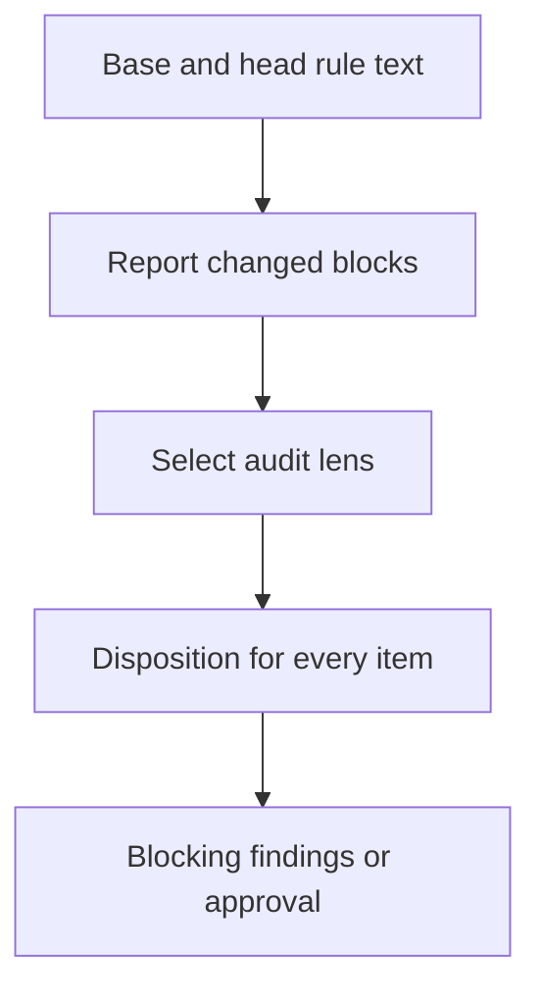

<a id="rule-changes"></a>
# Rule changes

Agents rewriting rule files have silently dropped or weakened approved rules.
Sentence-pinning tests cover samples and reject harmless rewording.
This specification makes changed text visible and requires a review of its meaning.
Readers need Git base/head revisions and a review pack, which contains rules, a task and the change.
The report supplies evidence; a reviewer decides whether meaning and approval survive.

How does changed text reach a mandatory audit?



The [rule-change report](#rule-change-report) precedes the diff in the task context.
The [review disposition](#review-disposition) accounts for every reported item.

<!-- spec-docs:navigation document="rule-changes" -->
<!-- Generated by spec-docs; edit authored declarations. -->

## Overview

Report rule text changes and require an explicit review disposition for each item.

**Audience:** Maintainers and review-service integrators familiar with Git revisions and review packs.

**Scope:** Protected Markdown comparison, review context and mandatory audit dispatch.

**Non-goals:** Automatic semantic approval, sentence-lock test deletion and service implementation.

## Document map

Use this map to choose the next explanation to read.

- [Rule changes](rule-changes.md#rule-changes) — Read the purpose and review boundary.
- [Tour](rule-changes.md#tour) — Follow a removal, weakening, move and re-wrap.
- [Report and review](rule-changes.md#report) — Compare protected text and preserve complete evidence.
- [Requirements](rule-changes.md#requirements) — Find the required report and review results.
- [Decisions](rule-changes.md#decisions) — Read the operator decision and the settled lead decisions.
- [Open questions](rule-changes.md#questions) — Identify the remaining service integration.
- [Reference](rule-changes.md#reference) — Configure coverage and call the shared selector.
- [Acceptance](rule-changes.md#acceptance) — Run behavior checks and inspect reviewer obligations.

## Entity index

Each technical term below links to its defining Markdown section.

- [Rule-change configuration](rule-changes.md#configuration) (`rule-changes.configuration`) — Rule-change configuration is optional versioned JSON at .rule-changes.json in the review base commit.
- [Review disposition](rule-changes.md#review-disposition) (`rule-changes.review-disposition`) — A review disposition is a reviewer's judgment and evidence for one reported item.
- [Rule-change report](rule-changes.md#rule-change-report) (`rule-changes.rule-change-report`) — A rule-change report is the complete comparison of protected Markdown changed blocks between review revisions.
<!-- /spec-docs:navigation -->

<a id="tour"></a>
## Tour

Follow one edit through detection and review. These synthetic files and the summary are the complete input.
All rule files are protected by the [rule-change configuration](#configuration).
The destination file already exists in the base, containing only `# Reporting` and its final newline.

**Base: rules/source.md**

```markdown
# Execution
- Keep the audit record.

- Never skip validation.

## Errors
- Report every failure.

Wrap this rule across
lines without changing its words.
```

**Head: rules/source.md**

```markdown
# Execution

- Avoid skipping validation.

## Errors

Wrap this rule across lines without changing its words.
```

**Head: rules/destination.md**

```markdown
# Reporting
- Report every failure.
```

**Head: CHANGELOG-RULES.md** (absent in the base)

```markdown
# Approval
Approved removal: “Keep the audit record. Retain the approval.”
```

**Selected --summary text**

```markdown
Audit example
## Rule changes
Remove the audit-record rule; operator approval is in CHANGELOG-RULES.md.
Change validation wording; operator approval is still required for weakening.
Move failure reporting to rules/destination.md without changing its meaning.
Rewrap the remaining paragraph.
```

**Procedure: prepare and audit the edit**

1. **Prepare the review.** The report contains a removal, a change with both texts and a move with both locations.
   - The removed block is source line 2: `- Keep the audit record.`
   - The changed block is source line 4 → line 3: `- Never skip validation.` → `- Avoid skipping validation.`
   - The moved block is source line 7 → destination line 2: `- Report every failure.`
   - The rewrapped block is source lines 9–10 → line 7, shown as one compact item.
   - The changelog block stays whole in Provenance entries; the rule remains removed.
2. **Read the declared changes.** The summary's section appears verbatim with original lines 2–6.
   - Lines 3–5 declare the removal, wording change and move; line 6 declares the rewrap.
   - When an explicit PR is given, its body replaces this summary as the selected source.
   - Without that section, the report prominently flags an undeclared change.
3. **Audit every item.** The normal panel gains the rule-preservation lens.
   - Without cited operator approval, the removal and weakening are Blocking findings.
   - The move can receive `same meaning` only after the reviewer checks its destination scope.
   - The rewrap needs a disposition after the reviewer opens its diff and confirms preserved structure.

<a id="report"></a>
## Report and review

The preparer compares captured Git text before rendering the change or dispatching reviewers.

**Procedure: build the comparison**

1. **Load base policy.** Resolve the [rule-change configuration](#configuration) from the pinned comparison base.
2. **Read changed paths.** Use one NUL-delimited raw Git diff with renames disabled; retain paths and modes without whole-tree inventories.
3. **Extract changed blocks.** Read base and head blobs for each protected changed path and take Git's zero-context hunks.
4. **Classify every block.** Keep same-word rewraps visible as `rewrapped` items; never drop a changed block.
5. **Pair exact moves.** Pair exact removed and added copies as moves.
6. **Check the allowance.** Refuse oversized complete reports before joining the rendered output.
7. **Select the lens.** Dispatch from the resulting rule items; provenance entries do not select a lens.

<a id="rule-change-report"></a>
### Rule-change report

A rule-change report is the complete comparison of protected Markdown changed blocks between review revisions.
It prevents changed obligations from disappearing inside a large diff.
The dispatch process pins the base commit before lens selection and preparation.
Preparation captures its merge base with head once and reuses that comparison base for the report, documentation context and diff.
The report names both immutable revisions. Working-tree edits do not affect it.

Each zero-context Git hunk is one changed block, with its complete old and new text and source line ranges.
Git runs with renames disabled, the Myers algorithm, no indentation heuristic and no inter-hunk context.

Paths come from NUL-delimited metadata and are passed as literal path arguments.
Hunk line ranges select text from the pinned blobs, so quoted patch filenames never determine source identity.
Headings outside fences supply section metadata; headings themselves remain changed text when Git includes them.
There is no sentence splitting, semantic unit extraction or cancellation of unchanged-looking siblings.
A procedure reorder therefore remains visible.

Every changed block remains reported.
For each side, strip each line's leading and trailing whitespace, then join the lines with single spaces.
A block is `rewrapped` only when these joined strings are identical and the stripped line sequences differ.
Spacing inside a line stays significant, including repeated spaces, tabs and code spacing.
Indentation-only changes and final-newline-only changes remain `changed` because their stripped line sequences match.
This comparison does not establish preserved Markdown structure; reviewers check it in the diff.

Any other block with removed and added lines is `changed`; an old-only block is `removed`; a new-only block is `added`.
An exact removed block copied elsewhere in the same range pairs with an exact added block as `moved`, retaining both locations.
Move identity includes every byte, including Markdown markers and final newlines.
Repeated copies pair in Git path and hunk order, first removed occurrence to first available added occurrence.
No partial-block matching or similarity pairing occurs; nonidentical blocks keep their Git classification.

Git supplies the comparison; the added work scans source lines and changed blocks and uses a hash table of exact additions for moves.
It does not compare every removed block with every added block.

Provenance files record why rules changed. Their text never pairs with rule blocks or other provenance entries.
A provenance block contributes its removed side and added side separately to `Provenance entries`.
Those entries retain identities, locations and exact text, but do not enter rule totals or trigger the rule-preservation lens.

Every item receives a stable report-local identity and class, plus old/new locations.
A `rewrapped` item renders once, on one line: identity, kind, old location → new location and `same words, line breaks moved`.
It contains no old/new text. Its rendered line alone contributes to the report allowance.
All other items include exact old/new text; absent sides display `(none)`. Totals include all five kinds.

With no protected change, the report status is one line, `No protected rule text changed.`, followed by any declaration evidence.
The report precedes the change in full preparation and context-only preparation.

The declared-changes source is the PR body when `--pr` is given; otherwise it is the supplied `--summary` text.
An automatically discovered PR does not override that summary.
Commit titles and messages are not declaration sources. A missing summary supplies no declarations.
The report names the source and copies its Rule changes section verbatim with original line numbers, including subsections.
A non-empty report without that section prominently says `UNDECLARED RULE CHANGES`.

The section is found by whole lines. Its heading is `## Rule changes`, indented at most three spaces.
Lines inside fenced code blocks do not count; a fence is indented at most three spaces.
Lines inside comments that start a line with `<!--` do not count either.

Inline comments and code spans are not parsed. A source that hides or fakes the heading this way costs at most one wrong warning line.
The author corrects the source, and every reported item still needs a disposition.

<a id="review-disposition"></a>
### Review disposition

A review disposition is a reviewer's judgment and evidence for one reported item.
The shared [review bar](../../../prompts/util/review-bar.md) owns the mandatory obligation for every compiled review input.
The [rule-preservation lens](../../../prompts/lenses/rule-preservation.md) owns the element-by-element audit procedure.
Each item receives `same meaning`, `approved change` or `regression`, plus one evidence line.
An approved change cites an approving line in the report's selected declaration source (PR body or `--summary`) or a recorded decision.

A removal or weakening needs operator approval on record. That record is the operator's dated words quoted in the selected declaration source, or an entry in the frozen `CHANGELOG-RULES.md` archive. The author's own declaration approves only same-meaning, stronger, intact moved and new rules.

The lens compares actor, condition, action, strength, numbers, exceptions, scope and cross-references.
It checks destination scope for moves and existing homes for new rules, including conflicts and duplicates.
For `rewrapped`, each reviewer opens the diff at the reported locations and confirms preserved heading, code, list, quote, table and hard-break structure.
Same words do not establish preserved structure; the item still needs evidence and a disposition.
It reconciles declared and detected changes and checks that removed text has a surviving home or approval.
A regression, missing disposition, unapproved removal or weakening, undeclared change or failed-closed report is Blocking.

<a id="failure-rule-report"></a>
### Failure state: incomplete rule report

This refusal prevents incomplete evidence from supporting approval.

**Trigger:** The complete report exceeds the configured character allowance after rewraps are rendered as compact lines, or inputs cannot be read correctly.

**Outcome:** Preparation exits nonzero. Oversize output says `FAILED CLOSED` and lists every item's identity, class and old/new location.
There is one limit on the rendered report, checked before joining the output; no separate blob-size limit rejects harmless large rewraps.

**Retained state:** Git and the checkout remain unchanged. The report is derived in memory; no index or approval state is stored.

**Recovery:** The lead narrows the review range or adjusts the base configuration through an approved change, then prepares again.
Malformed or unreadable inputs require repair before preparation.
For unreadable or malformed protected-path configuration, the lead reviews the repair against the last commit with a valid configuration.
The lead keeps the complete repair diff as evidence. Without a valid baseline, preparation stays blocked.
No approval is possible from an incomplete report.

**Authority:** The lead supplies the revised review input; a reviewer cannot waive missing evidence.

**Verification:** [Failure behavior](#test-rule-report-failure).

<a id="requirements"></a>
## Requirements

These obligations implement the [operator decision](#decision-rule-review). Their status is specified and settled by the decisions below.

<a id="req-rule-report"></a>
### Requirement: report protected changes

Expose every changed block without treating exact copying as approval.

**Actor:** Preparer.

**Condition:** A review compares base and head.

**Result:** Produce the [rule-change report](#rule-change-report) using the [rule-change configuration](#configuration), including source-labelled declarations, exact Git blocks, separate provenance entries and exact-copy moves.

**Verification:** Real Git fixture comparisons.

**Tests:** [Detection](#test-rule-report-detection), [coverage](#test-rule-report-coverage), [declarations](#test-rule-report-declarations), [provenance](#test-rule-report-provenance), [quotations](#test-rule-report-quotations), [failure behavior](#test-rule-report-failure).

**Status:** specified.

**Basis:** [Operator decision](#decision-rule-review).

<a id="req-rule-review"></a>
### Requirement: dispatch and account for changes

Require a meaning audit rather than sample sentence locks.

**Actor:** Review dispatch process and reviewers.

**Condition:** A report is non-empty.

**Result:** Every reviewer supplies a [review disposition](#review-disposition) per item, including `rewrapped` items.
Removed, changed or moved rule items require the rule-preservation lens alongside the normal panel.
Rewrapped-only changes do not require that lens.

**Verification:** Dispatch fixture and prompt inspection.

**Tests:** [Dispatch](#test-rule-report-dispatch), [Inspection: audit procedure](#test-rule-review-contract).

**Status:** specified.

**Basis:** [Operator decision](#decision-rule-review).

<a id="req-rule-portability"></a>
### Requirement: prepare from one copied file

Keep rule detection available to a service that copies only the preparer.

**Actor:** Preparer.

**Condition:** Python 3.9 runs a copied prepare.py in context-only mode.

**Result:** Rule reporting and lens selection use only the standard library and Git. The preparer imports no sibling module.
Existing full-pack and registered-document compilation remains the compiler's responsibility; missing required compiler inputs fail visibly.

**Verification:** Isolated execution and import inspection.

**Tests:** [Portability](#test-rule-report-portability).

**Status:** specified.

**Basis:** [Operator decision](#decision-rule-review).

<a id="decisions"></a>
## Decisions

The operator selected a report plus mandatory review of meaning. The comparison, item kinds, report allowance and declaration detection below are settled lead decisions within that scope; their records name the authority.

<a id="decision-rule-review"></a>
### Report and mandatory audit

**Choice:** Notify reviewers of rule changes and require an audit against the approved rules.

**Authority:** Operator instruction dated 2026-10-16: “make a script that is not failing tests but notifies about the changes”.
The same instruction requires mandatory re-checking and a focused auditor prompt.

**Reason:** Sentence samples miss omissions and fail on harmless rewording.

**Rejected alternatives:** More sentence locks repeat the defect. Automatic semantic approval would replace the required reviewer judgment.
Existing sentence-lock tests remain in this change; removal is a separate authorized task.

<a id="decision-rule-mechanics"></a>
### Deterministic comparison and base configuration

**Choice:** Use Git changed blocks, visible compact `rewrapped` items, exact-copy moves and one report-size allowance.
Never drop a changed block.
Keep base-commit [rule-change configuration](#configuration) and fixed default coverage.

**Authority:** Lead decision recorded 2026-10-17 after review round 7 replaces rewrap suppression with visible compact items.
The lead's clarification requires identical strip-and-join strings and a changed line division; spacing inside a line stays significant.
The rounds 3–4 decision to use Git blocks, exact moves and one rendered-report allowance remains in effect.

**Reason:** Round 3 found lost list ancestry. Round 4 found lost paragraph indentation, sibling order and fenced-code conditions.
Rounds 5–7 found further suppressed changes in inline code, indented code, setext headings, `<pre>` blocks and backslash hard breaks.
Visible compact items preserve evidence without extending Markdown suppression heuristics.
Review instrumentation counted 4 000 000 similarity calls for 2 000 unmatched units per side; it bypassed expensive matching, so this is an operation count, not runtime.
The per-blob allowance rejected a harmless 80 001-byte prose rewrap before comparison.
Git already supplies changed blocks; reviewers judge meaning after the report preserves the evidence.
Base configuration prevents a candidate from reducing its own coverage or increasing its own report allowance.
The default `max_report_chars` of 80 000 is 10% of the preparer's 800 000-character prompt limit, so a full report leaves room for the diff and rules.
It is an accepted initial value, not a measured fit; repositories may set their own in base configuration.

**Rejected alternatives:** Suppression based on structural-line signatures repeatedly hides Markdown changes; reviewers must inspect the diff instead.
Extending semantic unit matching repeats the same structural-loss class.
All-pairs similarity adds quadratic work without proving meaning preservation.
A separate blob limit rejects harmless input without bounding aggregate pairing work.
A stored projection duplicates Git; no persistent index is needed.

<a id="questions"></a>
## Open questions

No implementation choice blocks this repository change. The review-service owner must integrate the selector described in [Reference](#reference).
This repository contains the lane dispatch process, not the service dispatch process; its service adoption remains unverified here.

<a id="reference"></a>
## Reference

Use these interfaces to reproduce the tour and integrate the report.
The [rule-change report](#rule-change-report) and [review disposition](#review-disposition) define their meaning.

<a id="configuration"></a>
### Rule-change configuration

Rule-change configuration is optional versioned JSON at `.rule-changes.json` in the review base commit.
It extends coverage and provenance classification without replacing defaults. Files under `docs/` remain excluded even when an extension matches them.
Provenance classification also protects matching paths; no separate coverage declaration is needed.
A new configuration first takes effect after it reaches the base; candidate-only configuration is not active policy.
Unknown fields, unsupported versions, malformed patterns and invalid limits fail preparation visibly.

| Setting | Default | Meaning |
|---|---|---|
| version | 1 | Accepted format |
| extra_protected_paths | [] | Additional repository-relative globs |
| extra_provenance_paths | [] | Additional provenance globs |
| max_report_chars | 80000 | Complete rendered report character allowance |

Default protected paths are `INDEX.md`, `STRUCTURE.md`, `PREFERENCES.md`, `INSTALL-AGENTS.md`, `AGENTS.md`, `CHANGELOG-RULES.md`,
`rules/**/*.md`, `prompts/**/*.md`, `skills/**/*.md`, `.agents/rules.md` and `CONTEXT.md`.
`CHANGELOG-RULES.md` is the default provenance path.

That file is a frozen archive. New provenance lives in each pull request's Rule changes section. The merge commit carries that section ([pr-ready](../../../skills/pr-ready/SKILL.md) §4). [rules_changelog.py](../../../skills/pr-ready/scripts/rules_changelog.py) prints the changelog from those merge commits.

Glob `**/` matches zero or more directories; `*` matches within one path segment. Recursive wildcards include newline characters.
Only regular UTF-8 protected files are accepted. Invalid encoding or nonregular protected inputs fail visibly.

The [preparer](../../../skills/pr-ready/scripts/prepare.py) exposes `review --context-only` for the report and
`rule-lenses CHECKOUT --base BASE --rev HEAD --no-fetch` for dispatch.
The selector prints `rule-preservation` only when a removed, changed or moved rule item exists.
Rewrapped-only ranges select no lens; normal reviewers still dispose of every rewrapped item.
The lane [panel](../../../skills/pr-ready/scripts/review-panel.sh) adds that lens without replacing the requested reviewers.
The service must run the same selector from its pinned preparer, add the lens from its compiled pack, and honor nonzero preparation status.
There is no automatic service adoption in this repository.

For the tour, the reference counts are one removed, one changed, one moved, one rewrapped and zero added.
The moved item names source line 7 and destination line 2; the rewrap names source lines 9–10 and head line 7.

<a id="acceptance"></a>
## Acceptance

These cases use synthetic Git commits through the preparer. Runtime results belong to the test runner output.
Each new test must also fail with a deliberate defect in the behavior it protects.

<a id="test-rule-report-detection"></a>
### Detection

Detection checks the caller-visible result.

**Method:** test.

**Requirements:** [Required behavior](#req-rule-report).

**Inputs:** Deleted, changed, added and exact moved blocks; list ancestry, paragraph indentation, reordered steps, fenced conditions and harmless rewraps.
Also include setext headings, `<pre>` blocks, hard breaks and exact spacing inside prose and code.

**Expected:** Every changed block remains reported.
Prose and list-continuation rewraps render as compact `rewrapped` items; large harmless rewraps are reported without refusal.
Setext, `<pre>` and hard-break rewraps remain visible for structural review.
Exact spacing changes inside a line remain `changed`.

**Implementation:** [skills/pr-ready/scripts/test_rule_changes.py::RuleChangesTests::test_changed_block_acceptance](../../../skills/pr-ready/scripts/test_rule_changes.py), [skills/pr-ready/scripts/test_rule_changes.py::RuleChangesTests::test_blocks_preserve_all_source_text](../../../skills/pr-ready/scripts/test_rule_changes.py), [skills/pr-ready/scripts/test_rule_changes.py::RuleChangesTests::test_structural_spacing_is_reported](../../../skills/pr-ready/scripts/test_rule_changes.py), [skills/pr-ready/scripts/test_rule_changes.py::RuleChangesTests::test_exact_move_pairing_preserves_occurrences](../../../skills/pr-ready/scripts/test_rule_changes.py), [skills/pr-ready/scripts/test_rule_changes.py::RuleChangesTests::test_deterministic](../../../skills/pr-ready/scripts/test_rule_changes.py), [skills/pr-ready/scripts/test_rule_changes.py::RuleChangesTests::test_fenced_bytes_and_literal_paths](../../../skills/pr-ready/scripts/test_rule_changes.py)

<a id="test-rule-report-coverage"></a>
### Coverage

Coverage checks the caller-visible result.

**Method:** test.

**Requirements:** [Required behavior](#req-rule-report).

**Inputs:** Default paths, docs, unrelated files and a base [rule-change configuration](#configuration) extension.

**Expected:** Only protected paths are compared, including the repository extension.

**Implementation:** [skills/pr-ready/scripts/test_rule_changes.py::RuleChangesTests::test_coverage](../../../skills/pr-ready/scripts/test_rule_changes.py), [skills/pr-ready/scripts/test_rule_changes.py::RuleChangesTests::test_extended_paths](../../../skills/pr-ready/scripts/test_rule_changes.py), [skills/pr-ready/scripts/test_rule_changes.py::RuleChangesTests::test_base_policy](../../../skills/pr-ready/scripts/test_rule_changes.py), [skills/pr-ready/scripts/test_rule_changes.py::RuleChangesTests::test_rule_comparison_reads_only_changed_paths_and_base_policy](../../../skills/pr-ready/scripts/test_rule_changes.py), [skills/pr-ready/scripts/test_rule_changes.py::RuleChangesTests::test_recursive_wildcards_include_newlines](../../../skills/pr-ready/scripts/test_rule_changes.py)

<a id="test-rule-report-declarations"></a>
### Declarations

Declarations checks the caller-visible result.

**Method:** test.

**Requirements:** [Required behavior](#req-rule-report).

**Inputs:** PR bodies and local summaries with and without the Rule changes section, including simultaneous PR and summary input.

**Expected:** The selected source, original section and line numbers appear; missing declaration is prominent. The PR body takes precedence over a summary.

**Implementation:** [skills/pr-ready/scripts/test_rule_changes.py::RuleChangesTests::test_missing_declaration](../../../skills/pr-ready/scripts/test_rule_changes.py), [skills/pr-ready/scripts/test_rule_changes.py::RuleChangesTests::test_declaration](../../../skills/pr-ready/scripts/test_rule_changes.py), [skills/pr-ready/scripts/test_rule_changes.py::RuleChangesTests::test_summary_declarations](../../../skills/pr-ready/scripts/test_rule_changes.py), [skills/pr-ready/scripts/test_rule_changes.py::RuleChangesTests::test_pr_declarations_override_summary](../../../skills/pr-ready/scripts/test_rule_changes.py)

<a id="test-rule-report-provenance"></a>
### Provenance

Provenance comparisons preserve rule removals and approval evidence separately.

**Method:** test.

**Requirements:** [Required behavior](#req-rule-report).

**Inputs:** Removed rules quoted in changelog entries, configured provenance paths, and provenance edits or removals.

**Expected:** Rules remain removed; provenance entries never pair as moves or changes. Base configuration governs additional provenance paths.

**Implementation:** [skills/pr-ready/scripts/test_rule_changes.py::RuleChangesTests::test_provenance_does_not_pair_with_rules](../../../skills/pr-ready/scripts/test_rule_changes.py), [skills/pr-ready/scripts/test_rule_changes.py::RuleChangesTests::test_configured_provenance](../../../skills/pr-ready/scripts/test_rule_changes.py)

<a id="test-rule-report-quotations"></a>
### Quotations

Quotation checks preserve exact quoted text inside Git blocks and their source locations.

**Method:** test.

**Requirements:** [Required behavior](#req-rule-report).

**Inputs:** Matched straight and typographic quotes, apostrophes, inline code and unmatched quotes.

**Expected:** The removed block retains every quotation byte and its original first line; quotation punctuation never splits a block.

**Implementation:** [skills/pr-ready/scripts/test_rule_changes.py::RuleChangesTests::test_quotations_preserve_exact_block_and_location](../../../skills/pr-ready/scripts/test_rule_changes.py)

<a id="test-rule-report-failure"></a>
### Failure behavior

Failure behavior checks the caller-visible result.

**Method:** test.

**Requirements:** [Required behavior](#req-rule-report).

**Inputs:** An oversize report, a large harmless rewrap, and malformed protected inputs.

**Expected:** Report refusal retains every location; large harmless rewraps succeed. Invalid input fails visibly.

**Implementation:** [skills/pr-ready/scripts/test_rule_changes.py::RuleChangesTests::test_oversize](../../../skills/pr-ready/scripts/test_rule_changes.py), [skills/pr-ready/scripts/test_rule_changes.py::RuleChangesTests::test_invalid_inputs](../../../skills/pr-ready/scripts/test_rule_changes.py), [skills/pr-ready/scripts/test_rule_changes.py::RuleChangesTests::test_changed_block_acceptance](../../../skills/pr-ready/scripts/test_rule_changes.py)

<a id="test-rule-report-dispatch"></a>
### Dispatch

Dispatch checks the caller-visible result.

**Method:** test.

**Requirements:** [Required behavior](#req-rule-review).

**Inputs:** Removed, changed, moved, added, rewrapped-only and unchanged reviews.

**Expected:** The selector returns `rule-preservation` for removals, changes and moves; additions, rewrapped-only ranges and unchanged input return no lens.
The lane panel adds the required lens alongside normal reviewers.

**Implementation:** [skills/pr-ready/scripts/test_rule_changes.py::RuleChangesTests::test_rewrapped_only_range_needs_no_lens](../../../skills/pr-ready/scripts/test_rule_changes.py), [skills/pr-ready/scripts/test_rule_changes.py::RuleChangesTests::test_selector](../../../skills/pr-ready/scripts/test_rule_changes.py), [skills/pr-ready/scripts/test_rule_changes.py::RuleChangesTests::test_panel_adds_lens](../../../skills/pr-ready/scripts/test_rule_changes.py), [skills/pr-ready/scripts/test_rule_changes.py::RuleChangesTests::test_panel_keeps_base_selected_before_lens_selection](../../../skills/pr-ready/scripts/test_rule_changes.py), [skills/pr-ready/scripts/test_rule_changes.py::RuleChangesTests::test_base_command_resolves_reference_once_and_returns_commit](../../../skills/pr-ready/scripts/test_rule_changes.py)

<a id="test-rule-report-portability"></a>
### Portability

Portability checks the caller-visible result.

**Method:** test.

**Requirements:** [Required behavior](#req-rule-portability).

**Inputs:** A lone copied preparer under Python 3.9 and its import declarations.

**Expected:** Reporting works without siblings and all imports use the standard library.

**Implementation:** [skills/pr-ready/scripts/test_rule_changes.py::RuleChangesTests::test_python39](../../../skills/pr-ready/scripts/test_rule_changes.py), [skills/pr-ready/scripts/test_rule_changes.py::RuleChangesTests::test_no_sibling_imports](../../../skills/pr-ready/scripts/test_rule_changes.py)

<a id="test-rule-review-contract"></a>
### Inspection: audit procedure

Inspect reviewer obligations in every compiled pack.

**Method:** inspection.

**Requirements:** [Dispatch and accounting](#req-rule-review).

**Inputs:** Detected items and the selected summary from the tour, declaration lines 2–6 and specific changes on lines 3–5.

**Expected:** Every item receives evidence and a disposition; missing approval or accounting blocks review.

Planned evidence: the [review bar](../../../prompts/util/review-bar.md) and [rule-preservation procedure](../../../prompts/lenses/rule-preservation.md).
