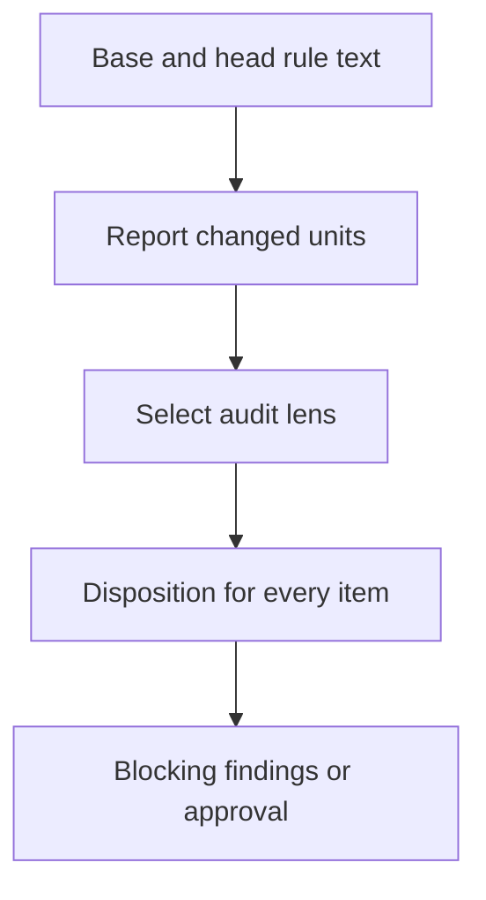

<a id="rule-changes"></a>
# Rule changes

Agents rewriting rule files have silently dropped or weakened approved rules.
Sentence-pinning tests cover samples and reject harmless rewording.
This specification makes changed text visible and requires a review of its meaning.
Readers need Git base/head revisions and a review pack, which contains rules, a task and the change.
The report supplies evidence; a reviewer decides whether meaning and approval survive.

How does changed text reach a mandatory audit?



The [rule-change report](#rule-change-report) precedes the diff in the task context.
The [review disposition](#review-disposition) accounts for every reported item.

<!-- spec-docs:navigation document="rule-changes" -->
<!-- Generated by spec-docs; edit authored declarations. -->

## Overview

Report rule text changes and require an explicit review disposition for each item.

**Audience:** Maintainers and review-service integrators familiar with Git revisions and review packs.

**Scope:** Protected Markdown comparison, review context and mandatory audit dispatch.

**Non-goals:** Automatic semantic approval, sentence-lock test deletion and service implementation.

## Document map

Use this map to choose the next explanation to read.

- [Rule changes](rule-changes.md#rule-changes) — Read the purpose and review boundary.
- [Tour](rule-changes.md#tour) — Follow a removal, weakening, move and re-wrap.
- [Report and review](rule-changes.md#report) — Compare protected text and preserve complete evidence.
- [Requirements](rule-changes.md#requirements) — Find the required report and review results.
- [Decisions](rule-changes.md#decisions) — Read the operator decision and implementation proposals.
- [Open questions](rule-changes.md#questions) — Identify the remaining service integration.
- [Reference](rule-changes.md#reference) — Configure coverage and call the shared selector.
- [Acceptance](rule-changes.md#acceptance) — Run behavior checks and inspect reviewer obligations.

## Entity index

Each technical term below links to its defining Markdown section.

- [Rule-change configuration](rule-changes.md#configuration) (`rule-changes.configuration`) — Rule-change configuration is optional versioned JSON at .rule-changes.json in the review base commit.
- [Review disposition](rule-changes.md#review-disposition) (`rule-changes.review-disposition`) — A review disposition is a reviewer's judgment and evidence for one reported item.
- [Rule-change report](rule-changes.md#rule-change-report) (`rule-changes.rule-change-report`) — A rule-change report is the complete comparison of protected Markdown units between review revisions.
<!-- /spec-docs:navigation -->

<a id="tour"></a>
## Tour

Follow one edit through detection and review. These synthetic files are the complete input.
Both files are protected by the [rule-change configuration](#configuration).

**Base: rules/source.md**

```markdown
# Execution
- Keep the audit record.
- Never skip validation.
- Report every failure.

Wrap this rule across
lines without changing its words.
```

**Head: rules/source.md**

```markdown
# Execution
- Avoid skipping validation.

Wrap this rule across lines without changing its words.
```

**Head: rules/destination.md**

```markdown
# Reporting
- Report every failure.
```

**Procedure: prepare and audit the edit**

1. **Prepare the review.** The report contains a removal, a change with both texts and a move with both locations.
   - The removed text is `Keep the audit record.`
   - The changed text is `Never skip validation.` → `Avoid skipping validation.`
   - The moved text is `Report every failure.`
   - The re-wrap produces no item.
2. **Read the declared changes.** A description section headed `## Rule changes` appears beside the detected items with its original line numbers.
   - Without that section, the report prominently flags an undeclared change.
3. **Audit every item.** The normal panel gains the rule-preservation lens.
   - Without cited approval, the removal and weakening are Blocking findings.
   - The move can receive `same meaning` only after the reviewer checks its destination scope.

<a id="report"></a>
## Report and review

The preparer compares captured Git text before rendering the change or dispatching reviewers.
Its order is [rule-change configuration](#configuration), unit extraction, exact matching, similarity pairing, rendering and lens selection.

<a id="rule-change-report"></a>
### Rule-change report

A rule-change report is the complete comparison of protected Markdown units between review revisions.
It prevents changed obligations from disappearing inside a large diff.
The review base is the merge base of the resolved base and head, matching the preparer's three-dot diff.
The report names both immutable revisions. Working-tree edits do not affect it.

List items and table rows are individual units. Paragraph sentences are individual units.

Fenced code blocks are whole units. Headings describe section scope and are location metadata.
Units retain file, first source line and heading ancestry. Whitespace and Markdown line wrapping normalize away.
List markers and table separator rows carry no rule text. Text inside a unit retains punctuation and strength words.

Exact copies in the same file and section cancel first, including repeated occurrences.
Remaining identical copies pair as moves across files or sections.
Remaining pairs above the configured similarity threshold become changes, in descending similarity order.
Ties use same-file preference, then old and new source order: path, line, section and text.
Unpaired old units are removals; unpaired new units are additions.
This lexical pairing is deterministic evidence organization, never a claim of semantic equivalence.

Every item receives a stable report-local identity and class, old/new locations and old/new text.
Absent sides display `(none)`. Totals include all four classes.
No-change output is one line: `No protected rule text changed.`
The report precedes the change in full preparation and context-only preparation.
The description's Rule changes section is copied verbatim with original line numbers, including any subsections.
A non-empty report without that section prominently says `UNDECLARED RULE CHANGES`.

<a id="review-disposition"></a>
### Review disposition

A review disposition is a reviewer's judgment and evidence for one reported item.
The shared [review bar](../../../prompts/util/review-bar.md) owns the mandatory obligation for every compiled review input.
The [rule-preservation lens](../../../prompts/lenses/rule-preservation.md) owns the element-by-element audit procedure.
Each item receives `same meaning`, `approved change` or `regression`, plus one evidence line.
An approved change cites a description line or recorded decision.

A removal or weakening needs operator approval on record: a `CHANGELOG-RULES.md` entry or the operator's dated words quoted in the description. The author's own declaration approves only same-meaning, stronger, intact moved and new rules.

The lens compares actor, condition, action, strength, numbers, exceptions, scope and cross-references.
It checks destination scope for moves and existing homes for new rules, including conflicts and duplicates.
It reconciles declared and detected changes and checks that removed text has a surviving home or approval.
A regression, missing disposition, unapproved removal or weakening, undeclared change or failed-closed report is Blocking.

<a id="failure-rule-report"></a>
### Failure state: incomplete rule report

This refusal preserves evidence when the complete text cannot fit the configured report size.

**Trigger:** Rendered report text exceeds the configured character limit, or protected inputs or configuration cannot be read correctly.

**Outcome:** Preparation exits nonzero. Oversize output says `FAILED CLOSED` and lists every item's identity, class and old/new location.

**Retained state:** Git and the checkout remain unchanged. The report is derived in memory; no index or approval state is stored.

**Recovery:** The lead narrows the review range or adjusts the base configuration through an approved change, then prepares again.
Malformed or unreadable inputs require repair before preparation. No approval is possible from an incomplete report.

**Authority:** The lead supplies the revised review input; a reviewer cannot waive missing evidence.

**Verification:** [Failure behavior](#test-rule-report-failure).

<a id="requirements"></a>
## Requirements

These obligations implement the [operator decision](#decision-rule-review). Their status is specified; the document remains a proposal for lead acceptance.

<a id="req-rule-report"></a>
### Requirement: report protected changes

Expose every changed unit without treating a lexical match as approval.

**Actor:** Preparer.

**Condition:** A review compares base and head.

**Result:** Produce the [rule-change report](#rule-change-report) using the [rule-change configuration](#configuration), including declarations and deterministic pairing.

**Verification:** Real Git fixture comparisons.

**Tests:** [Detection](#test-rule-report-detection), [coverage](#test-rule-report-coverage), [declarations](#test-rule-report-declarations), [failure behavior](#test-rule-report-failure).

**Status:** specified.

**Basis:** [Operator decision](#decision-rule-review).

<a id="req-rule-review"></a>
### Requirement: dispatch and account for changes

Require a meaning audit rather than sample sentence locks.

**Actor:** Review dispatch process and reviewers.

**Condition:** A report is non-empty.

**Result:** Every reviewer supplies a [review disposition](#review-disposition) per item. Removed, changed or moved items require the rule-preservation lens alongside the normal panel.

**Verification:** Dispatch fixture and prompt inspection.

**Tests:** [Dispatch](#test-rule-report-dispatch), [Inspection: audit procedure](#test-rule-review-contract).

**Status:** specified.

**Basis:** [Operator decision](#decision-rule-review).

<a id="req-rule-portability"></a>
### Requirement: prepare from one copied file

Keep rule detection available to a service that copies only the preparer.

**Actor:** Preparer.

**Condition:** Python 3.9 runs a copied prepare.py in context-only mode.

**Result:** Rule reporting and lens selection use only the standard library and Git. The preparer imports no sibling module.
Existing full-pack and registered-document compilation remains the compiler's responsibility; missing required compiler inputs fail visibly.

**Verification:** Isolated execution and import inspection.

**Tests:** [Portability](#test-rule-report-portability).

**Status:** specified.

**Basis:** [Operator decision](#decision-rule-review).

<a id="decisions"></a>
## Decisions

The operator selected a report plus mandatory review of meaning. Implementation details below are proposals within that scope.

<a id="decision-rule-review"></a>
### Report and mandatory audit

**Choice:** Notify reviewers of rule changes and require an audit against the approved rules.

**Authority:** Operator instruction dated 2026-10-16: “make a script that is not failing tests but notifies about the changes”.
The same instruction requires mandatory re-checking and a focused auditor prompt.

**Reason:** Sentence samples miss omissions and fail on harmless rewording.

**Rejected alternatives:** More sentence locks repeat the defect. Automatic semantic approval would replace the required reviewer judgment.
Existing sentence-lock tests remain in this change; removal is a separate authorized task.

<a id="decision-rule-mechanics"></a>
### Deterministic comparison and base configuration

**Choice:** Use greedy lexical pairing and base-commit [rule-change configuration](#configuration) with fixed default coverage.

**Authority:** Implementation proposal for the lead to accept.

**Reason:** This supplies reproducible evidence without another model call or persistent index.
Base configuration prevents a candidate from reducing its own coverage or increasing its own report allowance.

**Rejected alternatives:** A stored projection duplicates Git. A semantic classifier adds judgment before the mandatory human-readable audit.

<a id="questions"></a>
## Open questions

No implementation choice blocks this repository change. The review-service owner must integrate the selector described in [Reference](#reference).
This repository contains the lane dispatch process, not the service dispatch process; its service adoption remains unverified here.

<a id="reference"></a>
## Reference

Use these interfaces to reproduce the tour and integrate the report.
The [rule-change report](#rule-change-report) and [review disposition](#review-disposition) define their meaning.

<a id="configuration"></a>
### Rule-change configuration

Rule-change configuration is optional versioned JSON at `.rule-changes.json` in the review base commit.
It extends coverage without replacing defaults. Files under `docs/` remain excluded even when an extension matches them.
A new configuration first takes effect after it reaches the base; candidate-only configuration is not active policy.
Unknown fields, unsupported versions, malformed patterns and invalid limits fail preparation visibly.

| Setting | Default | Meaning |
|---|---|---|
| version | 1 | Accepted format |
| extra_protected_paths | [] | Additional repository-relative globs |
| max_report_chars | 80000 | Complete report character allowance |
| similarity_threshold | 0.6 | Minimum changed-pair similarity |

Default protected paths are `INDEX.md`, `STRUCTURE.md`, `PREFERENCES.md`, `INSTALL-AGENTS.md`, `AGENTS.md`, `CHANGELOG-RULES.md`,
`rules/**/*.md`, `prompts/**/*.md`, `skills/**/*.md`, `.agents/rules.md` and `CONTEXT.md`.
Glob `**/` matches zero or more directories; `*` matches within one path segment.
Only regular UTF-8 protected files are accepted. Invalid encoding or nonregular protected inputs fail visibly.

The [preparer](../../../skills/pr-ready/scripts/prepare.py) exposes `review --context-only` for the report and
`rule-lenses CHECKOUT --base BASE --rev HEAD --no-fetch` for dispatch.
The selector prints `rule-preservation` only when a removed, changed or moved item exists.
The lane [panel](../../../skills/pr-ready/scripts/review-panel.sh) adds that lens without replacing the requested reviewers.
The service must run the same selector from its pinned preparer, add the lens from its compiled pack, and honor nonzero preparation status.
There is no automatic service adoption in this repository.

For the tour, the reference counts are one removed, one changed, one moved and zero added.
The moved item names source line 4 and destination line 2; the re-wrap has no item.

<a id="acceptance"></a>
## Acceptance

These cases use synthetic Git commits through the preparer. Runtime results belong to the test runner output.
Each new test must also fail with a deliberate defect in the behavior it protects.

<a id="test-rule-report-detection"></a>
### Detection

Detection checks the caller-visible result.

**Method:** test.

**Requirements:** [Required behavior](#req-rule-report).

**Inputs:** Deleted, weakened, moved, added, re-wrapped and whitespace-only units.

**Expected:** All classes and both texts are correct; harmless wrapping is absent.

**Implementation:** [skills/pr-ready/scripts/test_rule_changes.py::RuleChangesTests::test_removed](../../../skills/pr-ready/scripts/test_rule_changes.py), [skills/pr-ready/scripts/test_rule_changes.py::RuleChangesTests::test_changed](../../../skills/pr-ready/scripts/test_rule_changes.py), [skills/pr-ready/scripts/test_rule_changes.py::RuleChangesTests::test_moved](../../../skills/pr-ready/scripts/test_rule_changes.py), [skills/pr-ready/scripts/test_rule_changes.py::RuleChangesTests::test_rewrap](../../../skills/pr-ready/scripts/test_rule_changes.py), [skills/pr-ready/scripts/test_rule_changes.py::RuleChangesTests::test_added](../../../skills/pr-ready/scripts/test_rule_changes.py), [skills/pr-ready/scripts/test_rule_changes.py::RuleChangesTests::test_units](../../../skills/pr-ready/scripts/test_rule_changes.py), [skills/pr-ready/scripts/test_rule_changes.py::RuleChangesTests::test_deterministic](../../../skills/pr-ready/scripts/test_rule_changes.py)

<a id="test-rule-report-coverage"></a>
### Coverage

Coverage checks the caller-visible result.

**Method:** test.

**Requirements:** [Required behavior](#req-rule-report).

**Inputs:** Default paths, docs, unrelated files and a base [rule-change configuration](#configuration) extension.

**Expected:** Only protected paths are compared, including the repository extension.

**Implementation:** [skills/pr-ready/scripts/test_rule_changes.py::RuleChangesTests::test_coverage](../../../skills/pr-ready/scripts/test_rule_changes.py), [skills/pr-ready/scripts/test_rule_changes.py::RuleChangesTests::test_extended_paths](../../../skills/pr-ready/scripts/test_rule_changes.py), [skills/pr-ready/scripts/test_rule_changes.py::RuleChangesTests::test_base_policy](../../../skills/pr-ready/scripts/test_rule_changes.py)

<a id="test-rule-report-declarations"></a>
### Declarations

Declarations checks the caller-visible result.

**Method:** test.

**Requirements:** [Required behavior](#req-rule-report).

**Inputs:** A description with and without the Rule changes section.

**Expected:** The original section and line numbers appear; missing declaration is prominent.

**Implementation:** [skills/pr-ready/scripts/test_rule_changes.py::RuleChangesTests::test_missing_declaration](../../../skills/pr-ready/scripts/test_rule_changes.py), [skills/pr-ready/scripts/test_rule_changes.py::RuleChangesTests::test_declaration](../../../skills/pr-ready/scripts/test_rule_changes.py)

<a id="test-rule-report-failure"></a>
### Failure behavior

Failure behavior checks the caller-visible result.

**Method:** test.

**Requirements:** [Required behavior](#req-rule-report).

**Inputs:** An oversize report and malformed protected inputs.

**Expected:** Every location survives oversize refusal; invalid input fails visibly.

**Implementation:** [skills/pr-ready/scripts/test_rule_changes.py::RuleChangesTests::test_oversize](../../../skills/pr-ready/scripts/test_rule_changes.py), [skills/pr-ready/scripts/test_rule_changes.py::RuleChangesTests::test_invalid_inputs](../../../skills/pr-ready/scripts/test_rule_changes.py)

<a id="test-rule-report-dispatch"></a>
### Dispatch

Dispatch checks the caller-visible result.

**Method:** test.

**Requirements:** [Required behavior](#req-rule-review).

**Inputs:** Removed, changed, moved, added and unchanged reviews.

**Expected:** The selector and lane panel add the required lens alongside normal reviewers.

**Implementation:** [skills/pr-ready/scripts/test_rule_changes.py::RuleChangesTests::test_selector](../../../skills/pr-ready/scripts/test_rule_changes.py), [skills/pr-ready/scripts/test_rule_changes.py::RuleChangesTests::test_panel_adds_lens](../../../skills/pr-ready/scripts/test_rule_changes.py)

<a id="test-rule-report-portability"></a>
### Portability

Portability checks the caller-visible result.

**Method:** test.

**Requirements:** [Required behavior](#req-rule-portability).

**Inputs:** A lone copied preparer under Python 3.9 and its import declarations.

**Expected:** Reporting works without siblings and all imports use the standard library.

**Implementation:** [skills/pr-ready/scripts/test_rule_changes.py::RuleChangesTests::test_python39](../../../skills/pr-ready/scripts/test_rule_changes.py), [skills/pr-ready/scripts/test_rule_changes.py::RuleChangesTests::test_no_sibling_imports](../../../skills/pr-ready/scripts/test_rule_changes.py)

<a id="test-rule-review-contract"></a>
### Inspection: audit procedure

Inspect reviewer obligations in every compiled pack.

**Method:** inspection.

**Requirements:** [Dispatch and accounting](#req-rule-review).

**Inputs:** Detected items and declared changes from the tour.

**Expected:** Every item receives evidence and a disposition; missing approval or accounting blocks review.

Planned evidence: the [review bar](../../../prompts/util/review-bar.md) and [rule-preservation procedure](../../../prompts/lenses/rule-preservation.md).
