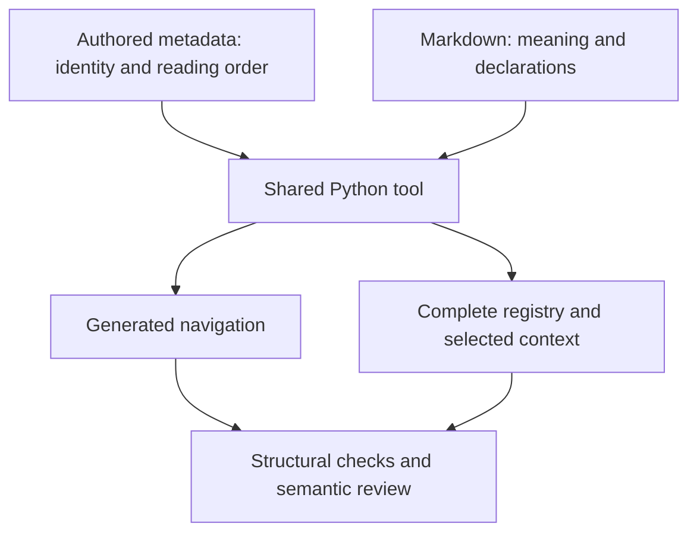

<a id="overview"></a>
# Specification and design-document system

This system keeps technical meaning in ordinary Markdown and checks its declared structure.
Readers follow direct links to definitions and literal values.
Authors maintain shared metadata for identity and reading order.
One Python tool checks those sources and generates navigation and agent context.
Human and agent review establish meaning, readability and test adequacy.
House Rules is the shared repository of operating rules, authoring skills and pinned documentation tools.

<!-- spec-docs:navigation document="spec-system" -->
<!-- Generated by spec-docs; edit authored declarations. -->

## Overview

Keep technical meaning in Markdown and check declared structure without a second writable contract.

**Audience:** Authors, reviewers and tool implementers familiar with Markdown and Git.

**Scope:** Single-file and multi-file specifications, design documents, declarations, navigation and mandatory agent context.

**Non-goals:** Publication server, custom renderer, expression evaluation, general prose formatting and product-specific contracts.

## Document map

- [Specification and design-document system](overview.md#overview) — Understand the system and follow a mismatched-value repair.
  - [Tour: repair a mismatched value](overview.md#tour)
  - [Source document](overview.md#source-document)
  - [Addressable section](overview.md#addressable-section)
  - [Registered entity](overview.md#registered-entity)
- [Minimal corpus](example.md#minimal-example) — Set up a passing specification from three authored files.
  - [docs/DOCUMENTS.json](example.md#example-documents)
  - [docs/ENTITIES.json](example.md#example-entities)
  - [docs/example.md](example.md#example-example)
  - [Generate and check](example.md#example-checking)
- [Setup and use](checking.md#checking) — Use the pinned tool to check sources and rebuild navigation.
  - [Tool environment](checking.md#tool-environment)
  - [Documentation checker](checking.md#documentation-checker)
  - [Navigation generation](checking.md#navigation-generation)
- [Sources, homes and declarations](sources.md#sources) — Declare homes, literal values, requirements, tests and recovery.
  - [Document manifest](sources.md#document-manifest)
  - [Entity index](sources.md#entity-index)
  - [Canonical fact](sources.md#canonical-fact)
  - [Requirement declaration](sources.md#requirement-declaration)
  - [Acceptance test](sources.md#acceptance-test)
  - [Scenario](sources.md#scenario)
  - [Failure declaration](sources.md#failure-declaration)
- [Snapshots, agent context and review](context.md#context) — Prepare complete snapshot-isolated assignments and semantic review.
  - [Source snapshot](context.md#source-snapshot)
  - [Complete registry](context.md#complete-registry)
  - [Context pack](context.md#context-pack)
  - [Semantic review](context.md#semantic-review)
- [Source formats](formats.md#source-format) — Look up exact JSON shapes, declarations and callable inputs.
  - [Sources and commands](formats.md#sources-and-commands)
  - [Metadata](formats.md#metadata)
  - [Markdown declarations](formats.md#markdown-declarations)
  - [Navigation](formats.md#navigation)
  - [Callable core and context assignment](formats.md#callable-core-and-context-assignment)
- [Reference, decisions and adoption](reference.md#reference) — Find exact interfaces, diagnostics, settled decisions and adoption duties.
  - [Interfaces and encodings](reference.md#interfaces)
  - [Writing profile](reference.md#writing-profile)
  - [Diagnostic reference](reference.md#diagnostics)
  - [Decisions](reference.md#decisions)
  - [Open questions](reference.md#open-questions)
  - [Adoption and ownership](reference.md#adoption)
- [Acceptance evidence](acceptance.md#acceptance) — Prove structural behavior and real authoring and review acceptance.
  - [Document roles](acceptance.md#test-roles)
  - [Homes and names](acceptance.md#test-homes)
  - [Literal values](acceptance.md#test-literals)
  - [Traceability and change selection](acceptance.md#test-traceability)
  - [Failure completeness](acceptance.md#test-failures)
  - [Checker failures](acceptance.md#test-checking)
  - [Navigation and interrupted output](acceptance.md#test-navigation)
  - [Toolchain ownership](acceptance.md#test-toolchain)
  - [Snapshot isolation and invalidation](acceptance.md#test-snapshots)
  - [Context selection](acceptance.md#test-context)
  - [Writing profile](acceptance.md#test-profile)
  - [Real authoring and review](acceptance.md#test-real-use)

## Entity index

- [Prompt compiler](../../design/76-review-entry-skill.md#prompt-compiler) (`review-entry-skill.prompt-compiler`) — Prompt compiler: skills/pr-ready/scripts/prompt.py.
The pack-assembly design requires the compiler to read Git objects from a named House Rules commit
(pack-assembly design (#77)).
- [Acceptance test](sources.md#acceptance-test) (`spec-system.acceptance-test`) — An acceptance test declares a verification method, inputs, pass condition and reciprocal requirement links.
- [Addressable section](overview.md#addressable-section) (`spec-system.addressable-section`) — An addressable section is a stable named part of a source document.
- [Canonical fact](sources.md#canonical-fact) (`spec-system.canonical-fact`) — A canonical fact is a named literal value declared in a table cell at its owning entity's home.
- [Complete registry](context.md#complete-registry) (`spec-system.complete-registry`) — The complete registry is a generated combination of every entity's identity, names, meaning, literal facts and home.
- [Context pack](context.md#context-pack) (`spec-system.context-pack`) — A context pack contains the complete mandatory documentation input for an explicit authoring or review assignment.
- [Document manifest](sources.md#document-manifest) (`spec-system.document-manifest`) — The document manifest is the repository's JSON declaration of document inventory, purpose, audience, scope and section reading order.
- [Documentation checker](checking.md#documentation-checker) (`spec-system.documentation-checker`) — The documentation checker is the shared Python parser and validator for selected Markdown and metadata bytes.
- [Entity index](sources.md#entity-index) (`spec-system.entity-index`) — The entity index is the repository's JSON authority for concept identities, classification, applicability, names and home locations.
- [Failure declaration](sources.md#failure-declaration) (`spec-system.failure-declaration`) — A failure declaration states how a stopping mechanism affects its caller and what recovery requires.
- [Navigation generation](checking.md#navigation-generation) (`spec-system.navigation-generation`) — Navigation generation projects authored purpose, audience, summaries, reading order and entity homes into deterministic Markdown.
- [Registered entity](overview.md#registered-entity) (`spec-system.registered-entity`) — A registered entity is a concept whose identity and names resolve to one Markdown home containing its meaning.
- [Requirement declaration](sources.md#requirement-declaration) (`spec-system.requirement-declaration`) — A requirement declaration states an actor, condition, observable result, verification, linked tests, Status and Basis.
- [Scenario](sources.md#scenario) (`spec-system.scenario`) — A scenario follows concrete inputs, actions and expected results across sections.
- [Semantic review](context.md#semantic-review) (`spec-system.semantic-review`) — Semantic review establishes whether checked documents explain correct behavior and provide adequate evidence.
- [Source document](overview.md#source-document) (`spec-system.source-document`) — A source document declares a technical purpose, audience, scope and reading order across one or more Markdown files.
- [Source snapshot](context.md#source-snapshot) (`spec-system.source-snapshot`) — A source snapshot is one immutable set of repository paths and bytes selected for checking, generation or assignment.
- [Tool environment](checking.md#tool-environment) (`spec-system.tool-environment`) — The tool environment is an isolated Python installation using dependencies owned by the shared spec-writing tool.
- [Writing profile](reference.md#writing-profile) (`spec-system.writing-profile`) — The writing profile is the versioned set of controlled-language practices owned by rules/writing.md.
- [Dispatcher](../../design/75-subagent-profiles.md#dispatcher) (`subagent-profiles.dispatcher`) — Dispatcher: the session or script that starts a subagent and writes its task.
<!-- /spec-docs:navigation -->

A separate renderer may consume checked Markdown.
House Rules owns no HTML publication pipeline.

The [document manifest](sources.md#document-manifest) declares purpose and reading order.
The [entity index](sources.md#entity-index) assigns identities and homes.
The [documentation checker](checking.md#documentation-checker) derives navigation and complete agent inputs from those sources.



**Entities in this example:** [document manifest](sources.md#document-manifest),
[entity index](sources.md#entity-index), [documentation checker](checking.md#documentation-checker),
[complete registry](context.md#complete-registry), [context pack](context.md#context-pack),
[semantic review](context.md#semantic-review).

Read the walkthrough below, then create a passing specification from the [minimal corpus](example.md#minimal-example).
Continue with setup and use, declaration rules, context preparation, exact formats, reference and acceptance evidence, in the map's order.

<a id="tour"></a>
## Tour: repair a mismatched value

A small synthetic specification declares a batch capacity.
Its [canonical fact](sources.md#canonical-fact) has the literal value `1 024`.
A [requirement declaration](sources.md#requirement-declaration) uses that value through a direct link.
An [acceptance test](sources.md#acceptance-test) links back to the requirement.
This story follows a value mismatch through checking, repair and review.
It adds no product contract.

**Procedure: follow a capacity correction**

1. **Declare the capacity.**
   - Put an empty `id` anchor in the Key cell of a value table.
   - Store `1 024` in its Value cell.
   - Set Status to `specified` and Basis to the approving decision link.
   - The capacity counts items in one synthetic batch.
2. **Write a linked use.**
   - Display `2048` in a link targeting the capacity's anchor.
   - The link resolves, but its text differs from the [canonical fact](sources.md#canonical-fact).
3. **Check the selected bytes.**
   - The [documentation checker](checking.md#documentation-checker) reports `D10` at the use.
   - The process returns [1](checking.md#checker-document-errors), identifying document errors.
   - The sources and previous generated output remain available for repair.
4. **Correct the use.**
   - Change the link label to `1024`.
   - Grouping normalization makes it equal to the [canonical fact](sources.md#canonical-fact).
   - No conversion, expression evaluation or independent default is introduced.
5. **Review the checked result.**
   - Regenerate navigation and a [context pack](context.md#context-pack) from the same selected bytes.
   - Reviewers confirm that the capacity means items per batch.
   - Reviewers check whether the [acceptance test](sources.md#acceptance-test) proves the linked [requirement declaration](sources.md#requirement-declaration).

The [literal-value acceptance case](acceptance.md#test-literals) proves the comparison in this story.
The [repair walkthrough](#capacity-repair) joins the structural and review paths.
The remaining mechanisms explain where declarations live, how checking works and how agents receive context.

<a id="capacity-repair"></a>
### Scenario: capacity repair

**Purpose:** Follow one incorrect displayed value through refusal and repair.

**Inputs:** A literal capacity of `1 024`; a linked use displaying `2048`.

**Expected:** Checking refuses the mismatch; a corrected `1024` passes literal comparison.

**Requirements:** [Literal equality](sources.md#req-literals), [visible refusal](checking.md#req-checking), [mandatory context](context.md#req-context).

**Tests:** [Literal values](acceptance.md#test-literals), [checker failures](acceptance.md#test-checking), [context selection](acceptance.md#test-context).

<a id="source-document"></a>
## Source document

A source document declares a technical purpose, audience, scope and reading order across one or more Markdown files.

A single-file design stays in its normal location.
It uses the repository's shared metadata and one generated navigation region.
It needs no private directory, companion glossary or exclusion file.

A specification explains maintained behavior.
A design document also supplies current evidence, constraints, alternatives, ownership, integration, rollout, work packages and acceptance evidence.
When design intent becomes maintained specification, move the current home instead of retaining two contracts.
Retained pointers follow the existing [skills/design-flow/SKILL.md](../../../skills/design-flow/SKILL.md).

Every document supplies a tour, mechanisms, requirements, acceptance, decisions, questions and reference.
Purpose, audience, scope and non-goals explain the reader's task and prerequisites.
An inapplicable role says “None” and explains why.
A draft may expose gaps; approval refuses an unresolved contract that prevents implementation.
The [role requirement](sources.md#req-roles) makes these declarations checkable.

<a id="addressable-section"></a>
## Addressable section

An addressable section is a stable named part of a [source document](#source-document).

For first-use linking, each level-2 section includes its level-3 and deeper subsections.
The opening text before the first level-2 heading has its own scope.
Heading text never contains links and does not count as a first use.
For assignment and home extraction, a heading instead selects its complete subtree through the next heading of equal or higher level.
These boundaries serve different operations.

The [document manifest](sources.md#document-manifest) sets reading order.
Source order sets position within each selected section.
A home in another document always counts as ahead of the reader.
Documents have no shared reading order.

Document, section, entity, fact and test identities survive title changes and reordering.
Local destinations use explicit empty `id` anchors.
Unreleased material requires no permanent redirects.
Moving a home changes its index entry and incoming links together.

For example, the nested headings below illustrate both boundaries:

```markdown
## Parent
Parent introduction.
### Child
Child introduction.
## Next
```

A home or assignment at Parent includes Child and stops before Next.
First-use linking resets at Next, but not at Child.
The first use in Parent's text links to its home; a later use in Child may be plain after that home has appeared.
Every use before its home still links, including uses in Child.
Several child homes may belong to one manifest section, each with its own anchor and definition.

<a id="registered-entity"></a>
## Registered entity

A registered entity is a concept whose identity and names resolve to one Markdown home containing its meaning.

Several entities may share an [addressable section](#addressable-section).
Each still has a distinct home anchor and complete entry.
The home anchor immediately precedes its heading.
The first paragraph defines meaning.
The home includes nested declarations and examples through the next heading of equal or higher level.

The [entity index](sources.md#entity-index) owns identity, classification, accepted forms, rejected forms and home location.
The Markdown home owns meaning, facts and operational explanation.
The generated [complete registry](context.md#complete-registry) combines both sources.
Authors never edit that generated combination.

Examples, diagrams and summaries illustrate obligations; they do not add obligations.
Excluded features remain in scope or non-goals text.
Exclusion alone creates no operational home or generated exclusion file.
The [home and linking requirement](sources.md#req-homes) preserves one writable authority.
