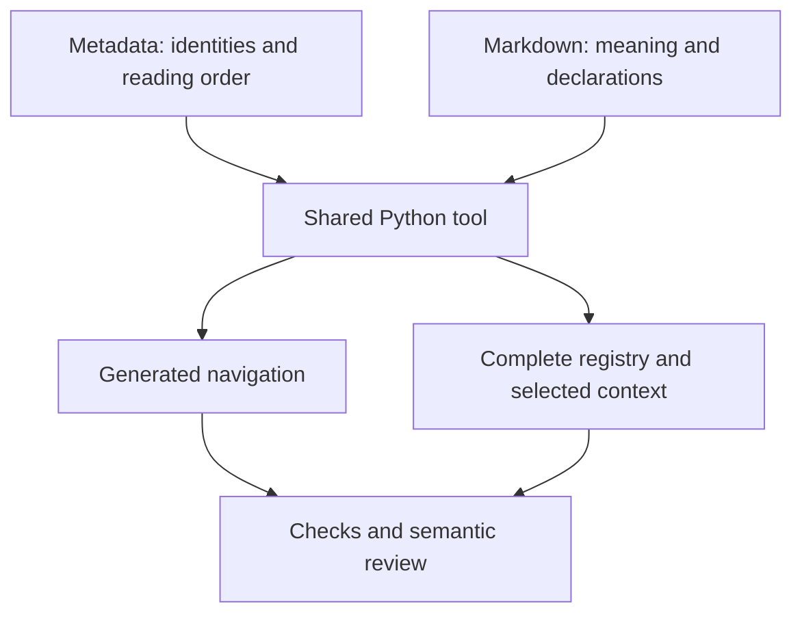

# Specification and design-document system

This system helps authors write specifications that readers can follow and engineers can implement.
Markdown holds technical meaning; shared metadata identifies its homes and reading order.
One Python tool checks those sources and generates navigation and complete agent inputs.
Review establishes whether the document explains the right behavior and proves its requirements.

Which authored inputs produce the navigation and evidence an agent needs?

**Entities in this example:** [document manifest](document-manifest.md#document-manifest),
[entity index](entity-index.md#entity-index), [documentation checker](documentation-checker.md#documentation-checker),
[complete registry](complete-registry.md#complete-registry), [context pack](context-pack.md#context-pack),
[semantic review](semantic-review.md#semantic-review).

<!-- spec-docs:navigation document="spec-system" -->
<!-- Generated by spec-docs; edit authored declarations. -->

## Overview

Keep technical meaning in Markdown and check declared structure without a second writable contract.

**Audience:** Authors, reviewers and tool implementers familiar with Markdown and Git.

**Scope:** Single-file and multi-file specifications, design documents, declarations, navigation and mandatory agent context.

**Non-goals:** Publication server, custom renderer, expression evaluation, general prose formatting and product-specific contracts.

## Document map

Use this map to choose the next explanation to read.

- [Specification and design-document system](specification-and-design-document-system.md#overview) — Follow a batch refusal from its authored contract to checked agent context.
  - [Tour: repair the bounded-batch example](specification-and-design-document-system.md#tour)
- [Source document](source-document.md#source-document) — Distinguish authored contracts from generated navigation and context.
- [Addressable section](addressable-section.md#addressable-section) — Select complete explanations by stable anchors and heading boundaries.
  Prerequisites: [Source document](source-document.md#source-document).
- [Registered entity](registered-entity.md#registered-entity) — Locate each technical meaning and its canonical declarations at one home.
  Prerequisites: [Addressable section](addressable-section.md#addressable-section).
- [Document manifest](document-manifest.md#document-manifest) — Declare document scope, reading order and input classifications.
- [Entity index](entity-index.md#entity-index) — Register accepted names, symbols and their owning explanations.
  Prerequisites: [Registered entity](registered-entity.md#registered-entity).
- [Canonical fact](canonical-fact.md#canonical-fact) — Declare a literal once and detect conflicting displayed values.
  Prerequisites: [Registered entity](registered-entity.md#registered-entity).
- [Requirement declaration](requirement-declaration.md#requirement-declaration) — State observable behavior and link its acceptance evidence.
  Prerequisites: [Registered entity](registered-entity.md#registered-entity).
- [Acceptance test](acceptance-test.md#acceptance-test) — Choose executable selectors or inspection evidence for an obligation.
  Prerequisites: [Requirement declaration](requirement-declaration.md#requirement-declaration).
- [Scenario](scenario.md#scenario) — Trace one behavior through its actions, requirements and evidence.
  Prerequisites: [Acceptance test](acceptance-test.md#acceptance-test).
- [Failure declaration](failure-declaration.md#failure-declaration) — Explain a refusal, retained state and authorized recovery.
  Prerequisites: [Acceptance test](acceptance-test.md#acceptance-test).
- [Tool environment](tool-environment.md#tool-environment) — Run the shared checker with the pinned interpreter and parser dependencies.
- [Documentation checker](documentation-checker.md#documentation-checker) — Find structural contradictions and report every available diagnostic.
  Prerequisites: [Tool environment](tool-environment.md#tool-environment).
- [Navigation generation](navigation-generation.md#navigation-generation) — Project authored metadata into a map without creating another authority.
  Prerequisites: [Document manifest](document-manifest.md#document-manifest), [Entity index](entity-index.md#entity-index).
- [Source snapshot](source-snapshot.md#source-snapshot) — Choose immutable bytes from the working tree, index or commit.
- [Complete registry](complete-registry.md#complete-registry) — Build complete reference input from metadata and entity homes.
  Prerequisites: [Entity index](entity-index.md#entity-index).
- [Context pack](context-pack.md#context-pack) — Select mandatory reading material and refuse missing or oversized assignments.
  Prerequisites: [Complete registry](complete-registry.md#complete-registry), [Source snapshot](source-snapshot.md#source-snapshot).
- [Writing profile](writing-profile.md#writing-profile) — Distinguish advisory prose counters from demonstrated reader problems.
- [Semantic review](semantic-review.md#semantic-review) — Assess meaning, readability and evidence beyond structural success.
- [Adoption and ownership](adoption-and-ownership.md#adoption) — Share one pinned tool across authoring, checking and context preparation.
  - [Implementation work packages](adoption-and-ownership.md#work-packages)
- [Requirements](requirements.md#requirements) — Find the observable obligations and their verification links.
- [Decisions](decisions.md#decisions) — Read the source, tool and rollout choices with their authority.
  - [Open questions](decisions.md#open-questions)
- [Source formats](source-formats.md#source-format) — Construct valid metadata, declarations and callable inputs.
  - [Sources and commands](source-formats.md#sources-and-commands)
  - [Metadata](source-formats.md#metadata)
  - [Markdown declarations](source-formats.md#markdown-declarations)
  - [Navigation](source-formats.md#navigation)
  - [Callable core and context assignment](source-formats.md#callable-core-and-context-assignment)
  Prerequisites: [Addressable section](addressable-section.md#addressable-section), [Entity index](entity-index.md#entity-index).
- [Minimal corpus](minimal-corpus.md#minimal-example) — Build and check a complete batch-refusal contract in an independent repository.
  - [docs/DOCUMENTS.json](minimal-corpus.md#example-documents)
  - [docs/ENTITIES.json](minimal-corpus.md#example-entities)
  - [docs/example.md](minimal-corpus.md#example-example)
  - [Generate and check](minimal-corpus.md#example-checking)
  Prerequisites: [Source formats](source-formats.md#source-format).
- [Interfaces and encodings](interfaces-and-encodings.md#interfaces) — Look up exact diagnostic codes and executable-selector behavior.
  - [Diagnostic reference](interfaces-and-encodings.md#diagnostics)
  - [Selector audit](interfaces-and-encodings.md#selector-audit)
  - [Bounded-batch lookup](interfaces-and-encodings.md#continuing-example-reference)
- [Acceptance evidence](acceptance-evidence.md#acceptance) — Run the evidence linked to each system obligation.
  - [Document roles](acceptance-evidence.md#test-roles)
  - [Homes and names](acceptance-evidence.md#test-homes)
  - [Literal values](acceptance-evidence.md#test-literals)
  - [Traceability and change selection](acceptance-evidence.md#test-traceability)
  - [Failure completeness](acceptance-evidence.md#test-failures)
  - [Checker failures](acceptance-evidence.md#test-checking)
  - [Navigation and interrupted output](acceptance-evidence.md#test-navigation)
  - [Toolchain ownership](acceptance-evidence.md#test-toolchain)
  - [Snapshot isolation and invalidation](acceptance-evidence.md#test-snapshots)
  - [Context selection](acceptance-evidence.md#test-context)
  - [Writing profile](acceptance-evidence.md#test-profile)
  - [Real authoring and review](acceptance-evidence.md#test-real-use)

## Entity index

Use this index to find each registered meaning at its home.

- [Prompt compiler](../../design/76-review-entry-skill.md#prompt-compiler) (`review-entry-skill.prompt-compiler`) — The prompt compiler assembles complete worker instructions from a named House Rules commit.
- [Acceptance test](acceptance-test.md#acceptance-test) (`spec-system.acceptance-test`) — An acceptance test makes a requirement assessable through a declared method, inputs and pass condition.
- [Addressable section](addressable-section.md#addressable-section) (`spec-system.addressable-section`) — An addressable section gives readers and assignments a stable destination containing one complete explanation.
- [Canonical fact](canonical-fact.md#canonical-fact) (`spec-system.canonical-fact`) — A canonical fact is a named literal value declared once, in a table at its owner's home.
- [Complete registry](complete-registry.md#complete-registry) (`spec-system.complete-registry`) — The complete registry gives agents every declared identity, meaning, literal fact and home in one generated input.
- [Context pack](context-pack.md#context-pack) (`spec-system.context-pack`) — A context pack gives an assigned agent the complete mandatory explanations from one selected source version.
- [Document manifest](document-manifest.md#document-manifest) (`spec-system.document-manifest`) — The document manifest guides readers through the declared purpose, scope and section order of each document.
- [Documentation checker](documentation-checker.md#documentation-checker) (`spec-system.documentation-checker`) — The documentation checker finds structural contradictions in one selected set of Markdown and metadata bytes.
- [Entity index](entity-index.md#entity-index) (`spec-system.entity-index`) — The entity index prevents naming ambiguity by assigning identities, accepted names and one home to each concept.
- [Failure declaration](failure-declaration.md#failure-declaration) (`spec-system.failure-declaration`) — A failure declaration helps callers recover by explaining a refusal, retained state and required authority.
- [Navigation generation](navigation-generation.md#navigation-generation) (`spec-system.navigation-generation`) — Navigation generation helps readers find explanations by projecting authored metadata and homes into deterministic Markdown.
- [Registered entity](registered-entity.md#registered-entity) (`spec-system.registered-entity`) — A registered entity lets readers resolve one technical meaning through a permanent identity and one Markdown home.
- [Requirement declaration](requirement-declaration.md#requirement-declaration) (`spec-system.requirement-declaration`) — A requirement declaration makes an obligation verifiable by naming its actor, condition, result and linked tests.
- [Scenario](scenario.md#scenario) (`spec-system.scenario`) — A scenario connects concrete actions and caller-visible results across the sections that explain them.
- [Semantic review](semantic-review.md#semantic-review) (`spec-system.semantic-review`) — Semantic review finds incorrect meaning and missing explanation that structural checks cannot establish.
- [Source document](source-document.md#source-document) (`spec-system.source-document`) — A source document gives readers one ordered explanation of a technical contract across Markdown files.
- [Source snapshot](source-snapshot.md#source-snapshot) (`spec-system.source-snapshot`) — A source snapshot prevents mixed-version checks by capturing one immutable set of repository paths and bytes.
- [Tool environment](tool-environment.md#tool-environment) (`spec-system.tool-environment`) — The tool environment prevents parser drift by isolating the shared tool and its pinned Python dependencies.
- [Writing profile](writing-profile.md#writing-profile) (`spec-system.writing-profile`) — The writing profile helps authors preserve readable explanations through the versioned practices in rules/writing.md.
- [Dispatcher](../../design/75-subagent-profiles.md#dispatcher) (`subagent-profiles.dispatcher`) — Dispatcher: the session or script that starts a subagent and writes its task.
<!-- /spec-docs:navigation -->

The map identifies source owners and the tool's derived outputs.
The tool never replaces the explanation with a second contract.
A renderer consumes checked Markdown separately.
The following tour is enough to understand the ordinary authoring loop.
Exact declarations are explained later in [Source formats](source-formats.md#source-format).

## Tour: repair the bounded-batch example

This tour shows how an author finds and repairs a value that disagrees with its declared home.
One synthetic batcher accepts items until its batch is full.
Its [minimal corpus](minimal-corpus.md#minimal-example) supplies the same example used throughout the following chapters and reference.
The product refusal keeps existing items; documentation checking independently refuses a false statement about that capacity.

**Procedure: follow a capacity correction**

1. **Declare the batch's capacity.** The author gives the limit one home; readers can follow a direct link to it.

   > **Detail — the example's source**
   >
   > The example's value table declares `capacity` as `2`, with Status `specified` and a linked teaching decision.
   > Its refusal is `Full`; the submitted item is not added.

2. **Introduce a wrong displayed value.** The author checks the document and receives a diagnostic at the incorrect link.

   > **Detail — mismatched literal**
   >
   > A link displays `3` while targeting the capacity row.
   > Checking reports `D10` and exits with [document-errors](documentation-checker.md#checker-document-errors).
   > The authored source and previous output remain available.

3. **Correct the displayed value.** The author checks again and receives a successful structural result.

   > **Detail — repair**
   >
   > Replace the label with `2`; do not change the table to match the mistaken label.
   > The [literal-value check](acceptance-evidence.md#test-literals) compares the displayed text with the home.

4. **Prepare review input.** Reviewers receive the checked example and its complete relevant explanations.

   > **Detail — selection**
   >
   > Select `example#main` from the minimal corpus.
   > The [context pack](context-pack.md#context-pack), a generated assignment input, includes the complete batcher home.
   > Reviewers inspect the full-batch refusal and its retained items.

The declaration mechanism is explained later in [Canonical fact](canonical-fact.md#canonical-fact).
Input selection is explained later in [Context pack](context-pack.md#context-pack).
The reference provides the exact files for this same story; its [checked example](acceptance-evidence.md#test-literals) is executable evidence.

### Scenario: capacity repair

This [scenario](scenario.md#scenario) connects the wrong label, visible refusal, correction and review input.

**Purpose:** Follow one incorrect displayed value through refusal and repair.

**Inputs:** The bounded-batch example, its capacity row, and a linked label that disagrees.

**Expected:** Checking refuses the mismatch; the corrected label passes literal comparison.

**Requirements:** [Literal equality](requirements.md#req-literals), [visible refusal](requirements.md#req-checking), [mandatory context](requirements.md#req-context).

**Tests:** [Literal values](acceptance-evidence.md#test-literals), [checker failures](acceptance-evidence.md#test-checking), [context selection](acceptance-evidence.md#test-context).
