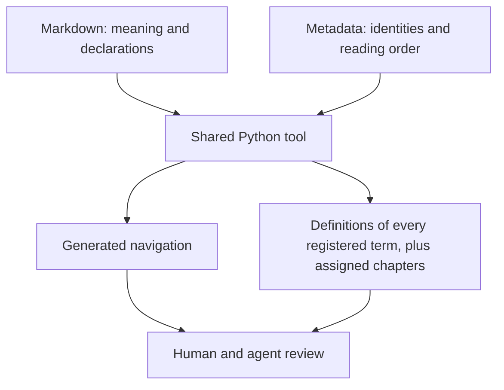

<a id="overview"></a>
# Specification and design-document system

The specification and design-document system helps authors keep technical contracts in Markdown and give readers checked navigation to their explanations. The shared Python tool also prepares complete reading material for assigned agents. Reviewers use that material to assess behavior and evidence beyond what structural checks can establish.

Which authored inputs become navigation and complete agent reading material?



The diagram separates authored inputs from rebuildable outputs. The [document manifest](documents-homes-and-values.md#document-manifest) lists chapters and their reading order. The [entity index](documents-homes-and-values.md#entity-index) maps technical names to their defining sections. Both identify Markdown explanations without copying their meaning.

House Rules is the repository that owns the authoring rules and documentation tool. This document assumes Markdown headings, links and basic Git snapshots. Its [design-flow approval procedure](../../../skills/design-flow/SKILL.md) is an additional prerequisite for deciding approval eligibility and delegated authority.

Read the map to choose a chapter, or continue with the [tour](tour-fixing-a-wrong-capacity.md#tour) for the author-facing repair. Mechanisms explain why the repair works; reference chapters supply exact inputs and commands. [Acceptance evidence](acceptance-evidence.md#acceptance) identifies the required verification.

<!-- spec-docs:navigation document="spec-system" -->
<!-- Generated by spec-docs; edit authored declarations. -->

## Overview

Authors write Markdown and metadata; the tool checks them and generates navigation and agent reading packages.

**Audience:** Specification and design-document authors, reviewers and tool implementers familiar with Markdown links, headings and basic Git snapshots; approval eligibility additionally requires the design-flow procedure named in the introduction.

**Scope:** Single-file and multi-file specifications and designs: who owns meanings and values, how checking and review work, and how agents receive material captured from one repository version.

**Non-goals:** Product contracts, HTML publication, a renderer, expression evaluation, semantic measurement conversion, independent requirement stores and general prose formatting.

## Document map

Use this map to choose the next explanation to read.

- [Specification and design-document system](specification-and-design-document-system.md#overview) — Choose a reading path and see which authored sources produce checked navigation and agent input.
  - [Continuing example](specification-and-design-document-system.md#continuing-example)
- [Tour: fixing a wrong capacity](tour-fixing-a-wrong-capacity.md#tour) — Follow a wrong capacity link through a visible error, correction, regenerated map and complete review input.
  - [The capacity correction](tour-fixing-a-wrong-capacity.md#capacity-repair)
- [Documents, homes and values](documents-homes-and-values.md#shared-contract) — Place meanings and values once, then connect reading order, accepted names and direct links to those homes.
  - [Sources and reading order](documents-homes-and-values.md#sources-and-reading-order)
  - [Names and home locations](documents-homes-and-values.md#names-homes-and-values)
  - [Single-file designs and maintained specifications](documents-homes-and-values.md#design-lifecycle)
- [Requirements, tests and failures](requirements-tests-and-failures.md#behavior-and-change) — Connect obligations, refusals and evidence, then determine which tests a changed contract brings into review.
  - [Behavior and evidence](requirements-tests-and-failures.md#behavior-and-evidence)
  - [Reviewing a changed contract](requirements-tests-and-failures.md#change-review)
  Prerequisites: [Documents, homes and values](documents-homes-and-values.md#shared-contract).
- [Checking and navigation](checking-and-navigation.md#checking-and-navigation) — Run the pinned checker, distinguish errors from warnings and rebuild valid navigation after a failed or interrupted generation.
  - [Toolchain and input boundaries](checking-and-navigation.md#toolchain-and-inputs)
  - [Checking and replacement](checking-and-navigation.md#checking-and-replacement)
  Prerequisites: [Documents, homes and values](documents-homes-and-values.md#shared-contract), [Requirements, tests and failures](requirements-tests-and-failures.md#behavior-and-change).
- [Agent context](agent-context.md#agent-context) — Select complete explanations from one snapshot and refuse unknown, stale or excessive assignments before dispatch.
  - [Complete registry](agent-context.md#complete-registry)
  - [Context pack](agent-context.md#context-pack)
  - [Snapshot and selection](agent-context.md#snapshot-and-selection)
  - [Dispatch and invalidation](agent-context.md#dispatch-and-invalidation)
  Prerequisites: [Documents, homes and values](documents-homes-and-values.md#shared-contract), [Requirements, tests and failures](requirements-tests-and-failures.md#behavior-and-change), [Checking and navigation](checking-and-navigation.md#checking-and-navigation).
- [Writing and review workflow](writing-and-review-workflow.md#authoring-and-review) — Assign source ownership, review technical meaning and qualify real authoring without mistaking a structural pass for reader acceptance.
  - [Ownership and readable explanation](writing-and-review-workflow.md#ownership-and-readable-explanation)
  - [Writing profile](writing-and-review-workflow.md#writing-profile)
  - [Semantic review](writing-and-review-workflow.md#semantic-review)
  - [Review and adoption](writing-and-review-workflow.md#review-and-adoption)
  Prerequisites: [Documents, homes and values](documents-homes-and-values.md#shared-contract), [Requirements, tests and failures](requirements-tests-and-failures.md#behavior-and-change), [Agent context](agent-context.md#agent-context).
- [Requirements](requirements.md#requirements) — Find the observable obligations for authoring, checking, generation, context and review with reciprocal verification links.
  - [Required system behavior](requirements.md#requirement-coverage)
  Prerequisites: [Documents, homes and values](documents-homes-and-values.md#shared-contract), [Requirements, tests and failures](requirements-tests-and-failures.md#behavior-and-change), [Checking and navigation](checking-and-navigation.md#checking-and-navigation), [Agent context](agent-context.md#agent-context), [Writing and review workflow](writing-and-review-workflow.md#authoring-and-review).
- [Decisions and open questions](decisions-and-open-questions.md#decisions) — Distinguish settled source and tool choices from unresolved differences between rules, code and approved intent.
  - [Settled choices and alternatives](decisions-and-open-questions.md#settled-choices)
  - [Open questions](decisions-and-open-questions.md#open-questions)
  Prerequisites: [Documents, homes and values](documents-homes-and-values.md#shared-contract), [Requirements, tests and failures](requirements-tests-and-failures.md#behavior-and-change), [Agent context](agent-context.md#agent-context).
- [Source formats](source-formats.md#source-format) — Look up exact metadata keys, declaration grammar and callable assignments after learning what each source contributes.
  - [Sources and commands](source-formats.md#sources-and-commands)
  - [Tool environment](source-formats.md#tool-environment)
  - [Metadata](source-formats.md#metadata)
  - [Markdown declarations](source-formats.md#markdown-declarations)
  - [Navigation](source-formats.md#navigation)
  - [Callable core and context assignment](source-formats.md#callable-core-and-context-assignment)
  Prerequisites: [Documents, homes and values](documents-homes-and-values.md#shared-contract), [Requirements, tests and failures](requirements-tests-and-failures.md#behavior-and-change), [Checking and navigation](checking-and-navigation.md#checking-and-navigation), [Agent context](agent-context.md#agent-context).
- [Minimal corpus](minimal-corpus.md#minimal-example) — Reproduce the bounded-batch fixture in an independent repository and inspect the exact files used throughout the tour.
  - [Document manifest input](minimal-corpus.md#example-documents)
  - [Entity index input](minimal-corpus.md#example-entities)
  - [Markdown input](minimal-corpus.md#example-example)
  - [Generate and check](minimal-corpus.md#example-checking)
  Prerequisites: [Source formats](source-formats.md#source-format).
- [Interfaces and encodings](interfaces-and-encodings.md#commands-and-diagnostics) — Choose the command or diagnostic remedy for the batch correction and inspect executable-selector audit results.
  - [Diagnostic reference](interfaces-and-encodings.md#diagnostics)
  - [Selector audit](interfaces-and-encodings.md#selector-audit)
  - [Bounded-batch lookup](interfaces-and-encodings.md#continuing-example-reference)
  Prerequisites: [Checking and navigation](checking-and-navigation.md#checking-and-navigation), [Agent context](agent-context.md#agent-context).
- [Acceptance evidence](acceptance-evidence.md#acceptance) — Find behavioral regressions and real-run evidence that prove each obligation, including reader understanding and visible recovery.
  - [Verification coverage](acceptance-evidence.md#planned-acceptance)
  Prerequisites: [Requirements](requirements.md#requirements).

## Entity index

Each technical term below links to its defining Markdown section.

- [Prompt compiler](../../design/76-review-entry-skill.md#prompt-compiler) (`review-entry-skill.prompt-compiler`) — The prompt compiler assembles complete worker instructions from a named House Rules commit.
- [Acceptance test](requirements-tests-and-failures.md#acceptance-test) (`spec-system.acceptance-test`) — An acceptance test is an identified verification case with a method, inputs and expected result linked to requirements.
- [Addressable section](documents-homes-and-values.md#addressable-section) (`spec-system.addressable-section`) — An addressable section is a named heading subtree with a stable identity and an explicit anchor.
- [Canonical fact](documents-homes-and-values.md#canonical-fact) (`spec-system.canonical-fact`) — A canonical fact is a named literal value declared once in a table at its entity's home.
- [Complete registry](agent-context.md#complete-registry) (`spec-system.complete-registry`) — The complete registry is a generated record of every registered entity, its definition, home, names and literal facts in the selected corpus.
- [Context pack](agent-context.md#context-pack) (`spec-system.context-pack`) — A context pack is the complete mandatory documentation input selected for an assignment from one immutable snapshot.
- [Document manifest](documents-homes-and-values.md#document-manifest) (`spec-system.document-manifest`) — The document manifest is the shared inventory and reading-order declaration for the repository's specification and design corpus.
- [Documentation checker](checking-and-navigation.md#documentation-checker) (`spec-system.documentation-checker`) — The documentation checker is the shared parser and validator for specification Markdown and metadata from one selected snapshot.
- [Entity index](documents-homes-and-values.md#entity-index) (`spec-system.entity-index`) — The entity index is the shared mapping from technical identities and accepted names to their Markdown homes.
- [Failure declaration](requirements-tests-and-failures.md#failure-declaration) (`spec-system.failure-declaration`) — A failure declaration is a contract for a stopping condition, its visible outcome, retained state and recovery authority.
- [Navigation generation](checking-and-navigation.md#navigation-generation) (`spec-system.navigation-generation`) — Navigation generation builds the same reading aids from the same declared document metadata and entity homes.
- [Registered entity](documents-homes-and-values.md#registered-entity) (`spec-system.registered-entity`) — A registered entity is an identified technical thing with one complete Markdown home.
- [Requirement declaration](requirements-tests-and-failures.md#requirement-declaration) (`spec-system.requirement-declaration`) — A requirement declaration is an identified obligation stating an actor, condition, result and verification relationship.
- [Scenario](requirements-tests-and-failures.md#scenario) (`spec-system.scenario`) — A scenario is a declared sequence or branching set of actions with concrete inputs and caller-visible results.
- [Semantic review](writing-and-review-workflow.md#semantic-review) (`spec-system.semantic-review`) — Semantic review is the examination of technical meaning and reader understanding that structural checking cannot establish.
- [Source document](documents-homes-and-values.md#source-document) (`spec-system.source-document`) — A source document is an ordered technical contract written in one or more Markdown files.
- [Source snapshot](checking-and-navigation.md#source-snapshot) (`spec-system.source-snapshot`) — A source snapshot is a captured set of repository paths, input bytes and source problems used by one documentation operation.
- [Tool environment](source-formats.md#tool-environment) (`spec-system.tool-environment`) — The tool environment is an isolated Python installation running the shared documentation tool with its owned dependency pins.
- [Writing profile](writing-and-review-workflow.md#writing-profile) (`spec-system.writing-profile`) — A writing profile is the versioned set of advisory prose targets read from the shared writing rules.
- [Dispatcher](../../design/75-subagent-profiles.md#dispatcher) (`subagent-profiles.dispatcher`) — Dispatcher: the session or script that starts a subagent and writes its task.
<!-- /spec-docs:navigation -->

<a id="continuing-example"></a>
## Continuing example

The [bounded-batch fixture](../../../skills/spec-writing/scripts/fixtures/minimal/docs/example.md) is a synthetic teaching contract with no running service or production approval. It gives the reader one example to follow through authoring, checking and review.

The [batcher home](../../../skills/spec-writing/scripts/fixtures/minimal/docs/example.md#batcher) contains the definition and a capacity of [2](../../../skills/spec-writing/scripts/fixtures/minimal/docs/example.md#capacity) items. Capacity counts items in one batch. When a caller submits a third item, the [full-batch refusal](../../../skills/spec-writing/scripts/fixtures/minimal/docs/example.md#failure-full) returns `Full` and leaves the existing items unchanged. The submitting caller can submit the refused item in a new batch.

The [capacity requirement](../../../skills/spec-writing/scripts/fixtures/minimal/docs/example.md#req-capacity) states that obligation. Its reciprocal [inspection case](../../../skills/spec-writing/scripts/fixtures/minimal/docs/example.md#test-capacity) checks the refusal and retained items.

The tour introduces a documentation defect by changing only a displayed link:

```markdown
Submit up to [3](#capacity); a full batch retains its items on refusal.
```

**Entities in this example:** [batcher and capacity](../../../skills/spec-writing/scripts/fixtures/minimal/docs/example.md#batcher).

The link still targets the capacity row, whose value remains [2](../../../skills/spec-writing/scripts/fixtures/minimal/docs/example.md#capacity). Checking reports `D10`, the diagnostic for a displayed value that differs from its home. Correcting the label repairs the documentation; it changes neither the capacity nor the meaning of `Full`. The [tour's correction](tour-fixing-a-wrong-capacity.md#capacity-repair) follows that repair through regenerated navigation and selection of the complete example chapter, including its nested headings.
