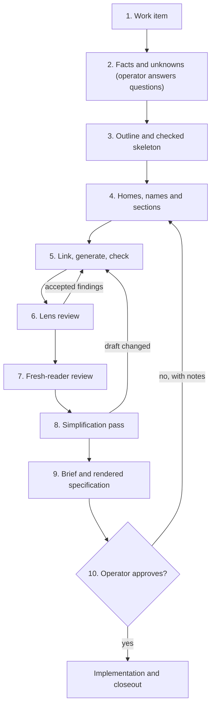

# Spec guide: write a specification from request to approval

This guide tells a coding agent how to write a specification that an engineer can
implement and a human can approve. It names the files to load, the stages to follow and
what the human receives. It is an entry page: the linked rule files and skills hold the
rules, and they win where this guide differs.

## Terms

- **Operator:** the human who owns the product, answers decisions and approves the specification.
- **Specification:** the maintained contract for a system: how it works, what it requires and how each requirement is tested.
- **Design document:** the proposal for one feature. Its shipped parts move into the specification when the feature closes.
- **Entity home:** the one section that defines a term or value. [Direct links](../../../rules/specifications.md#direct-links) states how other text links to it.
- **Document manifest:** `docs/DOCUMENTS.json`. It lists each document, its sections, reading order, purpose and scope.
- **Entity index:** `docs/ENTITIES.json`. It lists each term, its home, its accepted names and its rejected spellings.
- **Checker:** the House Rules tool [spec_docs.py](../scripts/spec_docs.py). It refuses structural errors and generates the chapter map and term index.
- **Lens:** a review instruction file that gives one reviewer one focus.
- **Fresh reader:** a new agent that reads only the specification, with no authoring conversation.

## Set up once

Run steps 3 to 5 in your own repository. They call the checker inside the House Rules
checkout; do not copy it into your repository.
[Sources and commands](../../../docs/specs/spec-system/source-formats.md#sources-and-commands)
defines every checker command, option and exit status.

**Procedure: prepare the agent and the tools**

1. **Clone House Rules:** `git clone https://github.com/symbiotic-build/house-rules.git ~/house-rules`.
   - Record the full commit ID you use, as the [House Rules revision](../../../docs/specs/spec-system/source-formats.md#house-rules-revision) rule states.
2. **Install the rules into the agent:** give the agent the prompt in [INSTALL-AGENTS.md](../../../INSTALL-AGENTS.md).
   - The agent then loads the shared rules at every session start.
3. **Create the checker's environment:** `python3 -m venv .tmp/spec-docs-env`.
   - [runtime.json](../scripts/runtime.json) states the supported Python range.
4. **Install the pinned lock** into that environment.
   - A failed download or wheel hash stops the installation.

   > **Detail — installation call**
   >
   > ```sh
   > .tmp/spec-docs-env/bin/python -m pip install --require-hashes --only-binary=:all: --no-deps -r ~/house-rules/skills/spec-writing/scripts/requirements.lock
   > ```

5. **Run the checker once:** it prints its findings, then its error and warning counts.
   - Until `docs/DOCUMENTS.json` and `docs/ENTITIES.json` exist, it reports them as missing. Stage 3 below creates them.

   > **Detail — checker call**
   >
   > ```sh
   > .tmp/spec-docs-env/bin/python -B ~/house-rules/skills/spec-writing/scripts/spec_docs.py check --root .
   > ```

6. **Install a renderer:** build [md-render](https://github.com/symbiotic-build/md-render) as its README describes.
   - It turns the Markdown chapters into an offline website for the operator.

## What to load for specification work

Load these files in full before writing. Each one is the authority for its subject.

| File | What it decides |
|---|---|
| [rules/writing.md](../../../rules/writing.md) | Prose, names, links, diagrams, numbers |
| [rules/specifications.md](../../../rules/specifications.md) | Chapter order, homes, requirements, tests |
| [skills/spec-writing/SKILL.md](../SKILL.md) | Authoring and reader-review procedure |
| [skills/design-flow/SKILL.md](../../design-flow/SKILL.md) | Lifecycle and approval |
| [skills/finding-unknowns/SKILL.md](../../finding-unknowns/SKILL.md) | Questions to settle before writing |
| [skills/operator-writing/SKILL.md](../../operator-writing/SKILL.md) | Every text the operator reads |
| [skills/decision-brief/SKILL.md](../../decision-brief/SKILL.md) | How to present a decision |
| [rules/session-writing.md](../../../rules/session-writing.md) | The numbered question format |

Two more sources show the result:

- The [specification template](../templates/specification.md) and the [design-document template](../templates/design-document.md) give the outline.
- The [specification of the specification system](../../../docs/specs/spec-system/specification-and-design-document-system.md) is a complete worked example. Start from its [minimal corpus](../../../docs/specs/spec-system/minimal-corpus.md#minimal-example): three files that pass the checker unchanged.

## How the specification must look

This list is for orientation. Each item names the rule that owns it.

- **Chapter order:** purpose and scope, tour, mechanisms, requirements, decisions with rejected alternatives, open questions, reference, acceptance. Owner: [reader progression](../../../rules/specifications.md#reader-progression).
- **Introduction:** opening paragraphs, then one diagram with its question stated before it, then its explanation. The generated chapter map and term index follow. Owner: reader progression.
- **One continuing example:** the tour tells one real story in plain steps. The same example returns in the mechanisms, the reference and the acceptance tests. Owner: reader progression.
- **Chapters by behaviour:** a mechanism chapter covers one coherent part of how the system works. Never write one chapter per term. Owner: reader progression.
- **One home per term and per value:** define each term once and state each literal value once. Owner: [authority and homes](../../../rules/specifications.md#authority-and-homes).
- **Names:** one name per concept in documents, code and user interfaces. Declare the naming conventions in the entity index, so the checker refuses a wrong spelling. Owner: [writing rules](../../../rules/writing.md#language).
- **Requirements and tests:** each has a permanent identity, and they link to each other. Owner: [requirements, tests and recovery](../../../rules/specifications.md#requirements-tests-and-recovery).
- **Failures:** every path that stops or refuses has a failure declaration. It states what the caller sees, what state remains and how to recover. Owner: requirements, tests and recovery.
- **Decisions:** one heading per choice, with its authority, reason and rejected alternatives. An author's proposal is never recorded as the operator's approval.
- **Prose and format:** short sentences with one fact each, Mermaid diagrams, unnumbered headings. Length targets produce warnings, never failures. Owner: [House technical English](../../../rules/writing.md#house-technical-english).

## The stages

Which stage produces which output, and where does the operator take part? The diagram answers that. The procedure below gives each stage's work.



The agent does the work of stages 1 to 9. The operator takes part twice before the final
approval: the operator answers the agent's questions in stage 2, and decides each
consequential choice that the agent may not settle alone, at whatever stage it appears.
Stage 10 is the final approval, on the two outputs of stage 9.

**Procedure: from request to approved specification**

1. **Open a work item.** Create an issue for the product or feature.
   - The issue owns the design document and links it.
2. **Sweep reality.** Follow [Before writing: sweep reality](../SKILL.md#before-writing-sweep-reality).
   - The operator answers the questions that remain. Record each answer where it applies.
3. **Outline and register a skeleton.** Follow step 1 of [Author the document](../SKILL.md#author-the-document).
   - The skeleton passes `generate` and `check` before any chapter body exists.
4. **Write homes, names and sections.** Follow steps 2 and 3 of Author the document.
   - Each term has one home, and each requirement has its acceptance test.
5. **Link, generate and check.** Follow step 4 of Author the document.
   - Continue only when `check` reports no errors and every remaining warning group has a stated disposition.
6. **Run the lens review.** Give read-only reviewers the candidate and one lens each.
   - One fixer integrates the accepted findings. Then repeat stage 5.
7. **Run the fresh-reader review.** Follow [Fresh-reader review](../SKILL.md#fresh-reader-review).
   - It states the readers, their questions and the pass condition.
8. **Run the simplification pass.** Follow [prime rule 12](../../../rules/core.md#prime-rules).
   - When the pass changes the draft, repeat stage 5 and the affected reviews of stages 6 and 7 before stage 9.
9. **Prepare the operator's package.** Write the decision brief and render the checked candidate.
   - Send both as files the operator can open.
10. **Wait for the operator's final approval.** The [design-flow](../../design-flow/SKILL.md) gate decides who may approve.
    - Apply review notes through stages 4 to 9 again. Start implementation only after approval.

> **Detail — lens review (stage 6)**
>
> Use these [lens files](../../../prompts/lenses/):
>
> - [design-spec.md](../../../prompts/lenses/design-spec.md): contradictions, undefined cases, requirements without tests, mechanisms nobody decided, overbuilt design.
> - [naming-readability.md](../../../prompts/lenses/naming-readability.md): names and reader understanding.
> - [spec.md](../../../prompts/lenses/spec.md): only when code exists; it traces the code against the requirements.
>
> Spread the reviewers over different model families where you have them. Reviewers cite
> the wrong claim or the missing explanation and show its consequence. They run no builds
> and write nothing. [pr-ready](../../pr-ready/SKILL.md) §3 owns the review rounds.

## What the operator receives

Before stage 9, the operator receives only questions. For the final approval, the operator
receives two things:

- **A decision brief,** as a Markdown file. It defines its terms, walks through one concrete example and lists each open decision with its real alternatives and their side effects. It ends with numbered questions. Each question recommends exactly one option and stands on its own.
- **The rendered specification,** as an offline website or one HTML file with a chapter menu and drawn diagrams.

The operator answers by question number. A choice the operator has not answered stays an
open question in the specification. The agent never fills it with its own proposal.

## After approval

Implementation, design changes and closeout follow [design-flow](../../design-flow/SKILL.md).
The agent implements the specification literally and proposes each deviation as a document
change. At closeout, the shipped sections move into the maintained specification.

## What this package does not include

- **A hosted review service.** The maintainers' pull-request review service is not public. It uses the same lens files, so stage 6 run by your own agents applies the same checks.
- **A panel runner for every model tool.** [review-panel.sh](../../pr-ready/scripts/review-panel.sh) starts lens reviewers in parallel, but only through the command-line tools its header names. With another tool, give each reviewer agent one lens file by hand.
- **Continuous integration for your repository.** The [repository-checks](../../repository-checks/SKILL.md) skill installs the checks in a clone and in CI.
