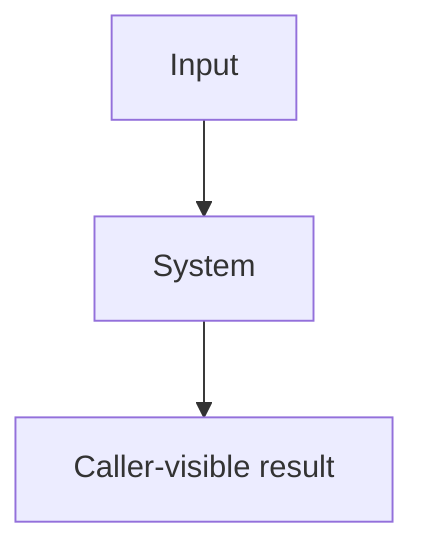

# Design-document template

Use this outline through [design-flow](../../design-flow/SKILL.md) and the
[authoring procedure](../SKILL.md#author-the-document). Replace this guidance and bracketed
prompts before approval. Adjust links when copying. Register the document and its sections
through the [exact source formats](../../../docs/specs/spec-system/source-formats.md#source-format), which owns declaration syntax.
Apply the [specifications rules](../../../rules/specifications.md) and
[writing profile](../../../rules/writing.md#house-technical-english).

[What question does this system's overview diagram answer? Replace this line with that question.]

[Add adjacent home links for terms in the diagram.]

<!-- spec-docs:navigation document="document-id" -->
<!-- /spec-docs:navigation -->

[Put purpose, audience, scope and non-goals in the manifest. Write purpose as a statement
of what the system does; generate this region immediately
following the authored opening paragraph. State the diagram's question before the diagram.
The map is followed by tour, mechanisms, requirements, decisions, open questions, reference,
then acceptance. Combine adjacent roles only; preserve their internal order.]

## Tour

[State the problem this story solves. Carry this same example through mechanisms,
reference and acceptance. Keep action/result steps plain; put exact values below each step
in a `> **Detail — label**` block. Name each deferred explanation in one linked line.]

[Follow a concrete end-to-end scenario. Explain shown values and the reason for each
write, change or retained value. Use labelled procedures for ordered actions. Describe
concurrent branches and synchronization points when applicable. Link declarations through
the format contract.]

## Proposed mechanism

[Choose a coherent part of how the system works, grouping related concepts and homes.
Use "Batch admission" with capacity, validation and refusal sections, not a chapter per
term. Name each chapter file from its title slug. Write a useful reader-outcome summary
and only conceptual prerequisites; follow the outline procedure for examples and checks.
Show the continuing example's relevant snippet or values where each concept is introduced,
not as a closing formula. Apply the reader-progression rule to section openings.]

### Entity home

[Replace this subsection heading and anchor with the entity's name and stable identity.
Start with its definition sentence, then its purpose and ordinary behavior. Cover applicable refusal, concurrency,
failure and recovery. Add canonical facts, relationships and requirements through the
format contract. Explain operating conditions and pass conditions for quality bounds.]

### Failure and recovery

[Add applicable declarations through the format contract. Trace retained state, restart,
exits and public error mappings. If the mechanism cannot stop or refuse, explain why.]

## Ownership and integration

[Name owners and affected boundaries. Explain changes to existing components and their
integration. Link exact interfaces and configuration to their reference homes.]

## Requirements

[Explain which observable obligations make the proposed mechanisms implementable.
Add the exact requirement declarations, reciprocal tests and failure-verification links.]

[Allocate permanent, repository-unique `req-<identity>` anchors under the specification
identity rules; do not derive them from the current file or heading.]

## Decisions and alternatives

[Record each choice, authority, evidence and rejected alternatives with reasons. Use the
format contract for decision anchors. Distinguish proposed choices from approved decisions.]

[Use one heading per decision and each field once: **Choice:**, **Authority:**,
**Reason:** and **Rejected alternatives:**. Put all rejected options and their reasons
in that one field, rather than repeating the label. Start each record with **Choice:**;
let **Reason:** explain its purpose without a formula opening such as "This choice keeps".]

## Open questions

[Identify unresolved contracts, decision owners and resolution paths. Use None with a
reason when empty. Apply the existing design-flow approval boundary.]

## Rollout

[Explain adoption, replacement and recovery within the approved scope. Follow design-flow
closeout when intent becomes maintained specification.]

## Work packages

[Split implementation into concrete deliverables with owners, dependencies and gates.]

## Reference

[Revisit the tour example in lookup form; link its exact files. Put installation pins and vocabulary tables here, with each
diagnostic's severity, meaning, remedy and behavioral selector in one table.]

[Keep exact schemas, signatures, module layouts, configuration and errors here. Reuse
canonical fact links; retain qualifications and their evidence beside the owning facts.]

## Acceptance evidence

[Add acceptance declarations through the format contract. Identify method, inputs, pass
condition and evidence, with reciprocal requirement links. Method `test` requires executable
Implementation selectors; inspection, analysis and demonstration link review/run evidence
and omit Implementation. Distinguish planned verification
from observed results. Allocate permanent `test-<identity>` anchors. When linking executable
tests, use the format contract's `Implementation` grammar:
`[tests/test_x.py::test_name](relative/path/to/tests/test_x.py)`; omit the field otherwise.]

[Run the fresh-reader procedure before acceptance: every reader rates every chapter
"followed on first read: yes / with effort / no" and quotes every choppy, abstract, formulaic
or repeated passage. Pass only with every chapter "yes" and no quote unaddressed.]
