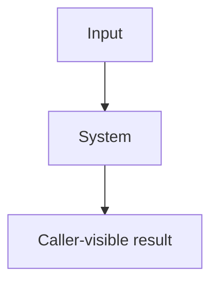

# Specification template

Use this outline through the [authoring procedure](../SKILL.md#author-the-document).
Replace this guidance and bracketed prompts before approval. Adjust links when copying.
Register the document and its sections through the [exact source formats](../../../docs/specs/spec-system/formats.md#source-format);
that contract owns all declaration syntax. Apply the
[specifications rules](../../../rules/specifications.md) and
[writing profile](../../../rules/writing.md#house-technical-english).

[What question does this system's overview diagram answer? Replace this line with that question.]

[Add adjacent home links for terms in the diagram.]

<!-- spec-docs:navigation document="document-id" -->
<!-- /spec-docs:navigation -->

[Put purpose, audience, scope and non-goals in the manifest; generate this region immediately
following the authored opening paragraph. State the diagram's question before the diagram.
The map is followed by tour, mechanisms, requirements, decisions, open questions, reference,
then acceptance. Combine adjacent roles only; preserve their internal order.]

## Tour

[State the problem this story solves. Carry this same example through mechanisms,
reference and acceptance. Keep action/result steps plain; put exact values below each step
in a `> **Detail — label**` block. Name each deferred explanation in one linked line.]

[Introduce the system with a complete story before its mechanisms and reference material.
Explain inputs, state changes, retained values and caller-visible results. Use the writing
rules' labelled procedure for ordered actions. Link the scenario's requirements and tests
through declarations from the format contract.]

## Mechanism

[Give this mechanism its own chapter. Open every section, including declaration records,
with its purpose. Define a home in one concise sentence before expanding its behavior.]

[Use the entity's real name as this heading and replace this anchor with its stable identity.
Open with its meaning and the problem it solves. Explain ordinary behavior, then applicable
refusal, concurrency, failure and recovery paths. Use direct home links under the
specifications rules. Add canonical facts and relations using the format contract.]

### Failure and recovery

[Add applicable failure declarations from the format contract. Review retained state,
restart behavior, exits and public error mapping. If the mechanism cannot stop or refuse,
explain why.]

## Requirements

[Add requirement declarations from the format contract. Explain operating conditions,
measurement notation and pass conditions for quality bounds. Allocate permanent,
repository-unique `req-<identity>` anchors under the specification identity rules;
do not derive them from the current file or heading.]

## Decisions

[Record choices, authority, evidence and rejected alternatives with reasons. Use the format
contract for resolving decision anchors. Do not treat an author's proposal as operator approval.]

[Use one heading per decision and each field once: **Choice:**, **Authority:**,
**Reason:** and **Rejected alternatives:**. Put all rejected options and their reasons
in that one field, rather than repeating the label.]

## Open questions

[Identify unresolved contracts, their owners and resolution paths. State None with a reason
when no question remains. Approval follows the specifications rules and design-flow.]

## Reference

[Revisit the tour example in lookup form; link its exact files, diagnostics and selectors.]

[Place exact interfaces, signatures, settings and errors here. Link canonical homes rather
than copying facts. Keep qualifications and evidence beside the facts they support.]

## Acceptance

[Add acceptance declarations from the format contract. Identify inputs, method and pass
conditions; use Method `test` with executable Implementation selectors, or link review/run evidence for
Method `inspection`, `analysis` or `demonstration` without Implementation. Check reciprocal requirement links
and test adequacy. Allocate permanent `test-<identity>` anchors. When linking executable
tests, use the format contract's `Implementation` grammar:
`[tests/test_x.py::test_name](relative/path/to/tests/test_x.py)`; omit the field otherwise.]
