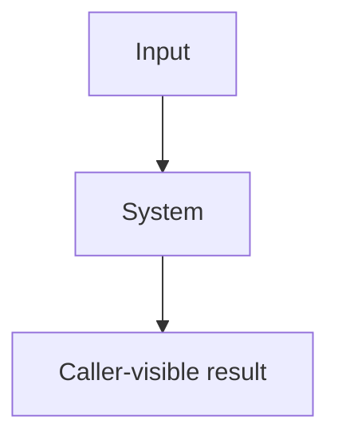

# Specification template

Use this outline through the [authoring procedure](../SKILL.md#author-the-document).
Replace this guidance and bracketed prompts before approval. Adjust links when copying.
Register the document and its sections through the [exact source formats](../../../docs/specs/spec-system/source-formats.md#source-format);
that contract owns all declaration syntax. Apply the
[specifications rules](../../../rules/specifications.md) and
[writing profile](../../../rules/writing.md#house-technical-english).

[What question does this system's overview diagram answer? Replace this line with that question.]

[Explain the diagram with adjacent home links; omit a repeated entity list when prose already supplies them.]

<!-- spec-docs:navigation document="document-id" -->
<!-- /spec-docs:navigation -->

[Put purpose, audience, scope and non-goals in the manifest. Write purpose as a statement
of what the system does; generate this region immediately
following the complete authored introduction, including the diagram's explanation and
prerequisites. Summarize needed outside procedures or name them as opening prerequisites.
State the diagram's question before the diagram.
The map is followed by tour, mechanisms, requirements, decisions, open questions, reference,
then acceptance. Combine adjacent roles only; preserve their internal order.]

## Tour

[State the problem this story solves. Carry this same example through mechanisms,
reference and acceptance. Keep action/result steps plain; put exact values below each step
in a `> **Detail — label**` block. Start with action and caller result, without author-centred
formulas. In repair tours start from the complete supplied example. Name each deferred
explanation in one linked line; show concrete refusals and arithmetic where used.]

[Introduce the system with a complete story before its mechanisms and reference material.
Explain inputs, state changes, retained values and caller-visible results. Use the writing
rules' labelled procedure for ordered actions. Link the scenario's requirements and tests
through declarations from the format contract.]

## Mechanism

[Choose a coherent part of how the system works, grouping related concepts and homes.
Use "Batch admission" with capacity, validation and refusal sections, not a chapter per
term. Name each chapter file from its title slug. Write a useful reader-outcome summary
and only conceptual prerequisites; follow the outline procedure for examples and checks.
Show the continuing example's relevant snippet or values where each concept is introduced,
not as an opening recap or closing formula. Open with what this chapter adds.
Explain borrowed behaviors before tool or standard names. Keep repeated distinctions in
one linked home. Apply the reader-progression rule to section openings.]

### Entity home

[Replace this subsection heading and anchor with the entity's name and stable identity.
Put its definition sentence first, then explain its purpose. Explain ordinary behavior,
then applicable
refusal, concurrency, failure and recovery paths. Use direct home links under the
specifications rules. State applicability before each fact table. Use the authority-and-homes rules for Status
and linked open questions in Basis. Add canonical facts and relations using the format contract.]

### Failure and recovery

[Add applicable failure declarations from the format contract. Review retained state,
restart behavior, exits and public error mapping. If the mechanism cannot stop or refuse,
explain why.]

## Requirements

[Add requirement declarations from the format contract. Explain operating conditions,
measurement notation and pass conditions for quality bounds. Allocate permanent,
repository-unique `req-<identity>` anchors under the specification identity rules;
do not derive them from the current file or heading.]

## Decisions

[Record choices, authority, evidence and rejected alternatives with reasons. Use the format
contract for resolving decision anchors. Do not treat an author's proposal as operator approval.]

[Use one heading per decision and each field once: **Choice:**, **Authority:**,
**Reason:** and **Rejected alternatives:**. Put all rejected options and their reasons
in that one field, rather than repeating the label. Start each record with **Choice:**;
let **Reason:** explain its purpose without a formula opening such as "This choice keeps".]

## Open questions

[Identify unresolved contracts, their owners and resolution paths. State None with a reason
when no question remains. Approval follows the specifications rules and design-flow.]

## Reference

[Revisit the tour example in lookup form; link its exact files. Put installation pins and vocabulary tables here, with each
diagnostic's severity, meaning, remedy and behavioral selector in one table.]

[Place exact interfaces, signatures, settings and errors here. Link canonical homes rather
than copying facts. Keep qualifications and evidence beside the facts they support.]

## Acceptance

[Add acceptance declarations from the format contract. Identify inputs, method and pass
conditions; use Method `test` with executable Implementation selectors, or link review/run evidence for
Method `inspection`, `analysis` or `demonstration` without Implementation. Check reciprocal requirement links
and test adequacy. Allocate permanent `test-<identity>` anchors. When linking executable
tests, use the format contract's `Implementation` grammar:
`[tests/test_x.py::test_name](relative/path/to/tests/test_x.py)`; omit the field otherwise.]

[Run the fresh-reader procedure before acceptance: every reader rates every chapter
"followed on first read: yes / with effort / no" using the canonical procedure's meanings.
Record polish notes separately. Pass with every chapter "yes", no quote unaddressed and
every polish note fixed or answered with a reason.]

[For conversions, follow the reader-progression voice rule: this document states the design;
quoted original claims belong in one provenance section. For inspection evidence, follow
the requirements-and-recovery rules: link available material and mark planned versus completed
work. Use descriptive Inspection or Analysis headings with permanent `test-` anchors. Keep
required Status and Basis fields short when they share one linked explanation.]
